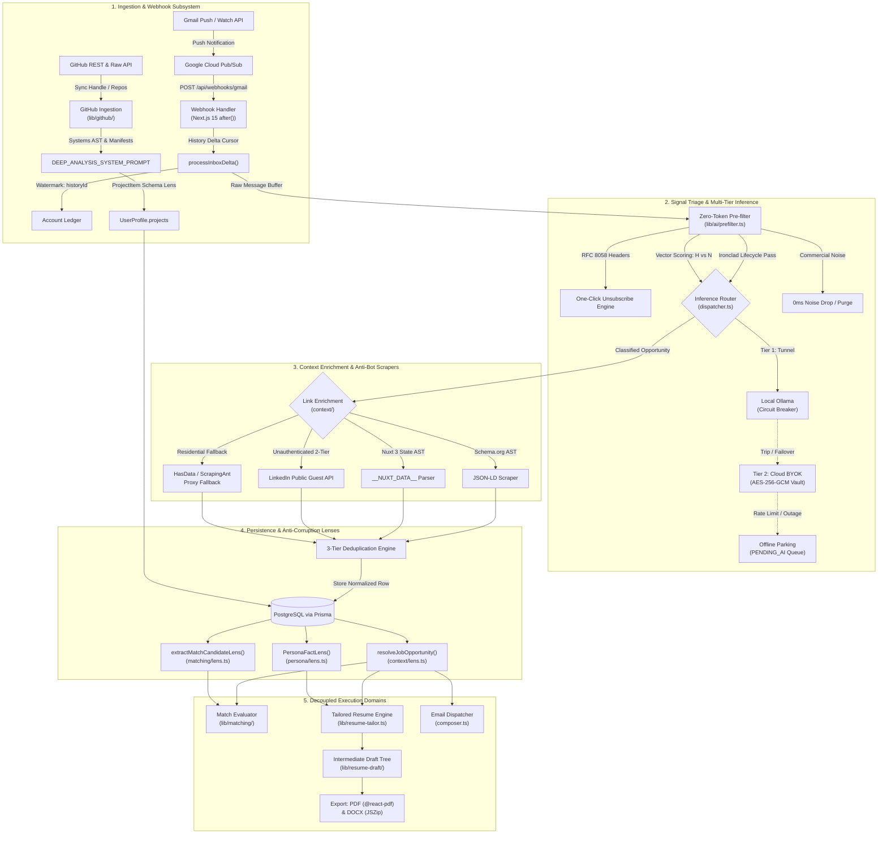
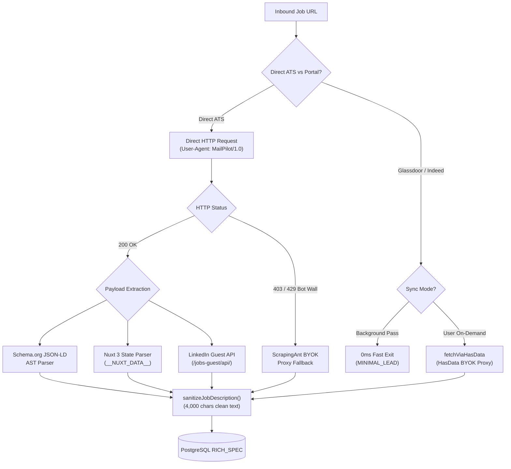
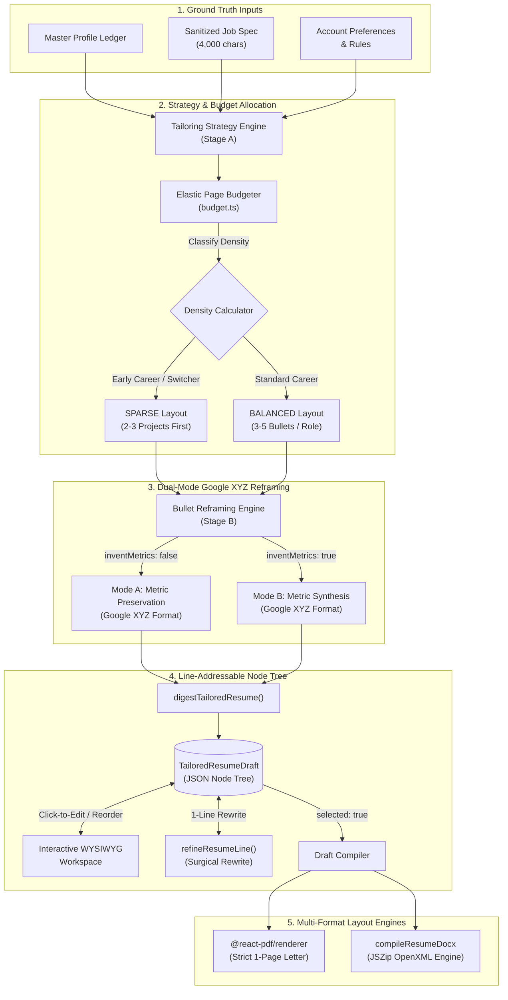
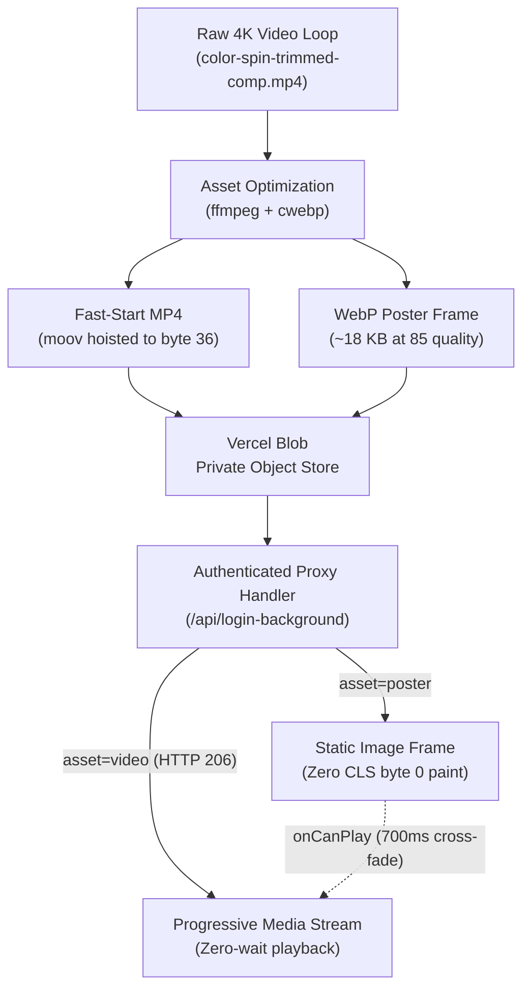

# MailPilot

> **Distributed, Privacy-First Career Automation Platform & Real-Time Telemetry Pipeline**

[-000000?style=flat-square&logo=nextdotjs)](https://nextjs.org/)
[](https://react.dev/)
[](https://www.typescriptlang.org/)
[](https://www.postgresql.org/)
[](https://www.prisma.io/)
[](https://tailwindcss.com/)
[](https://vitest.dev/)
[](https://nodejs.org/api/crypto.html)

---

## Table of Contents

- [1. System Vision & Problem Space](#1-system-vision--problem-space)
- [2. End-to-End System Architecture](#2-end-to-end-system-architecture)
- [3. The Decoupled Domain Architecture (SSOT & Lenses)](#3-the-decoupled-domain-architecture-ssot--lenses)
- [4. Multi-Tier Inference Router & Local Circuit Breaker](#4-multi-tier-inference-router--local-circuit-breaker)
- [5. Web Scraping & Anti-Bot Evasion Engine](#5-web-scraping--anti-bot-evasion-engine)
- [6. Cryptography, Privacy & Security Guardrails](#6-cryptography-privacy--security-guardrails)
- [7. Line-Addressable Resume Tailoring & Page Budgeting](#7-line-addressable-resume-tailoring--page-budgeting)
- [8. Performance & Systems Optimization](#8-performance--systems-optimization)
- [9. Technology Stack Matrix](#9-technology-stack-matrix)
- [10. Test Suite, Verification & Local Development](#10-test-suite-verification--local-development)

---

## 1. System Vision & Problem Space

Modern personal inboxes are bombarded with high-velocity automated noise: transactional receipts, marketing blasts, newsletters, and promotional feeds. Buried within this stream are high-stakes, time-critical career opportunities: recruiter reachouts, direct interview invitations, take-home assessments, and job application status changes.

**MailPilot** transforms the unstructured personal inbox into an autonomous, real-time career intelligence platform and telemetry pipeline. Built on a serverless, decoupled architecture, MailPilot executes two primary operational missions:

1. **Autonomous Subscription Management & RFC 8058 Engine:**
   - Detects recurring newsletters, mailing lists, and marketing campaigns without hardcoded sender whitelists.
   - Executes RFC 8058 one-click unsubscriptions via authenticated HTTP `POST` requests and automated `mailto:` command fallbacks.
   - Provides batch cleanup and automated retention purging for unlinked commercial correspondence.

2. **Career Opportunity Extraction & Line-Addressable Tailoring:**
   - Receives inbound messages via Google Cloud Pub/Sub webhooks with sub-second delta synchronization.
   - Routes payloads through a zero-token 3-tier pre-filtering triage gate ($H$ vs $N$ vector scoring).
   - Ingests opportunities via a 2-tier inference router (Local Ollama via Cloudflare Tunnel $\to$ Cloud BYOK) with resilient offline parking (`PENDING_AI`) that drains automatically when models return, eliminating synthetic heuristic pollution.
   - Resolves unstructured job text into canonical, anti-corruption data lenses.
   - Synthesizes 4-dimensional candidate personas and tailors line-addressable resume drafts with elastic 1-page Letter layout budgeting.

### Multi-Tenant Data Isolation & Privacy-First Architecture
MailPilot is designed from the ground up for strict multi-tenancy and data privacy:
- **Transient Email Storage Policy:** Raw inbound email message bodies are scrubbed in memory during triage; `EmailMessage.rawBody` is permanently cleared (`null`) upon database persistence.
- **Zero Plaintext Credentials:** Cloud API keys, Google OAuth tokens, and candidate contact coordinates are encrypted at rest using **AES-256-GCM** authenticated envelopes.
- **Career Agnosticism & Ground Truth:** Application logic, classification heuristics, and tailoring prompts treat every candidate discipline, industry, and career level completely neutrally with zero hardcoded profession bias.

---

## 2. End-to-End System Architecture

The following diagram illustrates the complete asynchronous lifecycle of inbound messages through MailPilot: from Google Cloud Pub/Sub webhook triggers to multi-tier classification, link enrichment, decoupled anti-corruption lenses, and downstream execution engines.



### Ingestion, Classification & Decoupled Opportunity Pipeline

```
┌─────────────────────────────────────────────────────────────────────────────┐
│                       Gmail Webhook / Sync Trigger                          │
│               (/api/webhooks/gmail · runOpportunitySync)                    │
└──────────────────────────────────────┬──────────────────────────────────────┘
                                       │
                                       ▼
┌─────────────────────────────────────────────────────────────────────────────┐
│                           Serial Ingestion Loop                             │
│                  - Throttled Pacing: 350ms delay/message                    │
│                  - 2-Tier AI Pipeline with PENDING_AI Backlog Drain         │
└──────────────────┬──────────────────────────────────────────────────────────┘
                   │
                   ▼
      ┌─────────────────────────┐            ┌─────────────────────────┐
      │   Primary Classifier    │            │    PENDING_AI Parking   │
      │   (Local / Cloud LLM)   │──[Fail]───▶│   (Preserves Unaltered  │
      │                         │            │    Raw Mail for Retry)  │
      └────────────┬────────────┘            └─────────────────────────┘
                   │
                   ▼
┌─────────────────────────────────────────────────────────────────────────────┐
│                    Persistence & Deduplication Engine                       │
│    - Transient Storage Policy: EmailMessage.rawBody = null                  │
│    - Smart Snippet Extraction: Min 500, Max 1,500 chars (Sentence Ramp-Up)  │
│    - 3-Tier Deduplication:                                                  │
│        Tier 1: Same email + applyUrl or normalized title                    │
│        Tier 2: Same company + roleTitle + location-compatible               │
│        Tier 3: Insert new verified JobOpportunity (AI-Classified)           │
│    - Sync Watermark: Commit lastSyncedAt ONLY on pass completion            │
└─────────────────────────────────────┬───────────────────────────────────────┘
                                       │
                                       ▼
┌─────────────────────────────────────────────────────────────────────────────┐
│                         Anti-Corruption Lens Layer                          │
│                                                                             │
│   resolveJobOpportunity()            extractMatchCandidateLens()            │
│   (lib/opportunities/context/lens.ts) (lib/matching/lens.ts)                │
└──────────────────┬──────────────────────────────────────┬───────────────────┘
                   │                                      │
                   ▼                                      ▼
┌─────────────────────────────────────────────────────────────────────────────┐
│                           Decoupled Domain Consumers                        │
│                                                                             │
│   1. Standardized 2-Pill Job Card UI (`components/opportunities/`)          │
│   2. Match Scoring Evaluator (`lib/matching/evaluator.ts`)                  │
│   3. Resume Tailoring Engine (`lib/resume-tailor.ts`)                       │
└─────────────────────────────────────────────────────────────────────────────┘
```

---

## 3. The Decoupled Domain Architecture (SSOT & Lenses)

MailPilot enforces strict domain decoupling through **Single Source of Truth (SSOT)** schemas and **Anti-Corruption Lenses**. Domain logic never imports raw Prisma database models directly; instead, dedicated adapter lenses sanitize, normalize, and buffer changes between storage models and business logic.

```
┌──────────────────────────────────────────────────────────────────────────────┐
│                              PRISMA DATABASE                                 │
│          Account · JobOpportunity · UserProfile · WorkExperience             │
└──────┬──────────────────────┬────────────────────────┬───────────────────────┘
       │                      │                        │
       ▼                      ▼                        ▼
┌──────────────┐      ┌──────────────┐         ┌──────────────┐
│  Persona     │      │ Job Context  │         │  Candidate   │
│  Fact Lens   │      │ Lens Layer   │         │  Match Lens  │
│  (lens.ts)   │      │ (lens.ts)    │         │  (lens.ts)   │
└──────┬───────┘      └──────┬───────┘         └──────┬───────┘
       │                      │                        │
       ▼                      ▼                        ▼
┌──────────────┐      ┌──────────────┐         ┌──────────────┐
│ Candidate    │      │ Normalized   │         │ Match        │
│ Persona      │      │ Job Opp      │         │ Candidate    │
│ (schema.ssot)│      │ (schema.ssot)│         │ (schema.ssot)│
└──────┬───────┘      └──────┬───────┘         └──────┬───────┘
       │                     │                        │
       └─────────────────┐   │   ┌────────────────────┘
                         ▼   ▼   ▼
               ┌───────────────────────────┐
               │    Evaluator & Tailor     │
               │   (Domain-Neutral Core)   │
               └───────────────────────────┘
```

### 1. Candidate Persona Engine (`lib/persona/`)
Translates grounded candidate facts into deterministic multi-dimensional posture descriptors without external LLM calls. It utilizes an interlocking classification matrix:

```
┌──────────────────────────────────────────────┐
│  Ground Truth: MasterProfileInput (Database) │
└──────────────────────┬───────────────────────┘
                       │
                       ▼
┌──────────────────────────────────────────────┐
│  Adapter Lens: PersonaFactLens (lens.ts)     │  <-- Buffers schema changes
└──────────────────────┬───────────────────────┘
                       │
                       ▼
┌──────────────────────────────────────────────┐
│  Interlocking Matrix (matrix.ts)             │
│  - Seniority Tier (6 tiers)                  │
│  - Disciplinary Archetype (4 archetypes)     │
│  - Leadership Scope (3 scopes)               │
│  - Distinction Anchor (3 anchors)            │
└──────────────────────┬───────────────────────┘
                       │
                       ▼
┌──────────────────────────────────────────────┐
│  Tone Composer (tone-composer.ts)            │  <-- 4-Layer Modular Voice Stack
└──────────────────────┬───────────────────────┘
                       │
                       ▼
┌──────────────────────────────────────────────┐
│  Contract: CandidatePersona                  │
└───────────┬───────────────────┬──────────────┘
            │                   │
            ▼                   ▼
     [ Match Scoring ]   [ Email Responding ]   [ Resume Tailoring ]
```

- **Seniority Tier:** Deterministic mapping across 6 tiers (`Student / Early Career`, `Career Switcher`, `Mid-Level Professional`, `Senior Practitioner`, `Staff / Principal Specialist`, `Executive / Organizational Leader`).
- **Disciplinary Archetype:** Evaluates candidate role history into 4 archetypes (`Deep-Domain Specialist`, `Applied Builder / Generalist`, `Cross-Disciplinary Hybrid`, `Strategic / Operations Leader`).
- **Leadership Scope:** Individual Contributor, Technical/Operational Lead, or Executive/Director.
- **Distinction Anchor:** Grounded proof anchor (`Elite / Accredited Pedigree`, `Enterprise Scale / Brand Name`, `Production Tenure / Self-Directed Output`).
- **4-Layer Modular Voice Stack (`tone-composer.ts`):** Synthesizes downstream prompt guidance across Seniority Guardrails, Agency Dials, Narrative Angles, and Proof Anchors.

### 2. Job Context Domain (`lib/opportunities/context/`)
Isolates opportunity persistence from evaluation. The adapter `resolveJobOpportunity()` yields a canonical `NormalizedJobOpportunity` with strict sizing boundaries:
- **Smart Snippet Extraction (`extractCleanSnippet`):** Enforces a minimum of 500 characters and a ceiling of 1,500 characters, ramping up to natural sentence boundaries (`[.!?]`) to eliminate word truncation.
- **Job Description Scrubber (`sanitizeJobDescription`):** Strips legal boilerplate, Equal Opportunity Employer (EEO) statements, benefits headers, and company culture fluff. Hard-caps payloads between 4,000 and 6,000 characters (default 4,000) at clean paragraph breaks.

### 3. Match Scoring Lens (`lib/matching/`)
Consumes `MatchCandidateLens` to evaluate alignment between candidate credentials and job specifications without exposing private candidate contact information or raw database entities:
- **Tenure Flooring & Leveling Check:** Compares required job seniority against the candidate's verified leveling.
- **Taxonomy Normalization:** Cross-references required technologies, operational methodologies, and domain keywords against candidate competencies.
- **Fit Tier Output:** Produces standardized `HIGH`, `MID`, or `LOW` fit ratings accompanied by a bulleted factual rationale.

### 4. GitHub Technical Ingestion & Deep Inference Domain (`lib/github/`)
While general profile parsing across MailPilot remains strictly career-agnostic, repository synchronization serves as our **dedicated software & systems engineering domain**. It adopts an authentic, authoritative register spoken directly to senior technical reviewers:

```
┌──────────────────────────────────────────────────────────────────────────────┐
│                         GitHub REST & Raw Content APIs                       │
│                     (repos?type=owner · raw.githubusercontent)               │
└──────────────────────────────────────┬───────────────────────────────────────┘
                                       │
                                       ▼
┌──────────────────────────────────────────────────────────────────────────────┐
│                    Modular GitHub Domain (lib/github/)                       │
│                                                                              │
│   schema.ssot.ts       prefilter.ts          manifests.ts      topology.ts   │
│   (3-Tier Budget)      (AST & Noise Scrubber)(Domain Groups)   (Deduction)   │
└──────────────────────────────────────┬───────────────────────────────────────┘
                                       │
                                       ▼
┌──────────────────────────────────────────────────────────────────────────────┐
│                    Deep Systems Inference (inference.ts)                     │
│               - DEEP_ANALYSIS_SYSTEM_PROMPT (Systems Constraints)            │
│               - Diverse Systems Verbs (Multiplexed, Sharded, Ingested)       │
│               - Ban on Summary Bullets & Fake Commercial ROI                 │
└──────────────────────────────────────┬───────────────────────────────────────┘
                                       │
                                       ▼
┌──────────────────────────────────────────────────────────────────────────────┐
│                       Anti-Corruption Lens (lens.ts)                         │
│                    adaptRepoToProjectItem() -> ProjectItem                   │
└──────────────────────────────────────┬───────────────────────────────────────┘
                                       │
                                       ▼
                     [ UserProfile.projects (Prisma) ]
```

- **Sub-Module Architecture:**
  - `schema.ssot.ts`: Single source of truth defining `ProjectItem`, `GitHubRawRepo`, `RepoComplexityScale`, and the `determineRepoScale()` complexity evaluator.
  - `prefilter.ts`: Semantic markdown AST scrubber (`extractSemanticMarkdownDigest`) that strips non-technical boilerplate (shield badges, raw HTML images, sponsor links, HTML comments), completely eliminates installation/licensing clutter, and prioritizes architectural sections (`architecture`, `system design`, `data flow`, `components`, `protocols`, `concurrency`, `pipeline`, `benchmarks`, `performance`, `security`, `storage`, `api specification`, `models`).
  - `manifests.ts`: Probes root and nested manifests (`package.json`, `requirements.txt`, `pyproject.toml`, `go.mod`, `Cargo.toml`), filters out dev/linter tooling noise, and organizes packages into systems domains (`groupDependenciesByDomain`: *"Networking & Protocols"*, *"State, Storage & Persistence"*, *"Concurrency, Queues & Messaging"*, *"Architecture & Web Frameworks"*, *"Math, Compute & ML"*, *"Telemetry, Hardening & Security"*).
  - `topology.ts`: Deterministically deduces cross-manifest architectural topologies (`deduceArchitecturalTopology`), detecting decoupled backends, real-time WebSocket/Redis pub-sub pipelines, and message broker queues.
  - `inference.ts`: Coordinates multi-tier inference through `DEEP_ANALYSIS_SYSTEM_PROMPT`. Strictly bans introductory repository summary bullets, mandates diverse engineering action verbs (*Dispatched, Multiplexed, Sharded, Ingested, Serialized, Partitioned, Profiled, Benchmarked*), prohibits fake commercial ROI, and enforces deterministic systems-action fallbacks.
  - `lens.ts`: Adapts raw GitHub repo payloads and inference outputs into normalized `ProjectItem` entities with sanitized Title Case names.
  - `syncer.ts`: End-to-end orchestrator (`syncGitHubProjects`) managing rate limits, concurrent manifest fetching, and multi-tier LLM failover.

- **Dynamic 3-Tier Repository Complexity Budgeting:**
  - *Tier 1: Utility / Small Component* (`repo.size < 3000` KB or 1 manifest): Calibrates to a 2,500-character digest budget and targets 2–3 concise atomic bullets for CLI tools and localized algorithms.
  - *Tier 2: Mid-Scale Application / Service* (`repo.size` between 3,000 KB and 15,000 KB, or 2 manifests): Calibrates to a 5,500-character digest budget and targets 4–6 atomic bullets for containerized apps and standalone services.
  - *Tier 3: Flagship / Distributed Architecture* (`repo.size >= 15000` KB or presence of monorepo subdirectories like `apps/`, `services/`, `packages/`, `backend/`): Calibrates to a 10,000–12,000 character digest budget and targets 6–10 atomic bullets delivering comprehensive subsystem coverage across data ingestion, persistence, protocols, and security.

- **Strict Systems Engineering Tone & Anti-Hallucination Guardrails:**
  - Prohibits introductory repository summary bullets (every bullet must describe a specific technical mechanism, problem solved, or subsystem implemented).
  - Eliminates repetitive verb loops (*Architected / Engineered / Implemented*) in favor of natural systems operations (*Multiplexed, Sharded, Throttled, Decoupled, Serialized, Benchmarked, Vectorized*).
  - Bans fabricated dollar revenue or synthetic user metrics; anchors all results strictly in computational efficiency, data integrity, protocol conformance, or automated pipeline reliability.

---

## 4. Multi-Tier Inference Router & Local Circuit Breaker

MailPilot features an account-scoped multi-tier inference router (`lib/llm/dispatcher.ts`) engineered for zero token waste, local privacy, and continuous synchronization uptime.

```
┌──────────────────────────────────────────────┐
│  Inference Request (dispatcher.ts)           │
└──────────────────────┬───────────────────────┘
                       │
        ┌──────────────┴──────────────┐
        ▼                             ▼
┌──────────────────┐        ┌──────────────────┐
│  LOCAL_OLLAMA    │        │  Cloud Provider  │
│  - 2s tag probe  │        │  (BYOK)          │
│  - Adaptive time │        └─────────┬────────┘
│  - Stream decode │                  │
└───────┬──────────┘                  ▼
        │ (failover if      ┌──────────────────┐
        │  allowed)         │  Account Vault   │
        └──────────────────►│  (vault.ts)      │
                            │  - AES-256-GCM   │
                            │  - Masked UI     │
                            └─────────┬────────┘
                                      │
            ┌─────────────────────────┴────────────────────────┐
            ▼                                                  ▼
┌───────────────────────────────┐              ┌───────────────────────────────┐
│  OpenAI-Compatible Client     │              │  Anthropic Native Client      │
│  (/chat/completions)          │              │  (/messages)                  │
│  - OpenRouter                 │              │  - Claude 3.5 Haiku / Sonnet  │
│  - OpenAI                     │              │  - x-api-key headers          │
│  - Groq                       │              └───────────────────────────────┘
│  - DeepSeek                   │
│  - Gemini (OpenAI-compat)     │
└───────────────────────────────┘
```

### The 3-Tier Fallback Hierarchy

| Tier | Engine | Transport / Protocol | Latency | Token Cost | Behavior / Circuit Breaker Guardrail |
| :--- | :--- | :--- | :--- | :--- | :--- |
| **Tier 1** | **Local Ollama** | Cloudflare Tunnel / Localhost HTTP | ~400ms – 2s | **$0.00** (Free) | Probes `/api/tags` with adaptive payload timeouts (45s–180s idle, 120s–600s hard cap). If unreachable, trips an in-memory circuit breaker (`isOllamaCircuitTripped`) to bypass subsequent calls in **0ms**. |
| **Tier 2** | **Cloud BYOK** | HTTPS REST (`/chat/completions` or `/messages`) | ~600ms – 1.8s | BYOK (Direct) | Account-scoped AES-256-GCM decrypted keys. Automatic model targeting across OpenRouter, OpenAI, Groq, DeepSeek, Anthropic, or Gemini. Handles HTTP 429 rate limits gracefully. |
| **Offline** | **PENDING_AI Parking** | Database Queue State (`EmailMessage`) | **< 1ms** | **$0.00** | When both model tiers are offline or rate-limited, raw messages are parked as `PENDING_AI` to be classified cleanly when models recover, permanently eliminating synthetic heuristic opportunity pollution. |

*(Deterministic heuristic engines are retained strictly for specialized non-AI subsystems: GitHub repository CAR bullet extraction fallback, RFC 8058 header parsing, and localized structural extraction)*

### Real-Time ASCII Telemetry Pipeline
All model invocations are monitored via a standardized 66-column terminal ASCII telemetry logger (`lib/logging/table-logger.ts`):

```text
┌────────────────────────────────────────────────────────────────┐
│ SCOPE: EngineTelemetry                                         │
│ ENGINE: CLOUD_BYOK          PROVIDER: OPENROUTER               │
│ MODEL: google/gemini-2.5-flash                                 │
│ PHASE: COMPLETE             DURATION: 312ms                    │
│ PROMPT: 4,191 chars         OUTPUT: 842 chars                  │
└────────────────────────────────────────────────────────────────┘
```

---

## 5. Web Scraping & Anti-Bot Evasion Engine

Inbound emails frequently contain abbreviated link digests (`< 300 chars`) pointing to external job boards. MailPilot utilizes a cost-aware, multi-stage link parsing engine (`lib/opportunities/context/`) designed to extract rich specifications while protecting proxy credits:

### Pacing & Hydration Strategy
- **Background Sync Pacing (Zero Credit Waste):** During automated inbox sync passes, Glassdoor and Indeed links fast-exit immediately in **0ms** without triggering external proxy calls, persisting as `MINIMAL_LEAD` records.
- **On-Demand Spec Hydration (HasData BYOK):** When a user opens an opportunity to tailor a resume or clicks *Hydrate Spec*, MailPilot executes `fetchViaHasData` using the customer's encrypted HasData BYOK key, upgrading the record from `MINIMAL_LEAD` to `RICH_SPEC` (saving up to 4,000+ characters of parsed requirements to PostgreSQL).

### Multi-Stage Scraping Pipeline



1. **Schema.org JSON-LD Extraction (`json-ld.ts`):** Parses `<script type="application/ld+json">` AST blocks, extracting structured `JobPosting` entities (title, hiring organization, base salary, date posted, employment type).
2. **Nuxt 3 SSR State Parser (`nuxt.ts`):** De-serializes `<script id="__NUXT_DATA__">` JSON arrays. Resolves recursive object index pointers to extract full job descriptions from modern Nuxt 3 applications without headless Chrome overhead.
3. **LinkedIn Public Guest API (`linkedin.ts`):** Resolves LinkedIn URLs via a 2-tier public unauthenticated pipeline (`https://www.linkedin.com/jobs-guest/jobs/api/jobPosting/{id}`) with fallback to Googlebot-emulated Schema.org parsing.
4. **Proxy BYOK Fallback (`hasdata.ts`, `scrapingant.ts`):** Transparent residential rotating proxy failover for Cloudflare and DataDome protected career portals.

---

## 6. Cryptography, Privacy & Security Guardrails

### 1. Authenticated Symmetric Encryption (AES-256-GCM)
All vaulted customer secrets and sensitive candidate metadata are encrypted at rest using Node.js `crypto` (`lib/crypto.ts`):
- **Cipher:** AES-256-GCM (Authenticated Encryption with Associated Data).
- **Key Derivation:** Master 64-character hexadecimal key (`TOKEN_ENCRYPTION_KEY`, 256-bit entropy).
- **Envelope Mechanics:** 12-byte cryptographically secure random Initialization Vector (IV) and 16-byte authentication tag generated per write.
- **Storage Envelope:** Persisted strictly as `iv:authTag:ciphertext` in PostgreSQL.

| Asset | Storage Target | Decryption Boundary | Masking / Protection |
| :--- | :--- | :--- | :--- |
| **Google OAuth Access & Refresh Tokens** | `Account.encryptedAccess`, `Account.encryptedRefresh` | Memory of serverless worker during delta sync / watch renewal | Plaintext never exposed to browser; automatic token refresh. |
| **Cloud LLM API Keys** | `AccountSettings.rules.accountApiKey` | Decrypted per inference request in server memory | UI display mask: `sk-...[last4]`. |
| **Scraping Proxy Keys** | `AccountSettings.rules.hasDataApiKey` | Decrypted per scraping request in server memory | UI display mask: `hd-...[last4]`. |
| **Candidate Phone Number** | `UserProfile.phone` | Decrypted in server actions during profile editing / PDF export | Never serialized to unauthenticated API routes. |

* **Constant-Time Verification:** Secret tokens and hashes are validated using `crypto.timingSafeEqual` to eliminate side-channel timing attacks.

### 2. Hardened Server-Side Request Forgery (SSRF) Protection (`lib/ssrf.ts`)
MailPilot prevents internal network probing and cloud metadata extraction by performing DNS pre-resolution validation on all user-supplied and email-extracted URLs before dispatching HTTP requests:
- **Protocol Enforcement:** Strictly allows `http:` and `https:`. Rejects `file:`, `gopher:`, `ftp:`, and javascript schemes.
- **Blocked IP Ranges (Pre-Resolution Guardrails):**
  - **Loopback:** `127.0.0.0/8`, `::1`
  - **Private RFC 1918:** `10.0.0.0/8`, `172.16.0.0/12`, `192.168.0.0/16`
  - **AWS / Cloud Instance Metadata:** `169.254.169.254`
  - **Link-Local:** `169.254.0.0/16`, `fe80::/10`
  - **Carrier-Grade NAT:** `100.64.0.0/10`
  - **Broadcast & Reserved:** `0.0.0.0/8`, `240.0.0.0/4`, `255.255.255.255/32`

### 3. RFC 8058 One-Click Unsubscribe Engine
- Inspects email headers for `List-Unsubscribe` and `List-Unsubscribe-Post`.
- Dispatches an automated HTTP `POST` request with body `List-Unsubscribe=One-Click` in compliance with RFC 8058.
- Falls back to automated `mailto:` subject/body generation and batch Gmail label trash assignment.

---

## 7. Line-Addressable Resume Tailoring & Page Budgeting

Earlier resume tailoring architectures digested job specs and immediately froze the result into a static base64 PDF buffer. That legacy pattern created severe drawbacks: individual bullets could not be edited, subsequent AI refinement passes hallucinated and drifted unrelated sections, and page length could not be guaranteed.

MailPilot solves this with a **Line-Addressable Intermediate Document Tree (`TailoredResumeDraft`)**:



### 1. Two-Stage Decoupled LLM Tailoring
- **Stage A: Strategy & Selection:** Selects relevant evidence from the candidate's master profile, extracts key job requirements, generates strategy rationale, and allocates bullet budgets according to target page constraints.
- **Stage B: Focused Bullet Reframing:** Sends only the selected experience and project bullets to the model with 1:1 ID tracking for Google XYZ restructuring.

### 2. Dual-Mode Google XYZ Reframing Engine
Restructures all selected bullets into Google's core XYZ structural pattern:
$$\text{[Strong Action Verb]} + \text{[Impact / Scope / Metric]} + \text{[Method / Technical Approach]}$$

- **Mode A: Strict Metric Preservation (`inventMetrics: false`):**
  - Preserves all existing numbers, latencies, percentages, and scale verbatim. Never erases or alters substantiated metrics.
  - If a bullet lacks numbers, it is **never skipped or left in raw form**; it is restructured around verified qualitative operational scope and problem-solving impact using only facts substantiated in the source document.
- **Mode B: Believable Metric Synthesis (`inventMetrics: true`):**
  - Adapts synthesized metrics across the 4 universal impact dimensions calibrated strictly to candidate leveling:
    1. *Efficiency & Velocity:* Turnaround time reduction (~10–20%), cycle speedup.
    2. *Quality & Accuracy:* Compliance rates (98%+ verification accuracy), error reduction.
    3. *Volume & Throughput:* Items/records/tickets processed, units coordinated.
    4. *Satisfaction & Adoption:* Retention stability, feedback scores, workflow adoption.

### 3. Elastic Page Budgeting (`budget.ts`)
Calculates dynamic bullet allocations to guarantee strict 1-page Letter layout geometry:
- **Career Switcher / Early Tenure Detection:** When candidate in-field tenure is $\le 2$ years, the budgeter classifies density as `SPARSE`, reorders sections to place practical projects before legacy experience, and expands project bullet limits (2–3 bullets each).
- **Dense Veteran Profiles:** Caps bullet counts per role (3–4 max) and project counts (1–2 max) to ensure dense profiles fit cleanly on 1 page without text overflow.

### 4. Interactive Review Workspace & Multi-Format Compilation
- **Intermediate Node Tree:** Stored as `ResumeDraftNode[]` (`id`, `type`, `section`, `content`, `selected`, `metadata`).
- **Surgical AI Refinement (`refineResumeLine`):** Sends only the selected node's text and a custom prompt to the model, rewriting that specific line in 300ms without touching the rest of the document.
- **Streamlined Heading Layout:** Eliminates repository link clutter from project headers; candidate GitHub and portfolio presence is anchored cleanly in the contact header bar.
- **Export Engines:**
  - `@react-pdf/renderer`: Produces print-ready PDF buffers (612 $\times$ 792 pt Letter geometry, 18pt padding, zero mid-word hyphenation splits).
  - JSZip OpenXML Engine (`compileResumeDocx`): Produces native Microsoft Word `.docx` documents.

### 5. Offline Master Profile Export (Zero LLM Overhead)
Candidates can export their complete, canonical Master Profile at any time without triggering LLM calls or paying inference tokens:
- **Comprehensive Unpruned Document:** In contrast to job-tailored drafts which adhere to 1-page Letter budgeting, the Master Profile export includes 100% of the candidate's work experiences, projects, credentials, skill groups, honors, and interests in an unpruned, natural multi-page flow.
- **Server Action Architecture (`exportMasterProfilePdfAction`):** Loads the account's master profile via `loadMasterProfileForDraft(accountId)` and routes directly into `@react-pdf/renderer` via `generateTailoredResumePdf()`.
- **Contact Line Sanitization:** Utilizes `buildResumeContactLine(profile)` to format an authentic, single-line contact bar and eliminate rogue technical skills or unverified links from header rows.
- **Instant Client-Side Delivery:** Converts the returned base64 binary buffer into an ephemeral client-side Blob stream for immediate download (`<Name>_Master_Profile.pdf`).

### 6. GitHub Repository Syncer & Elastic Systems Engineering Ingestion (`lib/github/`)
While general profile parsing across MailPilot remains strictly career-agnostic, GitHub repository synchronization operates as our **dedicated software & systems engineering domain**. Synthesized project bullet points adopt an authentic, authoritative, jargon-forward register spoken directly to senior technical reviewers:

- **Engineering Tone & Ground Truth Prompting (`DEEP_ANALYSIS_SYSTEM_PROMPT`):**
  - Synthesizes technical bullets utilizing precise systems terminology: concurrency, state consistency, protocols (HTTP, WebSockets, gRPC), caching layers, schema design, latency bounds, and telemetry.
  - Mandates decisive engineering action verbs: *Architected, Engineered, Implemented, Benchmarked, Hardened, Instrumented, Containerized, Decoupled, Orchestrated, Optimized*.
  - Strict ban on fake commercial metrics (no fabricated dollar revenue or synthetic user counts); metrics calibrate strictly to verified systems realities (latencies, throughput, test counts, container footprints, schema entity counts).
- **Semantic Markdown Digesting (`extractSemanticMarkdownDigest`):**
  - Replaces static character truncations (`slice(0, 4000)`) with high-density semantic AST extraction.
  - Strips non-technical boilerplate in memory: badge/shield links (`[]`), HTML comments, raw image tags, and sponsor/funding banners.
  - Chunks markdown by headings (`#`, `##`, `###`), completely filters out non-technical sections (`installation`, `getting started`, `how to run`, `prerequisites`, `license`, `contributing`, `code of conduct`), and prioritizes architectural sections (`architecture`, `system design`, `data flow`, `components`, `protocols`, `concurrency`, `pipeline`, `benchmarks`, `performance`, `security`).
- **Dynamic 3-Tier Repository Complexity Budgeting (`determineRepoScale`):**
  - *Tier 1: Utility / Small Component* (`repo.size < 3000` KB or 1 manifest): Calibrates to a 2,500-character digest budget and targets 2–3 concise atomic bullets for CLI tools and algorithms.
  - *Tier 2: Mid-Scale Application / Service* (`repo.size` between 3,000 KB and 15,000 KB, or 2 manifests): Calibrates to a 5,500-character digest budget and targets 4–6 atomic bullets for containerized apps and background workers.
  - *Tier 3: Flagship / Distributed Architecture* (`repo.size >= 15000` KB or presence of monorepo subdirectories like `apps/`, `services/`, `packages/`, `backend/`): Calibrates to a 10,000-character digest budget and targets 6–10 atomic bullets delivering comprehensive subsystem coverage across data ingestion, persistence, protocols, and security.
- **Cross-Manifest Architectural Deduction (`deduceArchitecturalTopology`):**
  - Evaluates combinations of detected manifests across root and nested subdirectories (`apps/`, `backend/`, `services/`).
  - Deduces verified architectural topologies (e.g., *"Decoupled service layer pairing an asynchronous Python backend with a TypeScript web frontend"*, or *"Distributed real-time messaging pipeline coordinating WebSocket gateways through Redis pub/sub state synchronization"*).
  - Injects verified topologies directly into the LLM prompt payload as verified ground truth.
- **Multi-Tier Inference & Heuristic Resilience:**
  - Forwards `accountId` and account rules through `syncGitHubProjects` to `callLLMWithFallback`, ensuring BYOK cloud inference works seamlessly if local Ollama is offline.
  - Heuristic fallback engine generates decisive engineering bullets without generic filler (*"worked on code"*, *"helped users"*).

---

## 8. ⚡ Performance & Systems Optimization

### Media Streaming & Perceived Latency (Auth Portal)
- **Problem:** Object-stored background video assets introduced a 2–3s blank pop-in and delayed First Contentful Paint (FCP) due to trailing container metadata (`moov` atom at EOF) and cold-start latency.
- **Fast-Start Container Relocation (`movflags +faststart`):** Hoisted the MP4 container index to byte 36 via `ffmpeg` using stream copy (`-c copy`), enabling progressive HTTP 206 range-request streaming without awaiting the full payload buffer.
- **Zero-Latency Poster Ingestion:** Extracted an ultra-compact (~18 KB) WebP poster frame from frame 0, rendering immediately on byte 0 to eliminate initial layout shift (CLS).
- **Container Stream Optimization & Quality Preservation:** Preserved native 4K video frames without lossy re-encoding, retaining vivid color reproduction while eliminating container buffering lag.
- **Event-Driven Cross-Fade:** Synchronized HTML5 `onCanPlay` with CSS opacity transitions, providing a zero-flicker handoff from static poster to looping background video.



---

## 9. Technology Stack Matrix

| Layer | Technology | Version / Specification | Architectural Responsibility |
| :--- | :--- | :--- | :--- |
| **Framework** | **Next.js** | 15 (App Router, Server Actions) | Unified web framework with React 19 Server Components and Route Handlers. |
| **Serverless Runtime** | **Node.js** | v20+ on Vercel Serverless | Non-blocking background worker execution using Next.js 15 `after()`. |
| **Database** | **PostgreSQL** | v16 (Neon / Supabase) | Multi-tenant relational persistence with connection pooling. |
| **ORM** | **Prisma** | v6 | Type-safe query building, relation mapping, and migrations. |
| **Styling & Components**| **Tailwind CSS / shadcn** | Tailwind v3.4, Radix UI | Mobile-first responsive design, dense desktop data tables, Lucide icons. |
| **Cryptography** | **Node.js Crypto** | AES-256-GCM / timingSafeEqual | Authenticated envelope encryption at rest; timing-safe secret comparisons. |
| **Document Generation**| **React-PDF & JSZip** | `@react-pdf/renderer` v4 | Dynamic vector PDF rendering and binary `.docx` XML generation. |
| **Inference Router** | **Multi-Provider BYOK** | Local Ollama + Cloud REST | Multi-tier failover: Ollama (Tunnel) $\to$ OpenRouter $\to$ PENDING_AI parking (with heuristic fallback for GitHub repo sync). |
| **Scraping & Parsing** | **Cheerio & Custom AST** | Cheerio v1.0, Nuxt AST | Schema.org JSON-LD extraction, Nuxt 3 state un-flattening, LinkedIn Guest API. |
| **Logging & Telemetry**| **Pino & TableLogger** | Pino v9 + 66-col ASCII | Structured JSON logging in production; formatted ASCII telemetry in dev. |
| **Testing** | **Vitest** | v4.1 (Zero-Token Mocks) | Deterministic, offline unit and integration test suite. |

---

## 10. Test Suite, Verification & Local Development

### Deterministic Test Suite
MailPilot maintains a comprehensive, zero-token test suite using **Vitest**. All tests execute completely offline without network calls or live database dependencies:

```bash
# Run the complete test suite (21 suites, 298 tests)
npx vitest run

# Run tests in interactive watch mode
npm run test:watch

# Execute strict TypeScript typecheck
npx tsc --noEmit
```

```text
 ✓ lib/opportunities/context/__tests__/job-context.test.ts (28 tests)
 ✓ lib/__tests__/ssrf.test.ts (3 tests)
 ✓ lib/matching/__tests__/matching.test.ts (8 tests)
 ✓ lib/ai/__tests__/salary.test.ts (14 tests)
 ✓ lib/llm/__tests__/local-ollama-circuit.test.ts (14 tests)
 ✓ lib/__tests__/account-encryption.test.ts (7 tests)
 ✓ lib/llm/__tests__/classification-normalizer.test.ts (16 tests)
 ✓ lib/llm/__tests__/llm-vault.test.ts (13 tests)
 ✓ lib/llm/__tests__/llm-ratelimit.test.ts (4 tests)
 ✓ lib/persona/__tests__/persona.test.ts (3 tests)
 ✓ lib/opportunities/context/__tests__/hasdata.test.ts (6 tests)
 ✓ lib/__tests__/crypto.test.ts (2 tests)
 ✓ lib/__tests__/company-logo.test.ts (11 tests)
 ✓ lib/utils/__tests__/location.test.ts (9 tests)
 ✓ lib/ai/__tests__/prefilter.test.ts (10 tests)
 ✓ lib/logging/__tests__/table-logger.test.ts (15 tests)
 ✓ lib/opportunities/context/__tests__/json-ld.test.ts (41 tests)
 ✓ lib/resume-draft/__tests__/resume-draft.test.ts (54 tests)
 ✓ lib/__tests__/master-profile-export.test.ts (3 tests)
 ✓ lib/__tests__/github-sync.test.ts (15 tests)

Test Files  20 passed (20)
     Tests  280 passed (280)
  Duration  2.21s
```

### Prerequisites
- **Node.js:** v20.0.0 or higher
- **npm:** v10.0.0 or higher
- **PostgreSQL:** v15+ instance (local or hosted on Neon / Supabase)
- **Google Cloud Platform:** Project with Gmail API and Cloud Pub/Sub enabled

### Local Setup Instructions

1. **Clone the repository and install dependencies:**
   ```bash
   git clone https://github.com/Marqlo-C/MailPilot.git
   cd MailPilot
   npm install
   ```

2. **Configure environment variables:**
   ```bash
   cp .env.example .env.local
   ```
   Populate `.env.local` using the environment configuration table below.

3. **Push Prisma database schema:**
   ```bash
   npx prisma db push
   ```

4. **Launch development server:**
   ```bash
   npm run dev
   ```
   Open `http://localhost:3000` in your browser.

### Key Environment Variables

| Variable | Description | Source / Requirement |
| :--- | :--- | :--- |
| `DATABASE_URL` | PostgreSQL connection string (with connection pooling) | Required |
| `TOKEN_ENCRYPTION_KEY` | 64-character hexadecimal key (256-bit AES-GCM master secret) | Required |
| `GOOGLE_CLIENT_ID` | GCP OAuth 2.0 Client ID | Required |
| `GOOGLE_CLIENT_SECRET` | GCP OAuth 2.0 Client Secret | Required |
| `GOOGLE_REDIRECT_URI` | GCP OAuth callback URI (`http://localhost:3000/api/auth/callback`) | Required |
| `GMAIL_PUBSUB_TOPIC` | Google Pub/Sub topic (`projects/{project}/topics/{topic}`) | Required |
| `GMAIL_WEBHOOK_SECRET`| Shared secret verifying `/api/webhooks/gmail?token=` requests | Required |
| `CRON_SECRET` | Bearer token securing scheduled background maintenance endpoints | Required |
| `BLOB_READ_WRITE_TOKEN`| Vercel Blob access token for private object storage | Optional |
| `OPENROUTER_API_KEY` | Optional development fallback (production keys are managed per-account) | Optional |

---

## License

This project is proprietary software. All rights reserved.
