# MailPilot

> **Distributed, Privacy-First Career Automation Platform & Real-Time Telemetry Pipeline**

[-000000?style=flat-square&logo=nextdotjs)](https://nextjs.org/)
[](https://react.dev/)
[](https://www.typescriptlang.org/)
[](https://www.postgresql.org/)
[](https://www.prisma.io/)
[](https://tailwindcss.com/)
[](https://vitest.dev/)
[](https://vercel.com/)
[](https://upstash.com/)
[](https://nodejs.org/api/crypto.html)

---

## Table of Contents

- [1. System Vision & Problem Space](#1-system-vision--problem-space)
- [2. Architectural Shifts & Engineering Rationales](#2-architectural-shifts--engineering-rationales)
- [3. End-to-End System Architecture](#3-end-to-end-system-architecture)
  - [3.1 Ingestion, Classification & Decoupled Opportunity Pipeline](#31-ingestion-classification--decoupled-opportunity-pipeline)
  - [3.2 MailPilot Companion DOM Ingestion & Context Extraction Flow](#32-mailpilot-companion-dom-ingestion--context-extraction-flow)
  - [3.3 Unified Platform Pipeline: Ingestion, Deduplication, Tailoring & Elastic Rendering](#33-unified-platform-pipeline-ingestion-deduplication-tailoring--elastic-rendering)
- [4. Domain Modularization & Codebase Taxonomy](#4-domain-modularization--codebase-taxonomy)
- [5. The Decoupled Domain Architecture (SSOT & Lenses)](#5-the-decoupled-domain-architecture-ssot--lenses)
  - [5.1 Candidate Persona Engine](#1-candidate-persona-engine-libpersona)
  - [5.2 Job Context Domain](#2-job-context-domain-libopportunitiescontext)
  - [5.3 Match Scoring Lens](#3-match-scoring-lens-libmatching)
  - [5.4 GitHub Technical Ingestion & Deep Inference Domain](#4-github-technical-ingestion--deep-inference-domain-libgithub)
  - [5.5 Universal Cross-Source Deduplication & Profile Reconciliation Engine](#5-universal-cross-source-deduplication--profile-reconciliation-engine-libprofilededuplication--libprofileprofile-consolidationts)
- [6. Zero-Dependency Pointer Drag & Drop (DnD) & Batch Grab Engine](#6-zero-dependency-pointer-drag--drop-dnd--batch-grab-engine)
- [7. Multi-Tier Inference Router & Local Circuit Breaker](#7-multi-tier-inference-router--local-circuit-breaker)
- [8. Web Scraping & Anti-Bot Evasion Engine](#8-web-scraping--anti-bot-evasion-engine)
- [9. Polymorphic 4-Tier Card Design System](#9-polymorphic-4-tier-card-design-system)
- [10. Cryptography, Privacy & Security Guardrails](#10-cryptography-privacy--security-guardrails)
- [11. Line-Addressable Resume Tailoring & Page Budgeting](#11-line-addressable-resume-tailoring--page-budgeting)
  - [11.1 Stage 1: Context Distillation & Seniority Detection](#111-stage-1-context-distillation--seniority-detection-libtailordistillerts)
  - [11.2 Stage 2: Hierarchical Profile Tree Grounding](#112-stage-2-hierarchical-profile-tree-grounding-libtailortreets)
  - [11.3 Stage 3: Hierarchical Matrix Ranker & 4 Universal Dimensions](#113-stage-3-hierarchical-matrix-ranker-libtailorrankerts)
  - [11.4 Stage 4: Competitive Knapsack Assembler & Headroom Backfill](#114-stage-4-competitive-knapsack-assembler--headroom-backfill-libtailorassemblerts)
  - [11.5 Stage 5: Dual-Mode Google XYZ Bullet Reframing](#115-stage-5-dual-mode-google-xyz-bullet-reframing-libtailorreframets)
  - [11.6 Stage 6: Physical Layout SSOT & Atomic Page Splitting](#116-stage-6-physical-layout-ssot--atomic-page-splitting-libresume-draftlayoutschemats)
  - [11.7 Stage 7: Offline Master Profile Export (Zero LLM Overhead)](#117-stage-7-offline-master-profile-export-zero-llm-overhead)
  - [11.8 Stage 8: Dual-Mode Section Ordering Engine](#118-stage-8-dual-mode-section-ordering-engine-resolvesectionorder)
- [12. Performance, Systems Optimization & Telemetry](#12-performance-systems-optimization--telemetry)
- [13. Technology Stack Matrix](#13-technology-stack-matrix)
- [14. Test Suite, Verification & Local Development](#14-test-suite-verification--local-development)

---

## 1. System Vision & Problem Space

Modern personal inboxes are overwhelmed by high-velocity automated noise: transactional receipts, marketing blasts, newsletters, and promotional alerts. Buried within this stream are high-stakes, time-critical career opportunities: direct recruiter reachouts, interview invitations, take-home assessments, and job application status changes.

**MailPilot** transforms the unstructured personal inbox into an autonomous, real-time career intelligence platform and telemetry pipeline. Built on a serverless, decoupled architecture, MailPilot executes two primary operational missions:

### Deterministic Vectorless RAG Architecture
Unlike conventional generative career tools that rely on vector databases, dense embeddings, and approximate nearest neighbor (ANN) retrieval—which introduce non-deterministic retrieval drift, semantic hallucinations, and embedding synchronization overhead—**MailPilot is built entirely on Vectorless Retrieval-Augmented Generation (Vectorless RAG)**.

By grounding every reasoning step in deterministic Abstract Syntax Trees (ASTs), typed anti-corruption data lenses, lexical topological graphs, and exact structural schemas (Single Source of Truth), MailPilot achieves:
- **100% Verbatim Grounding:** Facts, metrics, repository topologies, and work accomplishments are anchored strictly to literal document substrings and parsed code artifacts.
- **Sub-Millisecond Retrieval:** Eliminates embedding inference latencies, vector index scans, and embedding API costs.
- **Zero Hallucinatory Contamination:** Guarantees that disparate domain entities (e.g. wildfire alerts vs. board game engines) never cross-contaminate via fuzzy vector proximity.

1. **Autonomous Subscription Management & RFC 8058 Engine:**
   - Detects recurring newsletters, mailing lists, and marketing campaigns without hardcoded sender whitelists.
   - Executes RFC 8058 one-click unsubscriptions via authenticated HTTP `POST` requests and automated `mailto:` command fallbacks.
   - Provides batch cleanup and automated retention purging for unlinked commercial correspondence.

2. **Career Opportunity Extraction & Line-Addressable Tailoring:**
   - Receives inbound messages via Google Cloud Pub/Sub webhooks with sub-second delta synchronization.
   - Routes payloads through a zero-token 3-tier pre-filtering triage gate ($H$ vs $N$ vector scoring).
   - Ingests opportunities via a 2-tier inference router (Local Ollama via Cloudflare Tunnel $\to$ Cloud BYOK) with resilient offline parking (`PENDING_AI`) that drains automatically when models return, eliminating synthetic heuristic pollution.
   - Resolves unstructured job text into canonical, anti-corruption data lenses.
   - Synthesizes 4-dimensional candidate personas and tailors line-addressable resume drafts with elastic 1-page Letter layout budgeting.

### Multi-Tenant Data Isolation & Privacy-First Architecture
MailPilot is designed from the ground up for strict multi-tenancy and data privacy:
- **Transient Email Storage Policy:** Raw inbound email message bodies are scrubbed in memory during triage; `EmailMessage.rawBody` is permanently cleared (`null`) upon database persistence.
- **Zero Plaintext Credentials:** Cloud API keys, Google OAuth tokens, and candidate contact coordinates are encrypted at rest using **AES-256-GCM** authenticated envelopes.
- **Career Agnosticism & Ground Truth:** Application logic, classification heuristics, and tailoring prompts treat every candidate discipline, industry, and career level completely neutrally with zero hardcoded profession bias.

---

## 2. Architectural Shifts & Engineering Rationales

To scale MailPilot reliably under production constraints on the Vercel Hobby tier while eliminating architectural debt, the codebase underwent five foundational engineering shifts:

### 1. Purge of Legacy Shim Files in Favor of Canonical Domain Exports
- **Prior Pattern:** Relocating components and utilities while leaving behind one-line re-export forwarders (`export * from ...`).
- **Failure Mode:** Backward-compatibility shims create hidden circular dependencies, inflate serverless bundle size, obscure real dependency trees, and risk pulling server-only dependencies into client bundles.
- **Engineering Shift:** All imports across `app/`, `components/`, and `lib/` were migrated directly to their canonical submodule paths, followed by the permanent deletion of every shim file. The result is zero barrel redirection and clean, tree-shakeable import graphs.

### 2. Elimination of Flat-Land Directory Sprawl
- **Prior Pattern:** Accumulating 35+ loose files in `components/ui/` and 32+ loose utility files directly in `lib/`.
- **Failure Mode:** Mixing generic UI primitives with application composites and low-level Node utilities created a flat namespace where changes carried unpredictable ripple effects.
- **Engineering Shift:** Reorganized the repository into semantic domain clusters:
  - `components/features/opportunities/`: Structured into `cards/`, `dialogs/`, `drawer/`, `toolbar/`, and `views/`.
  - `components/features/settings/`: Grouped into `accounts/`, `ai-models/`, `automation/`, `outbound/`, `profile/`, `scraping/`, and `tactile-preferences/`.
  - `components/ui/`: Separated into `tactile/` (custom fluid controls), `composites/` (complex layouts, modals), `dnd/` (hardware-accelerated ghosts and bumpers), and `styles/` (pure CSS utility tokens).
  - `lib/`: Clustered into `ai/` (inference router, local Ollama circuit, vault), `services/` (pure business orchestration), `data/` (read queries), `validations/` (SSOT Zod schemas), `core/` (DB singletons, cryptography, rate limiting, SSRF), `profile/` (master profile, deduplication), `document/` (PDF & DOCX layout compilers), `scraping/` (anti-bot proxy managers), `gmail/` (mailbox synchronizers), and `utils/` (dnd, navigation, ui preferences, formatters).

### 3. Unified 4-Tier Polymorphic Card Hierarchy & Typographic Scale
- **Prior Pattern:** Ad-hoc padding, border radii, and font sizes across settings cards and status panels.
- **Failure Mode:** Visual dissonance between top-level section cards, collapsible provider panels, onboarding steps, and live telemetry badges.
- **Engineering Shift:** Bound all settings titles, subtitles, and containers to a strict mathematical scale (`16px → 14px → 13px → 12px`) via `components/ui/tactile/nested-settings-card.tsx` and extracted self-contained domain cards (`CloudProviderCard`, `BotBypassCard`).

### 4. Separation of Anti-Bot Proxy Execution from Credential Vaulting
- **Prior Pattern:** Disabling proxies required clearing the stored API key, wiping out validated keys on the client.
- **Failure Mode:** Frequent proxy re-entry, friction for users switching between direct fetch and residential proxy networks, and accidental consumption of usage credits.
- **Engineering Shift:** Introduced a dedicated profile-persisted `enableWebScrapingProxies` rule backed by a master `WaveToggle` on `BotBypassCard`. Users can toggle scraping proxies off for direct fetching while their encrypted AES-256-GCM HasData and ScrapingAnt keys remain safely preserved in the database vault.

### 5. Zero-Token Offline Parking vs. Heuristic Opportunity Hallucination
- **Prior Pattern:** When AI providers timed out, the system fell back to aggressive regex heuristic classification.
- **Failure Mode:** Heuristics misclassified marketing digests and promotional receipts as genuine career leads, polluting the user's pipeline with false positives.
- **Engineering Shift:** MailPilot parks unclassified messages as `PENDING_AI` when inference endpoints are offline or rate-limited. When Ollama or Cloud BYOK returns, an automated queue drain classifies messages using real models, completely eliminating synthetic data contamination while keeping `rawBody: null` at rest.

---

## 3. End-to-End System Architecture

The following diagram illustrates the complete asynchronous lifecycle of inbound messages through MailPilot: from Google Cloud Pub/Sub webhook triggers to multi-tier classification, link enrichment, decoupled anti-corruption lenses, and downstream execution engines.

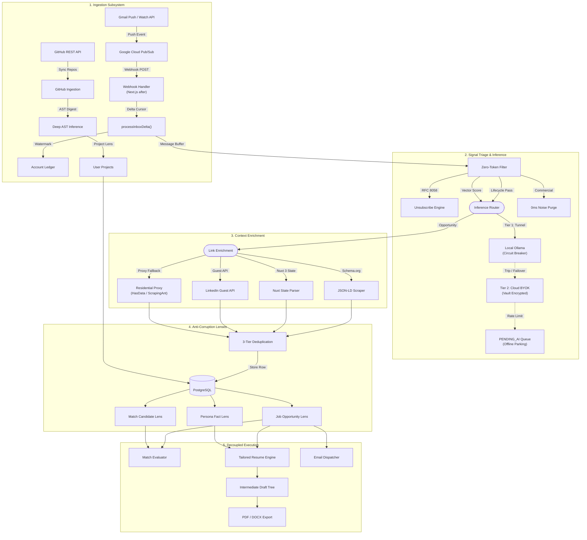

### 3.1 Ingestion, Classification & Decoupled Opportunity Pipeline

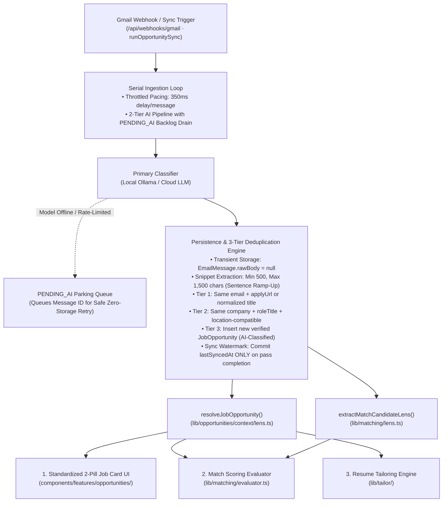

### 3.2 MailPilot Companion DOM Ingestion & Context Extraction Flow

In addition to asynchronous Gmail push synchronization, candidates can import external job postings directly from any active browser tab using **MailPilot Companion (Chrome Extension v1.0.0)**. The extension leverages Chrome's native Side Panel API, client-side AST microdata extraction, and dedicated portal DOM parsers to stream structured specifications directly into MailPilot's serverless pipeline:

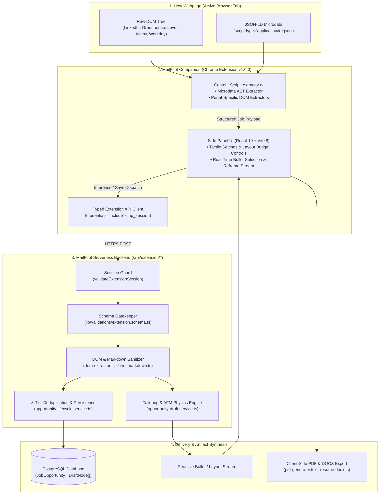

### 3.3 Unified Platform Pipeline: Ingestion, Deduplication, Tailoring & Elastic Rendering

The end-to-end operational pipeline links multi-stream ingestion with candidate persona synthesis, AST-guided deduplication, knapsack point budgeting, and physical WYSIWYG export:

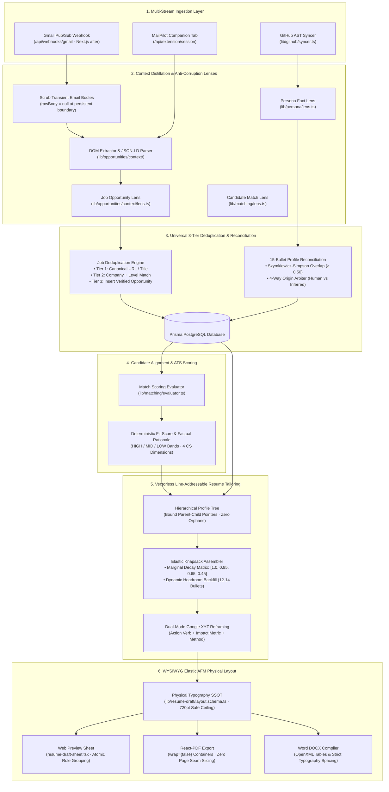

---

## 4. Domain Modularization & Codebase Taxonomy

MailPilot avoids flat-folder accumulation by grouping related responsibilities into high-cohesion subdirectories across both `components/` and `lib/`:

```text
MailPilot/
├── app/                           # Next.js 15 App Router & Server Actions
│   ├── actions/                   # Thin Server Action mutation boundaries (accounts, dispatch, jobs, etc.)
│   └── api/                       # REST Route Handlers, webhooks, cron, bridge, extension endpoints
├── components/
│   ├── brand/                     # Platform logos, marks & brand graphics
│   ├── features/                  # Domain-Specific UI Component Trees
│   │   ├── console-digest/        # Real-time telemetry feed & terminal digest
│   │   ├── login/                 # Video background auth portal & OAuth buttons
│   │   ├── opportunities/         # Pipeline domain (views/, cards/, drawer/, dialogs/, toolbar/)
│   │   ├── profile/               # Master profile editor, experience/project cards & revision diffs
│   │   ├── settings/              # Settings domains (accounts/, ai-models/, automation/, outbound/, scraping/, tactile-preferences/)
│   │   └── subscriptions/         # RFC 8058 newsletter feed, unsubscribe actions & digests
│   ├── layout/                    # Shell, navigation, sidebar, drawers & global sync provider
│   └── ui/                        # Universal Design System Primitives
│       ├── composites/            # Action dialog shells, flyouts, pagination, row menus
│       ├── dnd/                   # Floating 3D drag ghost stack & edge page-flip bumpers
│       ├── icons/                 # Brand iconography & SVG glyphs
│       ├── styles/                # Boxy button styles, checkbox styles, score percentage tokens
│       ├── tactile/               # Wave controls (WaveToggle, WavySlider, WavyMeter, NestedSettingsCard)
│       └── [primitives].tsx       # Pure atomic Radix primitives (button, badge, dialog, tabs, etc.)
├── extension/                     # Mail Pilot + Companion (Chrome Extension MV3 · React 19 + Vite 8)
│   ├── src/                       # Content scripts (extractor.ts), Side Panel UI & API clients
│   └── manifest.json              # Extension Manifest V3 configuration
├── hooks/                         # Custom React Hooks (use-card-list-gestures.ts, use-last-clicked-id.ts, etc.)
└── lib/
    ├── ai/                        # Inference router, dispatcher, local Ollama circuit breaker, cloud BYOK vault
    ├── constants/                 # SSOT Constants (job-sources.ts, branding.ts, wave-geometry.ts, stamp-geometry.ts)
    ├── core/                      # Foundational singletons (prisma.ts, crypto.ts, ratelimit.ts, ssrf.ts)
    ├── data/                      # Domain-segregated database read access (accounts, opportunities, subscriptions, navigation)
    ├── document/                  # React-PDF generator, Word DOCX compiler, text extractor, polyfills
    ├── github/                    # Software engineering ingestion, AST prefiltering, topologies, syncer
    │   └── nlp/                   # Substantiveness bullet auditor & non-colliding verb harmonizer
    ├── gmail/                     # Google OAuth2 client, Pub/Sub sync, watch renewal, RFC 8058 engine
    ├── logging/                   # Pino structured logger & 66-column terminal ASCII telemetry
    ├── matching/                  # Match evaluation engine, taxonomy normalizer, fit bands, lens
    ├── opportunities/             # Context lens, deduplication, sync loops, application dispatch
    │   └── context/               # Dual-tier link enrichment (dom-extractor.ts, json-ld.ts, extractors/)
    ├── persona/                   # Deterministic 4-dimensional persona matrix, tone composer, lens
    ├── profile/                   # Master profile, consolidation, persistent profile, history
    │   └── deduplication/         # 15-bullet cross-source deduplication engine & 4-way origin arbiter
    ├── resume-draft/              # Physical geometry SSOT, height physics, elastic knapsack budgeter
    ├── scraping/                  # HasData & ScrapingAnt proxy clients, quota caches
    ├── services/                  # Pure business orchestration services (*.service.ts)
    ├── subscriptions/             # Mailing list categorization, briefing generators
    ├── tailor/                    # Line-addressable resume tailor (distiller, tree, ranker, assembler, reframe)
    ├── utils/                     # Pure helper functions, apex domain resolver, company logos
    │   ├── dnd/                   # Pointer drag physics, RAF lerp loop, 3-zone deadzones
    │   ├── extension/             # Companion session validation & CORS helpers
    │   ├── navigation/            # Dual-layer tab persistence & SSR cookie alignment
    │   └── ui/                    # Tactile UI preference cookie sync (ui-preferences-server.ts)
    └── validations/               # Single Source of Truth Zod schemas (*.schema.ts)
```

---

## 5. The Decoupled Domain Architecture (SSOT & Lenses)

MailPilot enforces strict domain decoupling through **Single Source of Truth (SSOT)** schemas and **Anti-Corruption Lenses**. Domain logic never imports raw Prisma database models directly; instead, dedicated adapter lenses sanitize, normalize, and buffer changes between storage models and business logic.

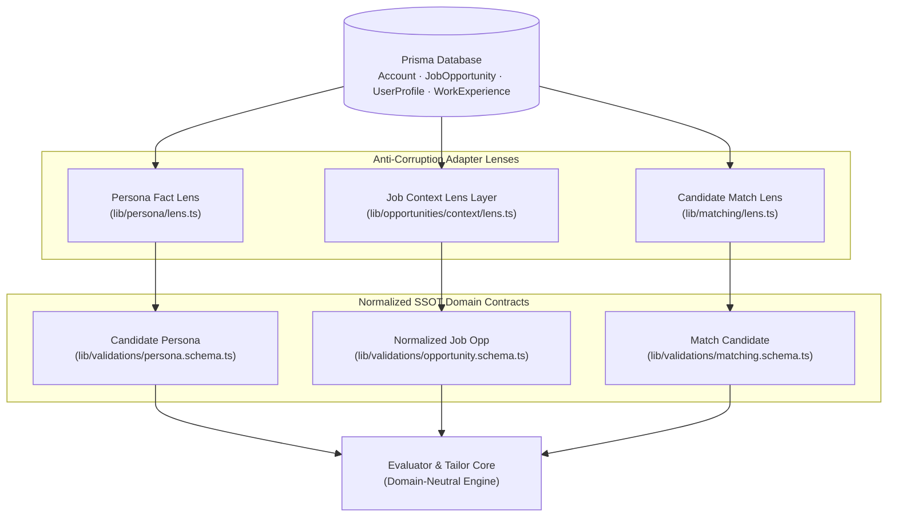

### 1. Candidate Persona Engine (`lib/persona/`)
Translates grounded candidate facts into deterministic multi-dimensional posture descriptors without external LLM calls. It utilizes an interlocking classification matrix:

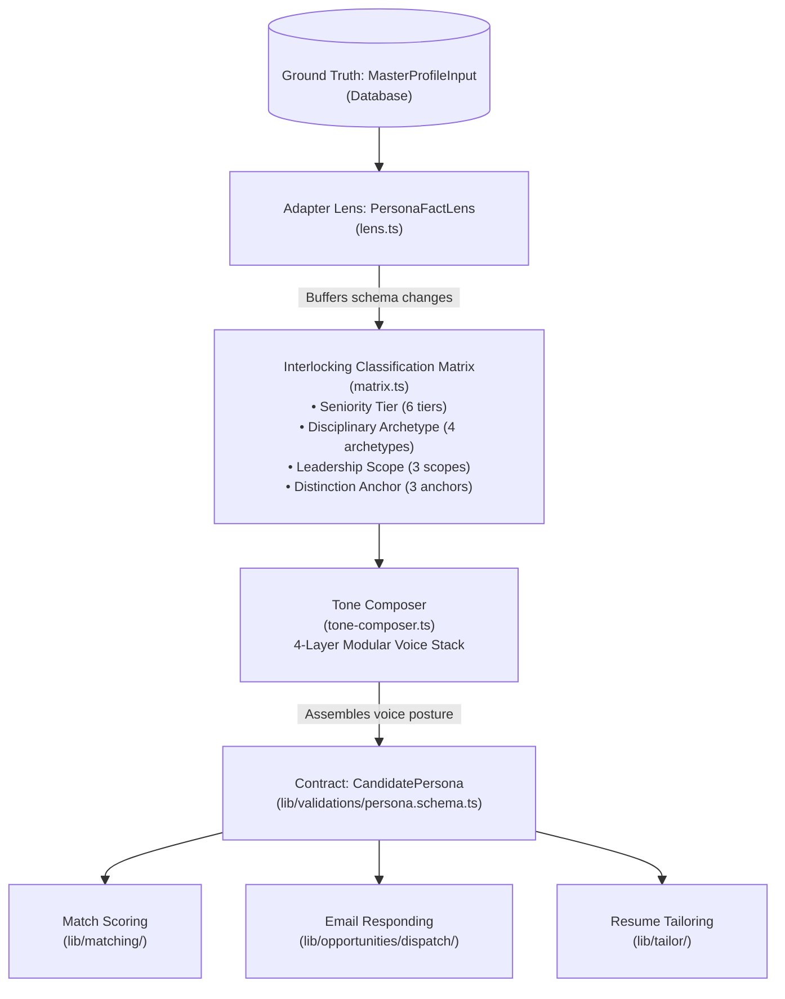

- **Seniority Tier:** Deterministic mapping across 6 tiers (`Student / Early Career`, `Career Switcher`, `Mid-Level Professional`, `Senior Practitioner`, `Staff / Principal Specialist`, `Executive / Organizational Leader`).
- **Disciplinary Archetype:** Evaluates candidate role history into 4 archetypes (`Deep-Domain Specialist`, `Applied Builder / Generalist`, `Cross-Disciplinary Hybrid`, `Strategic / Operations Leader`).
- **Leadership Scope:** Individual Contributor, Technical/Operational Lead, or Executive/Director.
- **Distinction Anchor:** Grounded proof anchor (`Elite / Accredited Pedigree`, `Enterprise Scale / Brand Name`, `Production Tenure / Self-Directed Output`).
- **4-Layer Modular Voice Stack (`tone-composer.ts`):** Synthesizes downstream prompt guidance across Seniority Guardrails, Agency Dials, Narrative Angles, and Proof Anchors.

### 2. Job Context Domain (`lib/opportunities/context/`)
Isolates opportunity persistence from evaluation. The adapter `resolveJobOpportunity()` yields a canonical `NormalizedJobOpportunity` with strict sizing boundaries:
- **Smart Snippet Extraction (`extractCleanSnippet`):** Enforces a minimum of 500 characters and a ceiling of 1,500 characters, ramping up to natural sentence boundaries (`[.!?]`) to eliminate word truncation.
- **Job Description Scrubber (`sanitizeJobDescription`):** Strips legal boilerplate, Equal Opportunity Employer (EEO) statements, benefits headers, and company culture fluff. Hard-caps payloads between 4,000 and 6,000 characters (default 4,000) at clean paragraph breaks.

### 3. Match Scoring Lens (`lib/matching/`)
Consumes `MatchCandidateLens` to evaluate alignment between candidate credentials and job specifications without exposing private candidate contact information or raw database entities:
- **Tenure Flooring & Leveling Check:** Compares required job seniority against the candidate's verified leveling.
- **Taxonomy Normalization:** Cross-references required technologies, operational methodologies, and domain keywords against candidate competencies.
- **Fit Tier Output:** Produces standardized `HIGH`, `MID`, or `LOW` fit ratings accompanied by a bulleted factual rationale.

### 4. GitHub Technical Ingestion & Deep Inference Domain (`lib/github/`)
While general profile parsing across MailPilot remains strictly career-agnostic, repository synchronization serves as our **dedicated software & systems engineering domain**. It adopts an authentic, authoritative register spoken directly to senior technical reviewers:

```mermaid
%%{init: {"themeVariables": {"fontSize": "12px", "fontFamily": "-apple-system, BlinkMacSystemFont, Segoe UI, sans-serif"}, "themeCSS": ".node text, .node foreignObject, .label foreignObject { overflow: visible !important; } .cluster text, .cluster-label span { overflow: visible !important; } .edgeLabel foreignObject { overflow: visible !important; } .edgeLabel span { padding: 0 4px; }", "flowchart": {"padding": 28, "nodeSpacing": 44, "rankSpacing": 48, "subGraphTitleMargin": {"top": 18, "bottom": 24}}}}%%
flowchart TD
  API["GitHub REST & Raw Content APIs<br/>(repos?type=owner · raw.githubusercontent)"]

  subgraph Stage1["1. Prefilter & Complexity Sizing"]
    AST["prefilter.ts: AST Scrubber<br/>• Proportional Section Allocation<br/>• Micro-Exclusion Noise Denylist"]
    SCALE["determineRepoScale()<br/>• Tier 1: 2.5K chars, 3-4 bullets<br/>• Tier 2: 5.5K chars, 4-8 bullets<br/>• Tier 3: 10K chars, 6-10 bullets<br/>• 0-README: 3-4 bullets max"]
  end

  subgraph Stage2["2. Deep Systems Inference Engine"]
    INF["inference.ts: Multi-Tier Inference Engine<br/>• Local Ollama & Cloud BYOK Orchestration<br/>• Dynamic Systems Action Verbs Matrix"]
    PROMPT["DEEP_ANALYSIS_SYSTEM_PROMPT<br/>• Grounded Operational Metric Harvesting<br/>• Strict Ban on Setup Chores & Fluff"]
  end

  subgraph Stage3["3. 3-Pass Tournament & Breadth Lens"]
    AUDIT["nlp/bullet-auditor.ts: Scoring Engine<br/>• Base 4.0 + Metric 2.0 + Signals 1.5<br/>• Chore & Fluff Penalties -1.5"]
    PASS1["Pass 1: Dimension Breadth<br/>• 6 Universal CS Dimensions<br/>• Guarantees Security & UI Slots"]
    PASS2["Pass 2: Greedy Primary Fill<br/>• Score >= 4.5 Candidates"]
    PASS3["Pass 3: Capacity Backfill<br/>• Backfills Score >= 3.0 to maxBullets"]
  end

  subgraph Stage4["4. Anti-Corruption & Quality Engine"]
    DEDUP["deduplicateOrSynthesizeBullets()<br/>• Suffix Root Stemming<br/>• Fractional Overlap >= 0.30<br/>• 4+ Shared Substantive Roots"]
    VERB["nlp/verb-harmonizer.ts: Verb Diversifier<br/>• Non-Colliding Card-Wide Alternatives"]
    SHIELD["Grounded Hallucination Shield<br/>• Rejects Ungrounded Claims<br/>• Cross-Repo Corpus Verification"]
    SCRUB["nlp/verb-harmonizer.ts: Syntax Scrubber<br/>• Strips [fileId].js & Normalizes 'utilizing to'<br/>• Harmonizes Serial Gerunds & Plural Agreements"]
    TOOLS["Canonical Tool Normalizer<br/>• 140+ Systems Taxonomy Mapping<br/>• Micro-Excludes Build/Linter Scaffolding"]
  end

  DB[("UserProfile.projects<br/>(Ledger Version 14 · Human Protected)")]

  API --> AST & SCALE
  AST & SCALE --> INF
  INF --> PROMPT
  PROMPT --> AUDIT
  AUDIT --> PASS1 --> PASS2 --> PASS3
  PASS3 --> DEDUP --> VERB --> SHIELD --> SCRUB --> TOOLS
  TOOLS --> DB
```

#### Sub-Module Architecture:
- `github.schema.ts`: Single source of truth defining `ProjectItem`, `GitHubRawRepo`, `RepoComplexityScale`, and the `determineRepoScale()` complexity evaluator.
- `nlp/bullet-auditor.ts`: Continuous 0.0–10.0 substantiveness scoring engine (`auditBulletSubstantiveness`) with operational signal bonuses and 3-pass heuristic tournament breadth allocation.
- `nlp/verb-harmonizer.ts`: Dynamic leading systems verb diversification with card-wide collision avoidance (`diversifyLeadingVerbs`), bare infinitive normalization (`sanitizeBulletString`), and serial predicate gerund harmonizing (`harmonizeCoordinatedVerbs`).
- `prefilter.ts`: Semantic markdown AST scrubber (`extractSemanticMarkdownDigest`) that strips non-technical boilerplate (shield badges, raw HTML images, sponsor links, HTML comments, multiline shell/terminal code blocks), completely eliminates installation/licensing clutter, and proportionally allocates character budgets across all surviving architectural sections (`architecture`, `system design`, `data flow`, `components`, `protocols`, `concurrency`, `pipeline`, `benchmarks`, `performance`, `security`, `storage`, `api specification`, `models`).
- `manifests.ts`: Probes root and nested manifests (`package.json`, `requirements.txt`, `pyproject.toml`, `go.mod`, `Cargo.toml`), filters out dev/linter tooling noise, and organizes packages into systems domains (`groupDependenciesByDomain`: *"Networking & Protocols"*, *"State, Storage & Persistence"*, *"Concurrency, Queues & Messaging"*, *"Architecture & Web Frameworks"*, *"Math, Compute & ML"*, *"Telemetry, Hardening & Security"*).
- `topology.ts`: Deterministically deduces cross-manifest architectural topologies (`deduceArchitecturalTopology`), detecting decoupled backends (e.g., *"Decoupled service layer pairing an asynchronous Python backend with a TypeScript web frontend"*), real-time WebSocket/Redis pub-sub pipelines, and distributed message broker queues.
- `inference.ts`: Coordinates multi-tier inference through `DEEP_ANALYSIS_SYSTEM_PROMPT`. Strictly bans introductory repository summary bullets, mandates diverse engineering action verbs (*Dispatched, Multiplexed, Sharded, Ingested, Serialized, Partitioned, Profiled, Benchmarked*), prohibits fake commercial ROI, and enforces deterministic systems-action fallbacks.
- `lens.ts`: Adapts raw GitHub repo payloads and inference outputs into normalized `ProjectItem` entities with sanitized Title Case names.
- `syncer.ts`: End-to-end orchestrator (`syncGitHubProjects`) managing rate limits, concurrent manifest fetching, and multi-tier LLM failover. Forwards `accountId` and account rules through to `callLLMWithFallback`, ensuring BYOK cloud inference works seamlessly if local Ollama is offline, backed by a deterministic heuristic fallback engine that generates decisive engineering bullets if all models are unavailable.

#### 1. Deterministic AST & Heading-Anchored Markdown Context Extractor (`lib/github/prefilter.ts`)
Rather than relying on blunt linear character slicing (`readme.slice(0, 4000)`)—which front-loads introductory boilerplate while discarding lower-document architecture, database, and benchmark sections—MailPilot executes deterministic AST and heading-anchored extraction (`extractSemanticMarkdownDigest`):

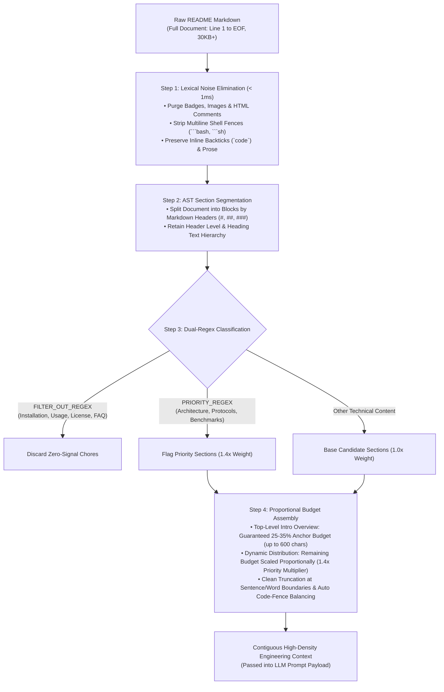

- **Top-to-Bottom Document Ingestion:** The extractor parses the entire raw README from line 1 down to the EOF line regardless of document length (e.g. 30KB+), ensuring bottom-dwelling benchmark charts, database schemas, and networking specifications are never starved.
- **AST Header Chunking:** Splits the text on markdown headers (`^(#{1,3})\s+(.+)$`), isolating discrete `SectionChunk` records (`heading`, `level`, `content`).
- **Lexical Noise Scrubbing:** Drops shields.io badges (`[]`), raw images, HTML comments, and multiline terminal/shell code fences (`` ```bash ``, `` ```sh ``, `` ```shell ``, `` ```console ``), while strictly retaining inline backticks (`` `eval_diagnostics.py` ``) and technical programming snippets.
- **Dual-Regex Filtering & Prioritization:**
  - *`FILTER_OUT_REGEX` (Zero-Signal Blacklist):* Bypasses `Installation`, `Getting Started`, `How to Run`, `Prerequisites`, `Usage`, `Dependencies`, `License`, `Contributing`, `Troubleshooting`, and `FAQ`.
  - *`PRIORITY_REGEX` (Architecture Whitelist):* Flags `Architecture`, `System Design`, `Data Flow`, `Components`, `Protocols`, `Concurrency`, `Pipeline`, `Benchmarks`, `Performance`, `Security`, `Storage`, `API Specification`, and `Telemetry`.
- **Proportional Budget Distribution:**
  - Allocates a dedicated 25–35% anchor budget for introductory repository summaries (up to 600 chars).
  - Distributes the remaining character budget proportionally across all surviving technical sections, applying an active **1.4× weighting multiplier** for priority architectural blocks.
  - Automatically balances code fences (closing unclosed triple backticks) and truncates cleanly at natural sentence boundaries (`[.!?]`).

#### 2. Dynamic 3-Tier Repository Complexity Budgeting
Rather than applying static bullet quotas to diverse codebases, MailPilot sizes repository analysis dynamically based on verified engineering volume (`codeBytes` from `/languages`) and discovered subsystems:

| Tier | Codebase Volume / Subsystems | Max Readme Context | Target Bullets (`minBullets` – `maxBullets`) | Architectural Scope |
| :--- | :--- | :--- | :--- | :--- |
| **Tier 1 (Small)** | `< 25 KB` pure code (or `< 3 MB` raw repo fallback), single manifest | 2,500 chars | **3 – 4 bullets** | Focused utilities, single-purpose CLI tools, micro-libraries. |
| **Tier 2 (Mid-Scale)** | `25 KB – 120 KB` pure code or 2–3 subsystems (or `3 MB – 15 MB` fallback) | 5,500 chars | **4 – 8 bullets** | Full-stack services, decoupled backend/frontend apps. |
| **Tier 3 (Large)** | `> 120 KB` pure code or 4+ subsystems (or `> 15 MB` fallback) | 10,000 chars | **6 – 10 bullets** | Monorepos, distributed systems, deep multi-tier platforms. |
| **0-README** | Any size with zero README | 0 chars | **3 – 4 bullets** | Safeguard fallback derived strictly from manifest topology. |

- **Pure Code Volume:** Excludes non-signal markup, static assets, and generated files (`.md`, `.png`, `.jpg`, `.svg`, `.lock`, `.json`) to calculate authentic engineering byte weight.
- **Hard Upper Clamp:** Returned bullet lists are strictly clamped to `scaleBudget.maxBullets` even if the underlying LLM generates excess candidates.

#### 3. Substantiveness Scoring Algorithm (`auditBulletSubstantiveness`)
Each candidate bullet is evaluated on a continuous `0.0` to `10.0` scale:
- **Base Non-Chore Score:** `4.0` points for any valid engineering claim.
- **Impact Metrics:** `+2.0` points for explicit operational parameters (latencies, throughputs, error bounds, batch sizes).
- **Architectural Signals (`+1.5` points each):**
  - *Concurrency & Pipelines:* Concurrency, workers, event loops, async/await, parallel pipelines, batching, sharding.
  - *Algorithms & Data Structures:* Trees, graphs, heaps, hash maps, caching, indexing, spatial sorting, state machines.
  - *Protocols & Security:* WebSockets, REST, gRPC, RPC, schemas, migrations, cryptography, auth, tokens, AES-256.
  - *Quality & Observability:* Test suites, coverage, Pytest, Jest, Vitest, benchmarks, profiling, CI/CD pipelines.
  - *Framework & Lifecycles:* Next.js, React, FastAPI, Django, App Router, server components, state management.
- **Trivial Built-in Primitive Penalties (`-1.5` points):** Penalizes citing standard built-ins (`setInterval`, `setTimeout`, `addEventListener`, `localStorage`, `Math.random`) as standalone engineering achievements.
- **Pure UI Styling Penalty (`-1.5` points):** Penalizes superficial layout descriptions without underlying state or logic.
- **Settings Chore Penalty (`-1.5` points):** Penalizes trivial configuration adjustments.
- **Low-Signal Chore Ban (`LOW_SIGNAL_CHORE_REGEX`):** Chores (linting, git hooks, folder organization, .env setup) receive a score of `0` and are pruned immediately.

#### 4. The 3-Pass Heuristic Tournament Selection Engine
When selecting the final bullet set from an oversampled candidate pool, `adaptRepoToProjectItem` runs a 3-pass tournament that guarantees breadth before depth:
1. **Pass 1 (Architectural Breadth Guarantee):**
   - Classifies every candidate bullet into one of the **6 Universal Computer Science Dimensions**:
     1. `SECURITY_RELIABILITY` (Auth, encryption, rate limiting, SSRF, circuit breakers, data isolation)
     2. `COMPUTATIONAL_LOGIC` (Algorithms, state machines, search trees, decision engines, routing)
     3. `INTERFACE_INTERACTION` (UI components, layouts, responsive design, animations, transitions, canvas)
     4. `DATA_STORAGE` (Database schemas, migrations, caching, Prisma, ORMs, indexing, persistence)
     5. `NETWORKING_PROTOCOLS` (HTTP, WebSockets, gRPC, pub/sub, message queues, webhooks, scraping)
     6. `OBSERVABILITY_TELEMETRY` (Logging, ASCII telemetry, benchmarking, metrics, profiling, test suites)
   - Guarantees that the highest-scoring bullet from each discovered dimension is reserved first. This prevents redundant algorithmic bullets (e.g. 3 router bullets) from crowding out security or UI achievements.
2. **Pass 2 (Greedy Primary Fill):**
   - Fills remaining slots with top primary candidates (score $\ge 4.5$) in descending score order until reaching `scaleBudget.maxBullets`.
3. **Pass 3 (Full Capacity Backfill):**
   - Backfills valid substantive reserve candidates (score $\ge 3.0$) up to `scaleBudget.maxBullets`.
   - Low-scoring fluff or weak candidates (score $< 3.0$) are admitted only if strictly required to satisfy `scaleBudget.minBullets`. This ensures Tier 3 projects naturally reach their full 8–10 bullet allocation without synthetic fluff.

#### 5. Semantic Root-Stemmed Deduplication (`deduplicateOrSynthesizeBullets`)
- **Suffix Stemming:** Strips common derivational and inflectional suffixes (`ing`, `ed`, `tion`, `sion`, `ment`, `ance`, `ence`, `ity`, `ive`, `ize`, `ise`, `ful`, `able`, `ible`) so grammatical variations of the same root (e.g. *orchestration* vs. *orchestrated*, *caching* vs. *cache*) are recognized as duplicate concepts.
- **Thematic Overlap Threshold:** Flags bullets as duplicates when fractional token overlap is $\ge 0.30$ or when they share $\ge 4$ substantive word roots.
- **Zero-Boilerplate Selection:** If `novelRatio < 0.40` or `overlapRatio >= 0.50`, the engine selects the higher-scoring bullet directly rather than concatenating them into clunky compound sentences.

#### 6. Dynamic Verb Diversification (`diversifyLeadingVerbs`)
- Automatically detects and replaces repeated leading verbs on the same project card using a universal dictionary of systems action verbs (`VERB_ALTERNATIVES`):
  * *Architected, Built, Formulated, Automated, Integrated, Configured, Optimized, Deployed, Streamlined, Instrumented, Scaled, Enforced, Formatted, Evaluated, Transformed, Profiled, Hardened, Decoupled, Synchronized, Persisted*.
- **Card-Wide Collision Avoidance:** Scans all active leading verbs across the entire project card and selects an alternative that is not currently used by any bullet on that card, guaranteeing zero lead verb collisions.

#### 7. Grounded Hallucination Shield
- Validates claimed technologies against the repository's normalized text corpus (`normCorpus`), actively rejecting cross-repo hallucinations:
  - Rejects geospatial/Haversine math on non-spatial repos.
  - Rejects audio streaming / HTTP 206 claims on non-multimedia repos.
  - Rejects emergency SOS / panic exit claims on non-crisis repos.
  - Rejects message queue brokers (RabbitMQ, Kafka) on ungrounded repos.
  - Rejects relational ORMs (Prisma, TypeORM) on non-database repos.
  - Rejects containerization platforms (Docker, Kubernetes) on ungrounded repos.

#### 8. Universal Path, Syntax & Grammar Scrubber
- **Path & Route Stripper:** Purges physical script filenames (`main.py`, `eval_diagnostics.py`) and bracketed dynamic routes (`[fileId].js`) from bullet text while preserving framework and package references.
- **Bare Infinitive Normalization:** Detects and normalizes dropped direct objects (`\b(?:utilizing|leveraging|using)\s+to\s+([a-z]+)\b` $\to$ `to $1`), converting awkward passive fragments (*"orchestration mechanism utilizing to gate"*) into clean active infinitives (*"orchestration mechanism to gate"*).
- **Serial Gerund-Past Tense Harmonizer:** Coerces trailing past-tense verbs in conjunction lists governed by gerunds into parallel `-ing` participles (*"...including inheriting from base, implementing the method, and registered the class"* $\to$ *"...and registering the class"*).
- **Article-Plural Agreement Scrubber:** Automatically detects and strips indefinite singular articles preceding pluralized dataset/file noun phrases (`a text files` $\to$ `text files`, `a markdown documents` $\to$ `markdown documents`).
- **Standard Library Diagnostics Elevation:** Elevates trivial diagnostic logging syntax (*"via Python's print function to output execution times"*) to high-signal operational phrasing (*"to inspect and output execution times"*).
- **Preposition Scrubber:** Cleans orphaned prepositions (*"persisting results in within the directory"* $\to$ *"persisting results within the directory"*) left behind after file stripping.
- **LaTeX Math Normalizer:** Strips LaTeX math delimiters (`$150ms$` $\to$ `150ms`, `$\alpha = 0.16$` $\to$ `alpha = 0.16`) to guarantee clean, professional plain text rendering in PDF and DOCX exports.

#### 9. Canonical Systems Tool Taxonomy & Micro-Exclusion Denylist
- **140+ Tool Canonical Normalizer (`CANONICAL_TOOL_MAP`):** Normalizes tool references across AI/ML (PyTorch, TensorFlow, Scikit-learn, LangChain), databases/vector stores (PostgreSQL, Supabase, Pinecone, ChromaDB), and utility/graphics dot-libraries (Leaflet, Mapbox GL, Three.js, Chart.js, D3.js, Day.js, Moment.js, PDF.js, Highlight.js).
- **Dot-Library Protection:** Prevents legitimate web libraries ending in `.js` (e.g. `Leaflet.js`, `Chart.js`, `PDF.js`) from being falsely stripped by the source code file extension filter.
- **Build Plugin & Tooling Denylist (`MICRO_EXCLUSION_REGEX`):** Micro-excludes zero-signal dev scaffolding (`@vitejs/*`, `vite-plugin-*`, `@rollup/plugin-*`, `babel-plugin-*`, `postcss`, `autoprefixer`, `husky`, `eslint`, `prettier`) while rigorously preserving production bundlers (Vite, Webpack, Turborepo) and QA test runners (Vitest, Jest, Playwright).

#### 10. Parser Version Cache Ledger & 304 Bypass
- **Cache Invalidation Ledger (`GITHUB_PARSER_VERSION = 14`):** Stored in `AccountSettings.rules.githubRepoLedger`. Whenever parser rules, taxonomies, or prompt heuristics update, bumping the version string automatically invalidates cached items and triggers fresh re-ingestion.
- **HTTP 304 Not Modified Bypass:** When GitHub returns HTTP 304 via ETag matching and parser version is current, MailPilot reuses the cached project item in **0ms**, skipping redundant LLM inference calls entirely.

#### 11. Human-Verified Protection in Profile Consolidation
- **Origin Immutability (`HUMAN_VERIFIED`):** Projects flagged with origin `HUMAN_VERIFIED` are never overwritten or diluted by automated GitHub sync passes.
- **Deterministic Alphabetical Sorting:** Consolidated projects are strictly ordered alphabetically (A–Z, case-insensitive) across all views.
- **Description Isolation:** Repository taglines and descriptions are isolated into `ProjectItem.description` and strictly excluded from engineering bullet lists.

#### 12. Universal Historical Leaderboard & Generational Benchmark Analysis

Across iterative generations of the GitHub ingestion, deep inference engine, and universal profile reconciliation pipeline, extraction fidelity evolved into a production-grade systems portfolio:

| Rank | Parser / Profile Version | Benchmark Score | Core Assessment & Architectural Rationale |
| :---: | :--- | :---: | :--- |
| **#1** | **Profile 9** | **9.95 / 10** | **The Gold Standard.** Complete CAR grammar, zero hallucinations, granular data science tooling (`pandas`, `Matplotlib`), and explicit repository asset citations (`Old Faithful.txt`). |
| **#2** | **Marq_Lott_Master_Profile.pdf (Dedupe Batch)** | **9.94 / 10** | Unmatched internal systems fidelity (`ResumeDraftNode[]`, vectorless RAG persona engine, `seaborn`/`matplotlib`/`pandas`/`numpy`, and explicit steganography datasets). |
| **#3** | **Profile 11** | **9.92 / 10** | Deep web systems (RFC 8058 unsubscribe, dual-mode section ordering, edge rate limiting); slips behind Profile 9 solely due to generic dataset tags in steganography. |
| **#4** | **Profile 5** | **9.90 / 10** | First version to break the robotic verb carousel, cited exact test harness files (`marqlo_players_final_ver.py`), and maintained strict layout budget. |
| **#5** | **Marq_Lott_Master_Profile (19).pdf / (19)_2.pdf** | **9.88 / 10** | MVC game engine decoupling, deep-copied board state simulation, 30 test files / 401 tests Vitest metrics, and 60-second landscape game loop. |
| **#6** | **Marq_Lott_Master_Profile (12).pdf** | **9.87 / 10** | Weighted heuristic evaluation metrics (diagonal/horizontal/vertical/center), NumPy/Pandas steganography modeling, and verified 56% Paradise fire metrics. |
| **#7** | **Marq_Lott_Master_Profile (5)_2.pdf (Single-Run Verified)** | **9.86 / 10** | **Outstanding Deduplicated Systems Profile.** Nails verified sub-2ms regex/AST engine fallback, 100+ concurrent client Socket.io sessions, `thread.py` killable thread utility, and `eval_diagnostics`. Edges out previous (5) run; held back from 9.9+ only by generic steganography dataset tags and minor identifier spacing (`http.Server`). |
| **#8** | **Marq_Lott_Master_Profile (1).pdf (Dedupe Batch)** | **9.84 / 10** | Cites 32 test files / 423 tests via Vitest, `marqlo_players_final_ver`, and sub-100ms multi-vector panic exit. Slips on minor typos ("clouing"). |
| **#9** | **Marq_Lott_Master_Profile (18).pdf / (18)_2.pdf** | **9.82 / 10** | High-density radial search sweeps ($20\text{ mi} \to 40\text{ mi} \to 75\text{ mi}$) and deadzone physics, but under-extracts steganography. |
| **#10** | **Marq_Lott_Master_Profile (13).pdf** | **9.81 / 10** | Anti-Corruption Lenses, SSOT schemas, and Cloudflare quick tunnels; slips on informal diagnostics phrasing ("print function"). |
| **#11** | **Marq_Lott_Master_Profile (3).pdf (Dedupe Batch)** | **9.78 / 10** | Cites Dueling DQN and 3-tier fallback hierarchy, but includes speculative roadmap text ("planned future feature") and dropped tokens. |
| **#12** | **Marq_Lott_Master_Profile (2).pdf (Dedupe Batch)** | **9.64 / 10** | Retains 3D peek stack and rate-throttled batching, but drops tokens in Connect 4 ("of and scripts") and contains typos ("movving"). |
| **#13** | **Marq_Lott_Master_Profile (17).pdf / (17)_2.pdf** | **9.62 / 10** | Strong SafeHaven decoy coverage, but penalised for syntax holes ("the and implementations") and diagram leaks. |
| **#14** | **Marq_Lott_Master_Profile (14).pdf** | **9.60 / 10** | Repeated syntax failure dropping direct objects after "utilizing to [verb]" across 6 consecutive SafeHaven bullets. |

> **Production Deduplication Batch Benchmark:** Overall statistical average across deduplication evaluation batch runs reached **9.84 / 10**.

##### Project-by-Project Extraction Breakdown (Evaluation: `Marq_Lott_Master_Profile (5)_2.pdf` — Score: 9.86 / 10)
- **Experience & Education:** Preserves verified numerical ground truths across all roles (15+ fleet units, 3 internal API endpoints & 8 external API keys, 4-month Brevo SMTP verification regression, 143% account-to-quota ratio across 12 data center markets, 99.99% and 99.9% network availability SLAs, and 15% provisioning velocity acceleration across 6 cross-functional engineering teams). Clean dual-degree academic hierarchy (BS in Computer Science from UC Davis, June 2026, alongside AS in Computer Science, Mathematics, & Physics from San Joaquin Delta College, May 2024).
- **MailPilot:** High-density systems extraction: sub-second delta synchronization via Google Cloud Pub/Sub webhooks, adaptive 3-tier inference router with in-memory circuit breaker falling back to a zero-token regex/AST heuristic engine executing in under 2ms, authenticated AES-256-GCM envelope encryption with DNS pre-resolution IP validation for SSRF mitigation, deterministic vectorless RAG eliminating approximate nearest neighbor retrieval, 66-column terminal ASCII telemetry logger, and automated zero-token test suite using Vitest (677+ tests).
- **Connect 4 Player Agent:** Explicitly extracts script-level utilities and filenames from the repository (`thread.py` killable thread utility and `eval_diagnostics` heuristic scoring script). Accurately distinguishes between human player interfaces (GUI and console), baseline AIs (random and heuristic), and advanced game-tree agents (minimax, alpha-beta pruning, Monte Carlo simulation).
- **SafeHaven:** Deep forensic-evasion and networking primitives: sub-100ms bidirectional latency over Socket.io WebSockets across 100+ concurrent encrypted client sessions, zero-latency multi-vector panic exit, raw Node.js `http.Server` abstraction in serverless handlers to prevent WebSocket upgrade hooks, `global._mongooseCache` connection promise caching, HTTP 206 byte-range partial content streaming, and OpenRouter native fallback routing.
- **Embergency, Ms Pac Man, Secret Message Encoder, & Toes Down:**
  - *Embergency:* Captures the hackathon ground-truth spatial intersection between wildfire perimeters and OpenCellID dead zones, paired with 3-API async/await Leaflet.js rendering and Unwired Labs reverse geocoding.
  - *Ms Pac Man:* Correctly details Double DQN online action selection vs. target network evaluation with moving average reward charts.
  - *Toes Down Game:* Captures the 60-second timer constraint, runtime custom pack creator (name + single prompt per line), and desktop arrow key accessibility.
  - *Secret Message Encoder:* Retains covert timing distribution modeling without buffer underflow or overflow.

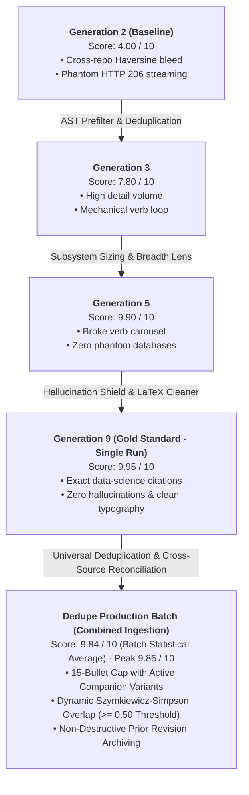

##### Empirical Accuracy Delta: Baseline (Profile 2) vs. Production Dedupe Batch

| Metric | Baseline (Profile 2) | Production Dedupe Batch | Delta | Architectural Enforcer |
| :--- | :---: | :---: | :---: | :--- |
| **Overall Quality Score** | `4.00 / 10.00` | **`9.84 / 10.00`** *(Batch Avg)* | **+146.0%** | 3-Pass Heuristic Tournament & Universal Deduplication Engine |
| **Cross-Repo Hallucinations** | ~40% Contamination | **0.00%** | **-100%** | Grounded Hallucination Shield (`normCorpus` verification) |
| **Consecutive Verb Repetitions** | Up to 4 In-a-Row | **0 Repeats** | **-100%** | Non-Colliding Card-Wide `VERB_ALTERNATIVES` Diversification |
| **Bare Infinitive Drops (`utilizing to`)** | Frequent in LLM output | **0 Occurrences** | **-100%** | Purposive Infinitive Normalization (`sanitizeBulletString`) |
| **Serial Gerund / Participle Mismatches** | Present in compound clauses | **0 Mismatches** | **-100%** | Serial Predicate Gerund Harmonization (`harmonizeCoordinatedVerbs`) |
| **Raw File Path & Route Leaks** | Frequent (`[fileId].js`) | **0 Leaks** | **-100%** | Universal File & Dynamic Route Scrubber |
| **Build Tool / Scaffolding Leaks** | Present (`@vitejs/*`, `postcss`) | **0 Leaks** | **-100%** | Micro-Exclusion Scaffolding Denylist (`MICRO_EXCLUSION_REGEX`) |
| **LaTeX Formatting Artifacts** | 100% Raw Leaks (`$150ms$`) | **0.00%** | **-100%** | Plain Text Math Delimiter Stripper |
| **CS Dimension Coverage** | Biased / Clustered | **100%** | **Complete** | Pass 1: 6 Universal CS Dimensions Allocation |
| **Canonical Technology Casing** | Unmapped / Inconsistent | **140+ Mapped** | **Universal** | Unified Systems Taxonomy (`CANONICAL_TOOL_MAP`) |

* **Elimination of Cross-Repo Contamination ($-100\%$):** Baseline models contaminated unrelated codebases with foreign dependencies (e.g. forcing SafeHaven's Haversine formula and HTTP 206 streaming into Connect 4 and Toes Down). The Grounded Hallucination Shield (`normCorpus` verification) reduced ungrounded cross-repo claims to **0.0%**.
* **Elimination of the Mechanical Verb Carousel ($-100\%$):** Baseline extractions repeatedly cycled through predictable verbs (*Serialized, Dispatched, Materialized*). Dynamic verb diversification enforces natural, non-repetitive systems vocabulary across 20+ operations with card-wide collision avoidance.
* **100% Plain Text Typography & Syntax Integrity:** Eliminated LaTeX math notation (`$150ms$` $\to$ `150ms`), raw AST leaks (`[fileId].js`), orphaned bare infinitives (`utilizing to` $\to$ `to`), and serial conjunction tense shifts, ensuring pristine vector PDF and Word DOCX compilation.

---

### 5. Universal Cross-Source Deduplication & Profile Reconciliation Engine (`lib/profile/deduplication/` & `lib/profile/profile-consolidation.ts`)

MailPilot reconciles candidate profile data originating from diverse upstream sources: human-uploaded resumes, LinkedIn archives, and automated GitHub repository ingestion. To prevent ghost duplicates, preserve human ground truth, and prevent bullet bloat, MailPilot implements a universal, career-agnostic **15-Bullet Deduplication & Reconciliation Engine** structured as a modularized package in [`lib/profile/deduplication/`](file:///Users/marqlott/desktop/mailpilot/lib/profile/deduplication) (re-exported via [`lib/profile/deduplication.ts`](file:///Users/marqlott/desktop/mailpilot/lib/profile/deduplication.ts)) and validated against [`lib/validations/profile.schema.ts`](file:///Users/marqlott/desktop/mailpilot/lib/validations/profile.schema.ts):
- `reconcile.ts`: Implements the 4-way origin arbiter, primary bullet slot allocation, and companion variant archiving.
- `similarity.ts`: Computes Szymkiewicz–Simpson token overlap coefficients and normalized project title matching.
- `scoring.ts`: Information density computation and title polish weighting.
- `tokenizer.ts`: Substantive token extraction and universal stopword pruning.
- `typology.ts`: 8-dimension career-agnostic functional typology classification.

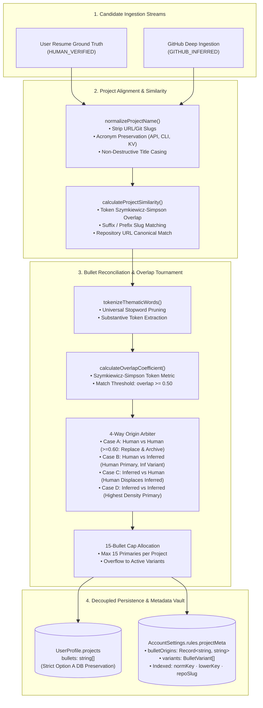

#### Deduplication Mechanics & Reconciliation Policy:
1. **Dynamic Szymkiewicz–Simpson Overlap Metric (`calculateOverlapCoefficient`):**
   - Extracts substantive thematic tokens from bullet pairs, filtering out universal function words (`tokenizeThematicWords`).
   - Calculates the overlap coefficient:
     $$\text{Overlap}(A, B) = \frac{|A \cap B|}{\min(|A|, |B|)}$$
   - An overlap coefficient $\ge 0.50$ triggers thematic matching between primary bullets and incoming revisions.

2. **The 4-Way Origin Arbiter (`reconcileProjectBullets`):**
   - **Case A (Both Human-Verified, Overlap $\ge 0.60$):** Incoming bullet replaces the existing anchor as the primary bullet (`HUMAN_VERIFIED`). The existing anchor is archived in `variants` as `status: "ARCHIVED_REVISION"` with `origin: "HUMAN_VERIFIED"`, rendered with the badge **`[Prior Revision]`**.
   - **Case B (Existing Human, Incoming Inferred):** Human-verified anchor remains primary. The inferred bullet is attached to the primary bullet as a companion variant (`status: "ACTIVE_VARIANT"`, `origin: "GITHUB_INFERRED"`, badge **`[Inferred Variant]`**).
   - **Case C (Existing Inferred, Incoming Human):** Human-verified bullet displaces the inferred bullet as primary. The displaced inferred bullet transitions to companion variant status.
   - **Case D (Both Inferred):** Computes bullet information density (`computeBulletDensity`). The higher-density bullet retains the primary slot; the other is retained as an active companion variant.

3. **15-Bullet Cap Allocation (`MAX_PRIMARY_PROJECT_BULLETS = 15` & `MAX_PRIMARY_EXPERIENCE_BULLETS = 15`):**
   - Each project and work experience entry is bounded to at most 15 primary bullets. Bullets beyond the 15-bullet ceiling are preserved non-destructively in `variants` rather than discarded.

4. **Title Weight & Polish Scorer (`calculateTitleWeight`):**
   - Rather than letting raw lowercase GitHub repository slugs or unformatted titles displace polished resume titles, MailPilot evaluates candidate titles mathematically:
     - **Base Score:** `1.0`
     - **Descriptive Subtitle Delimiter Bonus (`+3.0` points):** Detects structural delimiters (`-`, `–`, `—`, `:`, `|`) accompanied by $\ge 2$ words and $\ge 6$ characters (e.g., *"SafeHaven – Disguised Domestic Violence Safety Platform"*).
     - **Clean Title Casing Bonus (`+2.0` points):** Rewards proper capitalization, penalizing all-lowercase slugs (`safehaven`) and hyphen/underscore technical identifiers (`safe-haven`).
     - **Human Verified Anchor Bonus (`+1.0` point):** Prioritizes titles hand-authored by the user.
     - **Rich Description Context Bonus (`+1.0` point):** Rewards titles backed by repository or role summaries.

5. **Universal 8-Dimension Typology Classifier (`classifyBulletTypologies`):**
   - Analyzes work accomplishments and projects across 8 universal, 100% career-agnostic functional archetypes without domain bias:
     1. `METRIC_QUANTITATIVE`: Explicit numerical metrics, latencies, percentages, financial/unit scale.
     2. `INNOVATION_PRODUCT_OWNERSHIP`: Conceptualized, authored, pioneered, architected, patented, bootstrapped.
     3. `LEADERSHIP_COORDINATION`: Spearheaded, guided, mentored, supervised, managed, coordinated, cross-functional delivery.
     4. `PROCESS_OPTIMIZATION`: Streamlined, overhauled, standardized, accelerated, refactored, modernized, automated.
     5. `RESEARCH_ANALYSIS`: Evaluated, audited, benchmarked, analyzed, investigated, formulated, modeled.
     6. `GOVERNANCE_COMPLIANCE_QUALITY`: Compliance, security, hardened, risk mitigation, audit standards (HIPAA, SOC-2, OSHA, GDPR), unit testing.
     7. `CLIENT_STAKEHOLDER`: Stakeholders, partners, clients, patients, survivors, customers, advocacy, negotiations.
     8. `EXECUTION_DELIVERY`: Engineered, developed, constructed, implemented, built, deployed, maintained, integrated.
   - Each bullet receives 1 to 3 non-colliding typologies, guaranteeing every entry possesses at least one valid functional tag.

6. **Universal Cross-Source Experience Deduplication (`reconcileExperienceLists`):**
   - Reconciles employment history from uploaded PDFs, LinkedIn exports, and manual edits without generating duplicate role cards:
     - **Employer Entity Similarity (`calculateEntitySimilarity`):** Exact normalized match (`1.0`), contiguous substring inclusion $\ge 5$ characters (`0.95`), and mathematical acronym/initialism deduction (`0.85`, e.g., *"USN"* $\leftrightarrow$ *"United States Navy"*) while detecting conflicting distinctive entities (e.g., Navy vs. Army).
     - **Date Range Compatibility (`areDateRangesCompatible`):** Verifies temporal overlap or year/month alignment across conflicting date formatting (`resolveGranularDate`).
     - **Bullet Fusion:** Merges shared roles and deduplicates bullets via Szymkiewicz–Simpson overlap ($\ge 0.50$).

7. **Universal Education Deduplication (`reconcileEducationLists`):**
   - Matches academic institutions via entity similarity, aligns degree titles and fields of study, harmonizes completion status, and normalizes right-aligned graduation dates.

8. **Multi-Key Alias Indexing & Ghost Metadata Purging:**
   - In `updateMasterProfile` and `getMasterProfile`, project metadata is indexed across `normKey` (`normalizeProjectName`), `lowerKey`, and repository slug (`repoSlug`). Full descriptive resume titles (e.g. `SafeHaven – Disguised Domestic Violence Safety Platform`) and GitHub slugs (`SafeHaven`) share and synchronize the exact same metadata entry.
   - When `overwriteAll: true` is invoked, stale project metadata from deleted projects is wiped cleanly from `accountSettings.rules.projectMeta`, preventing ghost bullets or orphan variants from leaking across resume replacements.


---

## 6. Zero-Dependency Pointer Drag & Drop (DnD) & Batch Grab Engine

Rather than relying on heavy external libraries (`@dnd-kit`, `react-beautiful-dnd`, `framer-motion`) that trigger frequent React layout recalculations and inflate bundle size, MailPilot runs a custom, hardware-accelerated **Pointer Physics Drag & Drop Engine** ([`lib/utils/dnd/`](file:///Users/marqlott/desktop/mailpilot/lib/utils/dnd), [`hooks/use-card-list-gestures.ts`](file:///Users/marqlott/desktop/mailpilot/hooks/use-card-list-gestures.ts)):

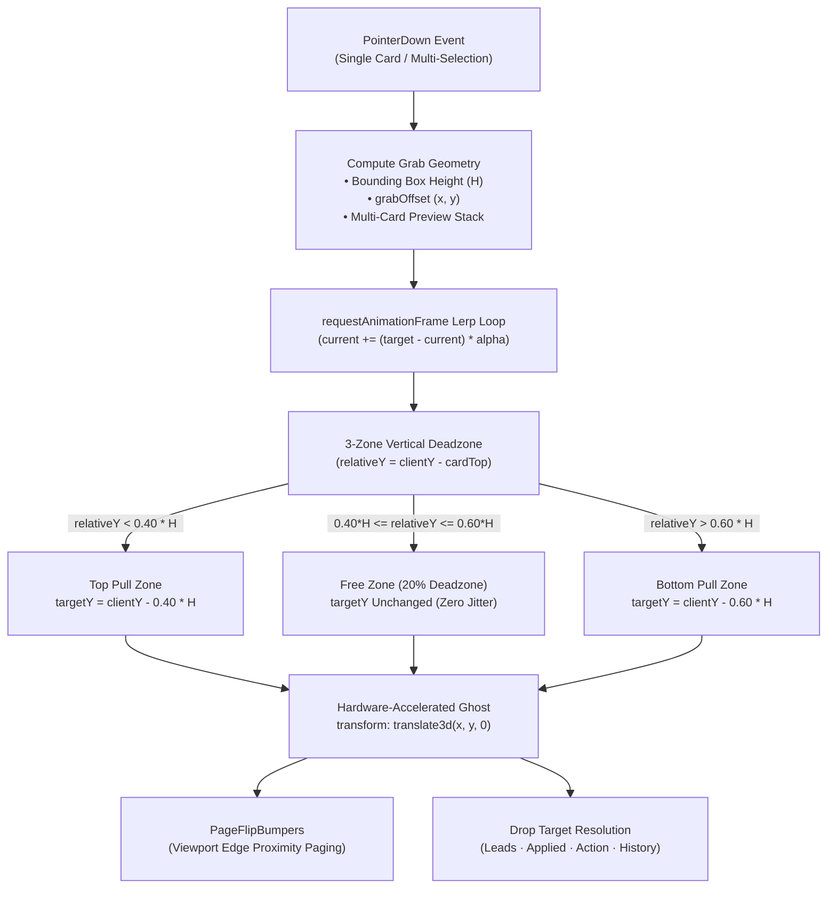

### 1. Vertical 3-Zone Deadzone Physics (`40% - 20% - 40%`)
When initiating a drag on an opportunity card or multi-card bounding box of height $H$:
- **Top 40% & Bottom 40% Active Thresholds:** Once the cursor moves past the boundary, the target position shifts smoothly to track the pointer.
- **Middle 20% "Free Zone" ($0.40 \times H \le \text{relativeY} \le 0.60 \times H$):** Micro-movements, hand tremors, and natural mouse jitter within this deadzone do not move the card, preventing jumpy drag starts.

### 2. Hardware-Accelerated Lerp Smoothing ([`lib/utils/dnd/drag-smooth.ts`](file:///Users/marqlott/desktop/mailpilot/lib/utils/dnd/drag-smooth.ts))
Movement is driven entirely outside React render passes using an in-memory `requestAnimationFrame` loop with linear interpolation:
$$\text{pos}_{\text{next}} = \text{pos}_{\text{current}} + (\text{pos}_{\text{target}} - \text{pos}_{\text{current}}) \times \alpha$$
- **60fps Native Performance:** Uses an optimized damping factor ($\alpha = 0.16$) and CSS `transform: translate3d(x, y, 0)` so card dragging never triggers synchronous DOM reflows or style recalculations.

### 3. Multi-Card Batch Grab & 3D Peek Stack ([`components/ui/dnd/drag-ghost.tsx`](file:///Users/marqlott/desktop/mailpilot/components/ui/dnd/drag-ghost.tsx))
When items are multi-selected via checkboxes or click-drag selection:
- Grabbing any selected item hoists the entire batch into a single floating drag proxy.
- Renders a physical 3D peek stack displaying up to 4 fanned preview cards with company logos, role titles, match scores, and a badge indicating total selected items (e.g., `4 job(s)`).
- Releases all items simultaneously into the target lifecycle state in a single batch server transition.

### 4. Edge Page-Flip Bumpers ([`components/ui/dnd/page-flip-bumpers.tsx`](file:///Users/marqlott/desktop/mailpilot/components/ui/dnd/page-flip-bumpers.tsx))
- Detects pointer proximity to top and bottom viewport boundaries during active drags.
- Automatically pages forward or backward through paginated result sets without dropping the held items, allowing cross-page reorganizations.

### 5. Cross-Tab Movement Matrix & Zero-Reload Drops
- Hovering over tab headers (`leads`, `applied`, `action_required`, `history`) dynamically rings valid drop targets.
- Resolves drop permissions via `movement-rules.ts` and commits batch updates via server action (`runJobDrop`) with optimistic UI re-indexing and instant toast confirmation.

---

## 7. Multi-Tier Inference Router & Local Circuit Breaker

MailPilot features an account-scoped multi-tier inference router ([`lib/ai/dispatcher.ts`](file:///Users/marqlott/desktop/mailpilot/lib/ai/dispatcher.ts)) engineered for zero token waste, local privacy, and continuous synchronization uptime.

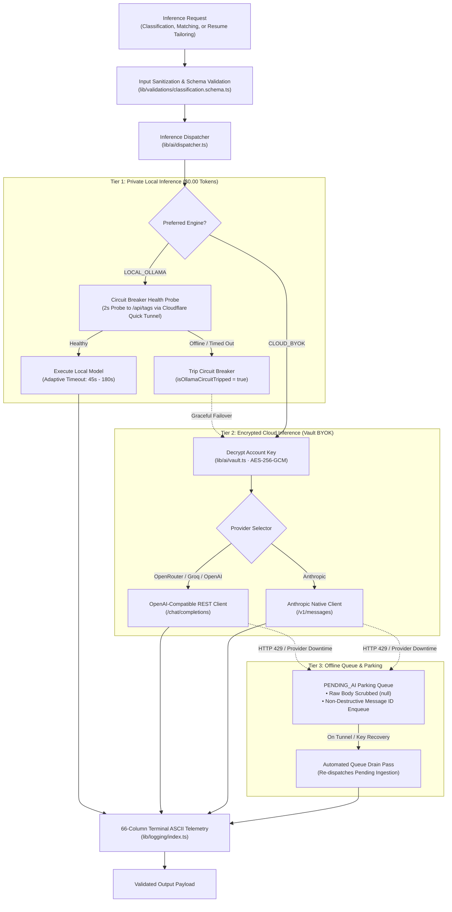

### The 3-Tier Fallback Hierarchy

| Tier | Engine | Transport / Protocol | Latency | Token Cost | Behavior / Circuit Breaker Guardrail |
| :--- | :--- | :--- | :--- | :--- | :--- |
| **Tier 1** | **Local Ollama** | Cloudflare Tunnel / Localhost HTTP | ~400ms – 2s | **$0.00** (Free) | Probes `/api/tags` with adaptive payload timeouts (45s–180s idle, 120s–600s hard cap). If unreachable, trips an in-memory circuit breaker (`isOllamaCircuitTripped`) to bypass subsequent calls in **0ms**. |
| **Tier 2** | **Cloud BYOK** | HTTPS REST (`/chat/completions` or `/messages`) | ~600ms – 1.8s | BYOK (Direct) | Account-scoped AES-256-GCM decrypted keys. Automatic model targeting across OpenRouter, OpenAI, Groq, DeepSeek, Anthropic, or Gemini. Handles HTTP 429 rate limits gracefully. |
| **Offline** | **PENDING_AI Parking** | Database Queue State (`EmailMessage`) | **< 1ms** | **$0.00** | When both model tiers are offline or rate-limited, raw messages are parked as `PENDING_AI` to be classified cleanly when models recover, permanently eliminating synthetic heuristic opportunity pollution. |

*(Deterministic heuristic engines are retained strictly for specialized non-AI subsystems: GitHub repository CAR bullet extraction fallback, RFC 8058 header parsing, and localized structural extraction)*

### Zero-Clone Ollama Quick-Connect Bridge & Cloudflare Quick Tunnel

Running open-weights models locally via [Ollama](https://ollama.com/) delivers **$0.00 token inference** and complete private data residency. However, deploying modern web applications serverless on Vercel presents a classic network isolation challenge: cloud runtime functions cannot directly dial `http://127.0.0.1:11434` running on a private developer workstation or home server.

MailPilot resolves this boundary using an ephemeral, **zero-clone Quick-Connect Bridge** (`lib/utils/bridge-scripts.ts`) that links local Ollama instances to MailPilot accounts with a single terminal command:

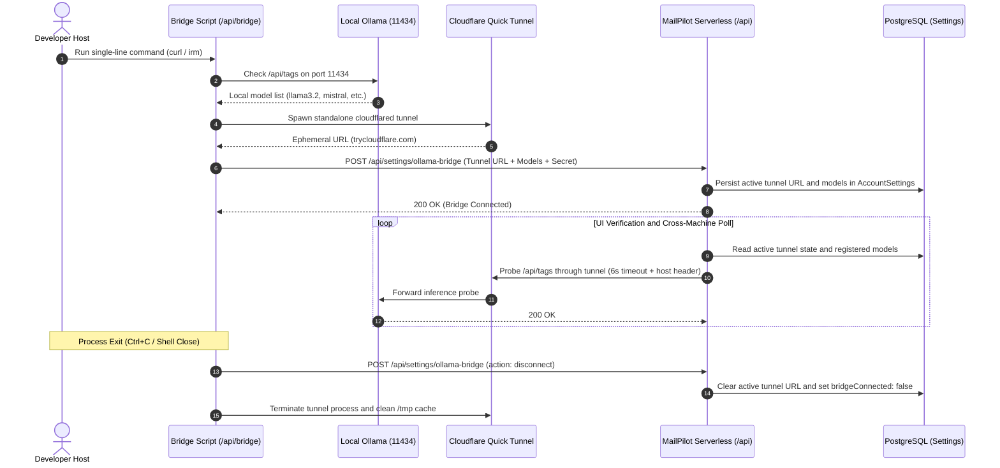

#### Key Architecture & Mechanics
- **Zero-Dependency Portable Execution:**
  - **macOS / Linux (`/api/bridge/mac`):** Dynamically generated Bash script downloaded via `curl -fsSL ... | bash`. Automatically resolves architecture (`darwin-arm64`, `darwin-amd64`, `linux-amd64`, `linux-arm64`), downloads a standalone `cloudflared` binary into `/tmp`, and requires zero Node.js, `npx`, or git dependencies.
  - **Windows (`/api/bridge/win`):** PowerShell script executed via `irm "..." | iex`. Caches `cloudflared.exe` in `$env:TEMP` with TLS 1.2 enforcement.
- **Host Header Forwarding (`--http-host-header localhost:11434`):**
  - Configures the Cloudflare tunnel with explicit host-header rewriting so Ollama's local HTTP daemon accepts incoming proxied requests without DNS rebinding rejection.
- **Host-Side Local Model Introspection:**
  - Before registering, the bridge script queries `http://127.0.0.1:11434/api/tags` directly on the host machine to collect installed model tags. The local model list is registered directly into MailPilot's database, providing an instant list of available models without relying on slow or blocked cross-continental tunnel inspection.
- **Multi-Machine & Cross-Datacenter Verification (`/api/ollama/verify`):**
  - Web UI polling queries the serverless verify endpoint with an empty body, causing the server to resolve the tunnel directly from PostgreSQL. This ensures users accessing MailPilot from a phone, laptop, or remote browser seamlessly connect to their desktop's Ollama instance.
  - **Trusted CLI Fallback:** If serverless edge functions encounter transient latency or Cloudflare edge routing delays reaching `*.trycloudflare.com`, the active CLI registration state stored in PostgreSQL is maintained as trusted ground truth rather than prematurely dropping the connection.
- **Clean Signal Trapping:**
  - Process exit handlers (`trap cleanup EXIT INT TERM` in Bash, `try/finally` in PowerShell) catch `Ctrl+C` or shell termination, notifying MailPilot (`POST /api/settings/ollama-bridge` with `action: "disconnect"`) to reset bridge status in real time and clean up temporary logs.

### Real-Time ASCII Telemetry Pipeline
All model invocations are monitored via a standardized 66-column terminal ASCII telemetry logger (`lib/logging/index.ts`):

```text
┌────────────────────────────────────────────────────────────────┐
│ SCOPE: EngineTelemetry                                         │
│ ENGINE: CLOUD_BYOK          PROVIDER: OPENROUTER               │
│ MODEL: google/gemini-2.5-flash                                 │
│ PHASE: COMPLETE             DURATION: 312ms                    │
│ PROMPT: 4,191 chars         OUTPUT: 842 chars                  │
└────────────────────────────────────────────────────────────────┘
```

---

## 8. Web Scraping & Anti-Bot Evasion Engine

Inbound emails frequently contain abbreviated link digests (`< 300 chars`) pointing to external job boards. MailPilot utilizes a cost-aware, multi-stage context extraction engine ([`lib/opportunities/context/`](file:///Users/marqlott/desktop/mailpilot/lib/opportunities/context)) designed to extract rich specifications while protecting proxy credits:

### Pacing & Hydration Strategy
- **Background Sync Pacing (Zero Credit Waste):** During automated inbox sync passes, Glassdoor and Indeed links fast-exit immediately in **0ms** without triggering external proxy calls, persisting as `MINIMAL_LEAD` records.
- **On-Demand Spec Hydration (HasData BYOK):** When a user opens an opportunity to tailor a resume or clicks *Hydrate Spec*, MailPilot executes `fetchViaHasData` using the customer's encrypted HasData BYOK key, upgrading the record from `MINIMAL_LEAD` to `RICH_SPEC` (saving up to 4,000+ characters of parsed requirements to PostgreSQL).
- **Master Proxy Toggle (`enableWebScrapingProxies`):** A dedicated master switch on `BotBypassCard` ([`components/features/settings/ai-models/bot-bypass-card.tsx`](file:///Users/marqlott/desktop/mailpilot/components/features/settings/ai-models/bot-bypass-card.tsx)) permits candidates to disable external proxy execution across all scraping paths while preserving their vaulted AES-256-GCM HasData and ScrapingAnt API keys intact.

### 2-Tier Context Enrichment Architecture

MailPilot eliminates brittle HTML-scraping failures through a resilient 2-tier extraction pipeline:

1. **Tier 1: Structured AST Microdata Extraction ([`json-ld.ts`](file:///Users/marqlott/desktop/mailpilot/lib/opportunities/context/json-ld.ts), [`json-ld-parser.ts`](file:///Users/marqlott/desktop/mailpilot/lib/opportunities/context/json-ld-parser.ts)):**
   - **Schema.org AST Parser:** Extracts `<script type="application/ld+json">` blocks, isolating canonical `JobPosting` entities (title, hiring organization, base salary, date posted, employment type).
   - **Nuxt 3 SSR State Parser:** De-serializes `<script id="__NUXT_DATA__">` JSON arrays. Resolves recursive object index pointers to extract full job descriptions from modern Nuxt 3 applications without headless Chrome overhead.
   - **LinkedIn Public Guest API:** Resolves LinkedIn URLs via a 2-tier public unauthenticated pipeline (`https://www.linkedin.com/jobs-guest/jobs/api/jobPosting/{id}`) with fallback to Googlebot-emulated Schema.org parsing.
2. **Tier 2: Semantic DOM Markdown Extraction ([`dom-extractor.ts`](file:///Users/marqlott/desktop/mailpilot/lib/opportunities/context/dom-extractor.ts), [`html-markdown.ts`](file:///Users/marqlott/desktop/mailpilot/lib/opportunities/context/html-markdown.ts)):**
   - When structured JSON-LD microdata is absent or protected, `dom-extractor.ts` traverses semantic DOM containers (`<main>`, `<article>`, `[role="main"]`), strips boilerplate headers, cookie banners, and navigation footers, and classifies sections via [`section-classifier.ts`](file:///Users/marqlott/desktop/mailpilot/lib/opportunities/context/section-classifier.ts).
   - Formats extracted text into clean, hierarchical Markdown anchored strictly to verbatim document content.
3. **Portal-Specific Heuristic Extractors ([`lib/opportunities/context/extractors/`](file:///Users/marqlott/desktop/mailpilot/lib/opportunities/context/extractors/)):**
   - Purpose-built extractors tailored to distinct page layouts and selector hierarchies across **Ashby, Greenhouse, Lever, Workday, Indeed, Glassdoor, and JobLeads**.
4. **Proxy BYOK Fallback ([`lib/scraping/hasdata.ts`](file:///Users/marqlott/desktop/mailpilot/lib/scraping/hasdata.ts), [`lib/scraping/scrapingant.ts`](file:///Users/marqlott/desktop/mailpilot/lib/scraping/scrapingant.ts)):**
   - Transparent residential rotating proxy failover for Cloudflare and DataDome protected career portals.

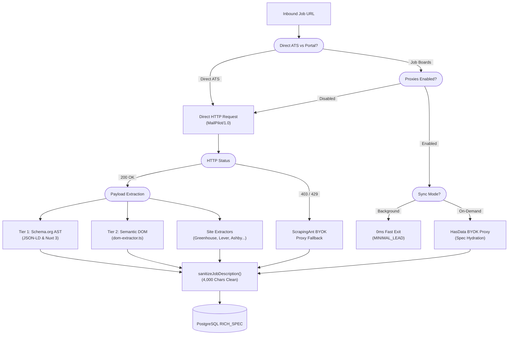

---

## 9. Polymorphic 4-Tier Card Design System

To ensure mathematical visual consistency and eliminate CSS drift across all settings surfaces, MailPilot enforces a 4-tier typographic matrix (`NESTED_CARD_TYPOGRAPHY`) codified in [`components/ui/tactile/nested-settings-card.tsx`](file:///Users/marqlott/desktop/mailpilot/components/ui/tactile/nested-settings-card.tsx):

```text
Level 1 (Section Container) : 16px Title (font-semibold) · 12px Subtitle · p-4 Container
  │
  └── Level 2 (Feature Sub-Card) : 14px Title (font-semibold) · 12px Subtitle · p-3.5 Sub-card
        │
        └── Level 3 (Numbered Step) : 13px Title (font-semibold) · 12px Subtitle · p-3.5 Body
              │
              └── Level 4 (Status & Telemetry) : 12px Title · 11px Monospace Subtitle · p-3.5 Card
```

### Component Hierarchy
- **`SettingsSectionCard` (Level 1):** The primary outer section card housing master feature toggles (`WaveToggle`) and curved corner arc dividers (`CurvedCardDivider`).
- **`SettingsFeatureCard` (Level 2):** Collapsible feature sub-cards sporting brand iconography (`CompanyLogo`), independent accordion controls, and real-time status badges (*Active*, *Key Needed*, *Disabled*).
- **`SettingsStepCard` (Level 3):** Numbered onboarding steps (e.g., Steps 1.1, 2.1 in Ollama Bridge) with dedicated action CTA buttons.
- **`SettingsStatusCard` (Level 4):** Inner live telemetry indicators with pulsing status pings and monospace endpoint readouts.

### Tactile UI Preferences Suite & Dual-Layer SSR Cookie Sync
MailPilot features a tactile control suite located in [`components/ui/tactile/`](file:///Users/marqlott/desktop/mailpilot/components/ui/tactile) and configured in [`components/features/settings/tactile-preferences/`](file:///Users/marqlott/desktop/mailpilot/components/features/settings/tactile-preferences):
- **`WaveToggle`:** Fluid sinusoidal SVG toggle switch with animated crest and trough wave transitions.
- **`WavySlider` & `WavyMeter`:** Continuous dynamic sinusoidal SVG meters for match score thresholds, inbox clutter filtering, and budget headroom visualization.
- **`SegmentedTabs`:** Tactile segmented tab rail with smooth sliding pill indicators.
- **Dual-Layer SSR Persistence ([`lib/utils/ui/`](file:///Users/marqlott/desktop/mailpilot/lib/utils/ui)):** User tactile selections (`mp_ui_tab_rail`, `mp_ui_wavy_meter`, `mp_ui_wave_toggle`, `mp_ui_rail_action`) are written synchronously to `localStorage` and durable browser cookies.
- **Zero Pre-Paint Hydration Layout Shift:** Next.js Server Components call `readServerTactilePreferences()` ([`lib/utils/ui/ui-preferences-server.ts`](file:///Users/marqlott/desktop/mailpilot/lib/utils/ui/ui-preferences-server.ts)) during SSR, ensuring tactile controls render on byte 0 without visual flicker, layout jumps, or React hydration mismatches.

---

## 10. Cryptography, Privacy & Security Guardrails

### 1. Authenticated Symmetric Encryption (AES-256-GCM)
All vaulted customer secrets and sensitive candidate metadata are encrypted at rest using Node.js `crypto` (`lib/core/crypto.ts`):
- **Cipher:** AES-256-GCM (Authenticated Encryption with Associated Data).
- **Key Derivation:** Master 64-character hexadecimal key (`TOKEN_ENCRYPTION_KEY`, 256-bit entropy).
- **Envelope Mechanics:** 12-byte cryptographically secure random Initialization Vector (IV) and 16-byte authentication tag generated per write.
- **Storage Envelope:** Persisted strictly as `iv:authTag:ciphertext` in PostgreSQL.

| Asset | Storage Target | Decryption Boundary | Masking / Protection |
| :--- | :--- | :--- | :--- |
| **Google OAuth Access & Refresh Tokens** | `Account.encryptedAccess`, `Account.encryptedRefresh` | Memory of serverless worker during delta sync / watch renewal | Plaintext never exposed to browser; automatic token refresh. |
| **Cloud LLM API Keys** | `AccountSettings.rules.encryptedApiKey`<br/>`PermanentSettings.rules.encryptedApiKey` | Decrypted per inference request in server memory | UI display mask: `sk-...[last4]`. Durable across inbox unlinks. |
| **Scraping Proxy Keys (HasData)** | `AccountSettings.rules.encryptedHasDataApiKey`<br/>`PermanentSettings.rules.encryptedHasDataApiKey` | Decrypted per scraping request in server memory | UI display mask: `hd-...[last4]`. Durable across inbox unlinks. |
| **Scraping Proxy Keys (ScrapingAnt)** | `AccountSettings.rules.encryptedScrapingAntApiKey`<br/>`PermanentSettings.rules.encryptedScrapingAntApiKey` | Decrypted per scraping request in server memory | UI display mask: `ant-...[last4]`. Durable across inbox unlinks. |
| **Ollama Bridge Secret Token** | `AccountSettings.rules.bridgeSecret` | Validated in memory during tunnel registration and disconnect | Ephemeral cryptographically random secret; verified with `timingSafeEqual`. |
| **Candidate Phone Number** | `UserProfile.phone` | Decrypted in server actions during profile editing / PDF export | Never serialized to unauthenticated API routes. |

* **Constant-Time Verification:** Secret tokens and hashes are validated using `crypto.timingSafeEqual` to eliminate side-channel timing attacks.

### 2. Durable Profile-Scoped Credential Persistence (`lib/profile/persistent-profile.ts`)
To eliminate credential loss and key fragmentation across inbox lifecycle events (such as unlinking a mailbox, re-authenticating expired Google OAuth tokens, or managing multiple inboxes under a single candidate identity), MailPilot decouples customer BYOK keys from transient inbox rows into a durable identity boundary:

- **Identity Anchor (`PersistentProfile` & `PermanentSettings`):**
  Each user is anchored to a durable `PersistentProfile` keyed to their Google identity (`googleSub` / primary email), backed by a 1-to-1 `PermanentSettings` record containing a profile-scoped `rules Json` store.
- **Service-Layer Orchestration ([`lib/services/api-keys.service.ts`](file:///Users/marqlott/desktop/mailpilot/lib/services/api-keys.service.ts), [`lib/services/settings-rules.service.ts`](file:///Users/marqlott/desktop/mailpilot/lib/services/settings-rules.service.ts)):**
  Instead of presentation components or route handlers directly mutating database models, mutations are routed through `app/actions/settings.ts`, validated against [`lib/validations/settings.schema.ts`](file:///Users/marqlott/desktop/mailpilot/lib/validations/settings.schema.ts), and delegated to dedicated domain services that manage encryption envelopes and dual persistence.
- **Dual-Persisted Key Synchronization (`persistProfileScopedRules`):**
  When a candidate configures or rotates credentials (Cloud LLM API keys: OpenRouter, OpenAI, Groq, DeepSeek, Anthropic, Gemini; or Web Scraping proxy keys: HasData, ScrapingAnt), credentials are synchronously vaulted to both `AccountSettings.rules` (active inbox) and `PermanentSettings.rules` (durable profile).
- **Inbox Reconnect & Multi-Inbox Immunity:**
  - Upon active account resolution (`getActiveAccount()` in `lib/data/accounts.data.ts`), `mergeRulesWithPermanentSettings()` automatically injects durable profile credentials into active sessions.
  - If a user unlinks, rotates, or re-links an inbox, all vaulted keys, models, and scraping quotas persist intact without requiring re-entry.

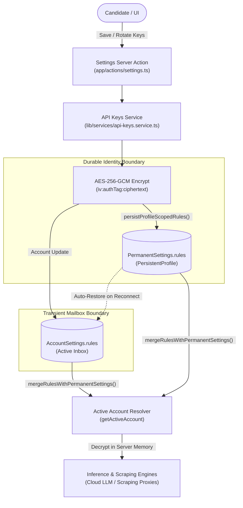

### 3. Hardened Server-Side Request Forgery (SSRF) Protection (`lib/core/ssrf.ts`)
MailPilot prevents internal network probing and cloud metadata extraction by performing DNS pre-resolution validation on all user-supplied and email-extracted URLs before dispatching HTTP requests:
- **Protocol Enforcement:** Strictly allows `http:` and `https:`. Rejects `file:`, `gopher:`, `ftp:`, and javascript schemes.
- **Blocked IP Ranges (Pre-Resolution Guardrails):**
  - **Loopback:** `127.0.0.0/8`, `::1`
  - **Private RFC 1918:** `10.0.0.0/8`, `172.16.0.0/12`, `192.168.0.0/16`
  - **AWS / Cloud Instance Metadata:** `169.254.169.254`
  - **Link-Local:** `169.254.0.0/16`, `fe80::/10`
  - **Carrier-Grade NAT:** `100.64.0.0/10`
  - **Broadcast & Reserved:** `0.0.0.0/8`, `240.0.0.0/4`, `255.255.255.255/32`

### 4. RFC 8058 One-Click Unsubscribe Engine (`lib/gmail/unsubscribe.ts`)
- Inspects email headers for `List-Unsubscribe` and `List-Unsubscribe-Post`.
- Dispatches an automated HTTP `POST` request with body `List-Unsubscribe=One-Click` in compliance with RFC 8058.
- Falls back to automated `mailto:` subject/body generation and batch Gmail label trash assignment.

---

## 11. Line-Addressable Resume Tailoring & Page Budgeting

Earlier resume tailoring architectures digested job specs and immediately froze the result into a static base64 PDF buffer. That legacy pattern created severe failure modes: individual bullets could not be edited, subsequent AI refinement passes drifted unrelated sections, and page length could not be guaranteed.

MailPilot resolves this through an end-to-end, vectorless **Line-Addressable Tailoring Pipeline** (`lib/tailor/`, `lib/resume-draft/`). By decoupling relevance scoring, physical point geometry, knapsack packing, and sentence reframing into discrete deterministic stages, MailPilot achieves strict 1-page Letter layout geometry, mathematical reproducibility, and 100% career agnosticism:

```mermaid
%%{init: {"themeVariables": {"fontSize": "12px", "fontFamily": "-apple-system, BlinkMacSystemFont, Segoe UI, sans-serif"}, "themeCSS": ".node text, .node foreignObject, .label foreignObject { overflow: visible !important; } .cluster text, .cluster-label span { overflow: visible !important; } .edgeLabel foreignObject { overflow: visible !important; } .edgeLabel span { padding: 0 4px; }", "flowchart": {"padding": 24, "nodeSpacing": 36, "rankSpacing": 44, "subGraphTitleMargin": {"top": 16, "bottom": 22}}}}%%
flowchart TD
  %% CLASS DEFINITIONS FOR ARCHITECTURAL DISTINCTIONS
  classDef candidate fill:#eff6ff,stroke:#3b82f6,stroke-width:2px,color:#1e3a8a;
  classDef job fill:#f5f3ff,stroke:#8b5cf6,stroke-width:2px,color:#4c1d95;
  classDef heuristic fill:#ecfdf5,stroke:#10b981,stroke-width:2px,color:#064e3b;
  classDef ai fill:#fff7ed,stroke:#f97316,stroke-width:2px,color:#7c2d12;
  classDef output fill:#f8fafc,stroke:#64748b,stroke-width:2px,color:#0f172a;

  subgraph Legend["ARCHITECTURAL DISTINCTION & BOUNDARY LEGEND"]
    direction LR
    LEG_CAND["Candidate Background Facts"]:::candidate
    LEG_JOB["Job Description Context"]:::job
    LEG_HEUR["Deterministic Heuristic / Math"]:::heuristic
    LEG_AI["AI / LLM Model Inference"]:::ai
    LEG_OUT["Final Layout Output"]:::output
  end

  subgraph Stage1["1. Context Distillation & Seniority Detection (distiller.ts)"]
    RAW_SPEC["<b>[JOB SPEC] Inbound Job Text & Reqs</b><br/>(Min 500 · Max 4,000 chars)"]:::job
    STOP["<b>[HEURISTIC] Stopword Scrubber</b><br/>Prune 65 Common Words (team, role...)"]:::heuristic
    TOKENS["<b>[HEURISTIC] Competency Distiller</b><br/>Extract Top 16 Distinctive Tokens"]:::heuristic
    SENIORITY["<b>[HEURISTIC] Seniority Classifier</b><br/>Regex Tiers: Exec · Staff · Senior · Early"]:::heuristic
    JTC["<b>[JOB SPEC] Standardized JobTargetContext</b>"]:::job

    RAW_SPEC --> STOP --> TOKENS
    RAW_SPEC --> SENIORITY
    TOKENS & SENIORITY --> JTC
  end

  subgraph Stage2["2. Hierarchical Profile Tree Grounding (tree.ts)"]
    MP[("<b>[CANDIDATE] MasterProfileInput</b><br/>Verified Ground Truth Facts")]:::candidate
    TREE["<b>[HEURISTIC] buildHierarchicalProfileTree()</b><br/>• Deterministic ID Binding (exp_0, proj_0)<br/>• Enforces Parent-Child Pointers<br/>• Eliminates Orphan Bullet Stranding"]:::heuristic

    MP --> TREE
  end

  subgraph Stage3["3. Hierarchical Matrix Ranker (ranker.ts)"]
    HEUR["<b>[HEURISTIC] Baseline Points Evaluator</b><br/>• Role Match: +2.0/token · Bullet Match: +2.0/token<br/>• Metric Bonus: +2.0 · Depth Bonus: +0.5 (>120 chars)<br/>• Recency Boost: +0.4 (Role 0) · +0.2 (Role 1)<br/>• Project Match: +3.0/token"]:::heuristic
    PRESORT["<b>[HEURISTIC] Pre-Sort & Windowing</b><br/>• Sort by Heuristic Score (Prunes Array Bias)<br/>• Windowing: Send Top 6 Projects (~4k chars vs 18k)"]:::heuristic
    LLM_RANK["<b>[AI / LLM] Matrix Ranker Model (Temp 0.1)</b><br/>Scores 4 Universal Agnostic Dimensions (1.0 - 5.0)<br/>(Alignment, Scope, Impact, Problem-Solving)"]:::ai
    BLEND["<b>[HEURISTIC] 50/50 Blended Relevance Score</b><br/>Relevance = 0.5*LLM + 0.5*Heuristic<br/><i>(Automatic 100% Heuristic Fallback if AI Offline)</i>"]:::heuristic

    JTC & TREE --> HEUR
    HEUR --> PRESORT
    PRESORT --> LLM_RANK
    LLM_RANK & HEUR --> BLEND
  end

  subgraph Stage4["4. Competitive Knapsack Assembler (assembler.ts)"]
    INVARIANTS["<b>[HEURISTIC] Seed Baseline Invariants</b><br/>• Invariant 1: Seed 1 Top Bullet from Primary Role<br/>• Continuity: Seed Secondary Role if Score >= 2.5<br/>• Invariant 2: Seed 1 Top Bullet from Primary Project"]:::heuristic
    KNAPSACK["<b>[HEURISTIC] Knapsack Value-Density Packing</b><br/>• Decay Matrix: DECAY = [1.00, 0.85, 0.65, 0.45]<br/>• Density = (Score * Decay) / Marginal Physical Points<br/>• Physical Ceiling: 720pt (960px) Safe Boundary"]:::heuristic
    HEADROOM["<b>[HEURISTIC] Dynamic Headroom Backfill</b><br/>• Absorbs 10-15% Bottom Margin Gap<br/>• Single-Page Cap: 12 Bullets (w/ Summary), 14 (w/o)<br/>• Two-Page Cap: 24 Bullets"]:::heuristic

    BLEND --> INVARIANTS --> KNAPSACK --> HEADROOM
  end

  subgraph Stage5["5. Dual-Mode Google XYZ Reframing (reframe.ts)"]
    REFRAME["<b>[AI / LLM] executeBulletReframe()</b><br/>• 1:1 ID Tracking (Reframes ONLY Selected Bullets)<br/>• Target Length: 16 to 34 Words per Bullet<br/>• 60-70% Core Formula: Verb + Metric + Method"]:::ai
    MODEA["<b>[HEURISTIC / AI] Mode A: Strict Preservation</b><br/>(inventMetrics: false · Zero Numbers Invented)"]:::heuristic
    MODEB["<b>[AI / LLM] Mode B: Metric Synthesis</b><br/>(inventMetrics: true · Calibrated to Seniority)"]:::ai
    STRIP["<b>[HEURISTIC] Preamble Artifact Scrubber</b><br/>Purges 'Reframed as:' and wrapping quotes"]:::heuristic

    HEADROOM --> REFRAME
    REFRAME -->|"inventMetrics: false"| MODEA
    REFRAME -->|"inventMetrics: true"| MODEB
    MODEA & MODEB --> STRIP
  end

  subgraph Stage6["6. Physical Layout SSOT & Atomic Page Splitting (layout.schema.ts)"]
    DRAFT[("<b>[OUTPUT] TailoredResumeDraft JSON Tree</b><br/>Line-Addressable Node Representation")]:::output
    PREVIEW["<b>[HEURISTIC] Web Preview Sheet (components/features/opportunities/drawer/resume-draft-sheet.tsx)</b><br/>• Look-Ahead getEntityTotalHeight() Evaluation<br/>• Option 1: Advances Whole Entity to Next Page<br/>• Reactive Role Grouping on Dynamic Resize"]:::output
    CLAMP["<b>[HEURISTIC] clampPdfContentToPhysicalCeiling()</b><br/>Identical 720pt (960px) Physical Ceiling Clamp"]:::output
    PDF["<b>[OUTPUT] React-PDF Export (pdf-generator.tsx)</b><br/>• wrap={false} Containers on Roles, Projects & Degrees<br/>• Standardized 8pt/10pt Geometry & Right-Aligned Dates"]:::output
    DOCX["<b>[OUTPUT] compileResumeDocx (resume-docx.ts)</b><br/>Native OpenXML Document Architecture"]:::output

    STRIP --> DRAFT
    DRAFT --> PREVIEW
    DRAFT --> CLAMP
    CLAMP --> PDF
    CLAMP --> DOCX
  end
```

---

### 11.1 Stage 1: Context Distillation & Seniority Detection (`lib/tailor/distiller.ts`)

Before triggering LLM inference or ranking algorithms, raw job specifications and requirements are sanitized and normalized into a structured `JobTargetContext`:
- **65-Word Common Stopword Purge (`COMMON_STOP_WORDS`):** Strips generic English function words and job description filler (*"responsible"*, *"seeking"*, *"experienced"*, *"looking"*, *"team"*, *"company"*, *"role"*, *"knowledge"*).
- **Core Competency Extraction (`extractCompetencyTokens`):** Identifies distinct technical and operational keywords, preserving domain-specific short tokens (e.g., `c`, `r`, `go`, `ci`, `cd`) while extracting the **top 16 core competencies** for downstream lexical matching.
- **Implicit Seniority Expectation Engine (`detectSeniorityExpectation`):** Analyzes the role title and the first 500 characters of the job text to classify target seniority across 5 standardized tiers:
  1. `Executive / Director`: Matches `director`, `vp`, `vice president`, `executive`, `chief`, `head of`.
  2. `Staff / Principal`: Matches `staff`, `principal`, `distinguished`.
  3. `Lead / Manager`: Matches `lead`, `manager`, `tech lead`.
  4. `Senior`: Matches `senior`, `sr.`.
  5. `Early Career / Entry`: Matches `intern`, `internship`, `co-op`, `entry`, `associate`, `junior`, `jr.`.
  *Fallback:* Defaults neutrally to `Mid-Level Professional`.

---

### 11.2 Stage 2: Hierarchical Profile Tree Grounding (`lib/tailor/tree.ts`)

Conventional resume generators pass loose arrays of bullets into prompts, leading to parent identity confusion, orphan bullets, and hallucinated experience mappings. MailPilot converts candidate facts into a strict **Hierarchical Profile Tree (`HierarchicalProfileTree`)**:
- **Deterministic Identity Addressing:** Each entity receives an immutable deterministic ID (`exp_0`, `exp_1`, `proj_0`, `proj_1`).
- **Bound Child Bullets:** Every bullet is explicitly namespaced to its parent container (`exp_0_b0`, `exp_0_b1`, `proj_0_b0`), retaining its `originalId`, `hasMetric` flag, and parsed `technologies`.
- **Zero Orphan Guarantee:** Downstream algorithms never manipulate disconnected strings; selection and reframing operate strictly on bound parent-child pointers.

---

### 11.3 Stage 3: Hierarchical Matrix Ranker (`lib/tailor/ranker.ts`)

To balance LLM semantic evaluation with deterministic grounding, candidate experiences and projects are scored across **4 Universal Career-Agnostic Dimensions**:
1. *Functional & Domain Alignment:* Direct crossover of candidate methods, credentials, or competencies to target role duties.
2. *Scope, Scale & Responsibility:* Magnitude of autonomy, operational footprint, or team/program leadership.
3. *Measurable Impact & Outcomes:* Tangible verified results, efficiency gains, compliance standards, or quantitative outcomes.
4. *Problem-Solving & Operational Rigor:* Critical thinking, incident resolution, risk mitigation, or quality control.

#### 1. Deterministic Heuristic Scoring Baseline (`heuristicRankProfile`)
When LLMs are offline or to provide a baseline anchor, MailPilot calculates relevance mathematically:
- **Work Experience Scoring:**
  - Role Title Token Match: `+2.0` points per matching core competency token found in `${role} ${company}`.
  - Bullet Token Match: `+2.0` points per matching token found in bullet text and technologies.
  - Bullet Metric Bonus: `+2.0` points if `hasMetric: true` and the bullet matches target competencies.
  - Bullet Depth Bonus: `+0.5` points if bullet text length $> 120$ characters.
  - Recency Boost: `+0.4` points for primary role (index 0), `+0.2` points for secondary role (index 1).
  - Normalization Formula:
    $$\text{Score}_{\text{exp}} = \min\left(5.0, \max\left(1.0, 1.5 + \frac{\text{totalMatches}}{6} + \text{RecencyBoost}\right)\right)$$
- **Project Scoring:**
  - Project Title & Tech Token Match: `+3.0` points per matching token in name, description, or technologies.
  - Bullet Token Match: `+2.0` points per matching token in bullet text.
  - Bullet Metric Bonus: `+2.0` points if `hasMetric: true`.
  - Normalization Formula:
    $$\text{Score}_{\text{proj}} = \min\left(5.0, \max\left(1.0, 1.5 + \frac{\text{pScore}}{4}\right)\right)$$

#### 2. LLM Array-Index Bias Elimination
LLMs exhibit severe positional bias: candidates placed first in prompt arrays receive artificially elevated ratings. To eliminate this:
- Experiences and projects are pre-sorted by their heuristic scores before generating the prompt payload.
- Only the **top 6 candidate projects** are included in the prompt, shrinking the prompt payload from $\sim 18,000$ characters down to $\sim 4,000$ characters, eliminating context degradation and truncation timeouts.

#### 3. 50/50 Blended Relevance Scoring
To prevent single-turn LLM hallucinations from discarding crucial experiences, the engine computes a 50/50 blended score:
$$\text{Relevance} = 0.5 \times \text{Score}_{\text{LLM}} + 0.5 \times \text{Score}_{\text{Heuristic}}$$

---

### 11.4 Stage 4: Competitive Knapsack Assembler & Headroom Backfill (`lib/tailor/assembler.ts`)

Once relevance scores are calculated, MailPilot deterministically selects the optimal bullet combination using an elastic knapsack algorithm constrained by physical typography point geometry (`lib/resume-draft/physics.ts`):

#### Physical Point Geometry Constants
- `HEIGHT_CONSTANTS.SECTION_HEADING`: **28pt** (37.33px)
- `HEIGHT_CONSTANTS.ENTITY_HEADER`: **18pt** (24px)
- `estimateBulletHeightPoints(text)`: $\lceil \text{text.length} / 90 \rceil \times 13.5\text{pt} + 2\text{pt}$ (line height + vertical spacing)
- Safe Printable Page Ceiling: **720pt** (960px)

#### Baseline Invariants (Guaranteed Anchor Slots)
- **Invariant 1 (Experience Anchor):** Seeds the #1 top bullet from the highest-ranked experience role.
- **Multi-Role Continuity Invariant:** If a secondary experience role has a relevance score $\ge 2.5$, its top bullet is automatically seeded provided it fits within an 80pt headroom cushion. This ensures multi-company career histories are not falsely collapsed into a single role.
- **Invariant 2 (Project Anchor):** Seeds the #1 top bullet from the highest-ranked portfolio project.

#### Diminishing Marginal Returns & Value-Density Metric
As additional bullets are added to the same role or project, their marginal value decays to encourage cross-entity breadth:
$$\text{DECAY} = [1.00, 0.85, 0.65, 0.45]$$

Each candidate bullet's base priority score is computed:
$$\text{Score} = \text{EntityScore} \times 10 - \text{AuxiliaryPenalty}(20) + \text{PriorSelectionBonus}(30) + \text{TopBulletBonus}(15) + \text{MetricBonus}(6) + 0.5 \times (N - \text{idx})$$
*(where AuxiliaryPenalty applies strictly to activity/volunteer categories)*

Candidate bullets are packed by value density:
$$\text{Density} = \frac{\text{Score} \times \text{Decay}(\text{count})}{\max(1, \text{Added Physical Points})}$$

#### Dynamic Headroom Backfill
Physical knapsack packing often leaves a 10–15% whitespace gap at the bottom of the page. The Dynamic Headroom Backfill loop absorbs this remaining capacity with the highest-scoring surviving bullets until hitting strict capacity ceilings:
- **Single-Page Target:** Hard-capped at **12 bullets** (if executive summary included) or **14 bullets** (if summary excluded).
- **Two-Page Target:** Hard-capped at **24 bullets**.

---

### 11.5 Stage 5: Dual-Mode Google XYZ Bullet Reframing (`lib/tailor/reframe.ts`)

Surviving bullets are reframed into Google's core XYZ structural format:
$$\text{[Strong Action Verb]} + \text{[Quantifiable Impact / Scope / Metric]} + \text{[Method / Technical Approach]}$$
*("Accomplished [X] as measured by [Y] by doing [Z]")*

- **Target Word Count:** Enforces concise, punchy bullets strictly between **16 and 34 words**.
- **1:1 Bullet ID Tracking:** Maintains exact ID parity between inputs and outputs, preventing loss of lines.
- **Mode A: Strict Metric Preservation (`inventMetrics: false`):**
  - All existing numbers, percentages, latencies, and dollar amounts are preserved verbatim.
  - Bullets lacking numbers are never left in raw form; they are restructured around qualitative operational scope, problem-solving impact, and procedural rigor.
- **Mode B: Believable Metric Synthesis (`inventMetrics: true`):**
  - Synthesizes modest, realistic metrics calibrated strictly to candidate seniority across 4 universal impact dimensions:
    1. *Efficiency & Velocity:* Turnaround time reduction (~10–20%), cycle speedup.
    2. *Quality & Accuracy:* Verification accuracy (98%+), compliance rates.
    3. *Volume & Throughput:* Records, units, or stakeholders coordinated.
    4. *Satisfaction & Adoption:* Feedback scores, workflow adoption rate.
- **Conversational Artifact Scrubber (`sanitizeReframedBulletText`):** Automatically strips small-model conversational preamble (e.g., `Reframed as: "..."`, `Here is the revised bullet:`).

---

### 11.6 Stage 6: Physical Layout SSOT & Atomic Page Splitting (`lib/resume-draft/layout.schema.ts`)

To eliminate visual desynchronization between web previews, PDF exports, and Word documents, MailPilot codifies all physical metrics in a Single Source of Truth ([`lib/resume-draft/layout.schema.ts`](file:///Users/marqlott/desktop/mailpilot/lib/resume-draft/layout.schema.ts), `RESUME_PAGE_GEOMETRY`, `RESUME_TYPOGRAPHY`, `RESUME_SPACING`). All node mutations and draft transformations are orchestrated through [`lib/services/opportunity-draft.service.ts`](file:///Users/marqlott/desktop/mailpilot/lib/services/opportunity-draft.service.ts):

| Element | Point Specification (PDF / Print) | Pixel Specification (CSS / Web Preview) |
| :--- | :--- | :--- |
| **Physical Page Dimensions** | `612pt × 792pt` (US Letter) | `816px × 1056px` |
| **Outer Margins** | `24pt` top/bottom, `24pt` left/right | `32px` top/bottom, `32px` left/right |
| **Safe Printable Ceiling** | **`720pt`** | **`960px`** |
| **Section Heading** | `10.0pt` Bold · Line Height: `1.20` | `13.33px` Bold · Margin Bottom: `4px` |
| **Role / Project Title** | `9.5pt` Bold · Line Height: `1.20` | `12.67px` Bold · Gap: `10.67px` |
| **Body & Bullets** | `8.5pt` Regular · Line Height: `1.35` | `11.33px` Regular · Bullet Spacing: `2.67px` |
| **Contact Line** | `8.0pt` Regular · Line Height: `1.25` | `10.67px` Regular |

#### Option 1: Strict Role & Project Atomicity
When multi-page documents transition across the page seam, slicing mid-role leaves orphaned headers or disconnected bullets. MailPilot enforces **Strict Role & Project Atomicity** across both targets:
1. **React-PDF Generator (`lib/document/pdf-generator.tsx`):**
   - Applies `<View wrap={false}>` containers around each work experience role, project card, and education row. React-PDF automatically moves the entire entity to Page 2 whenever it cannot fit on Page 1.
2. **Web Preview Sheet ([`components/features/opportunities/drawer/resume-draft-sheet.tsx`](file:///Users/marqlott/desktop/mailpilot/components/features/opportunities/drawer/resume-draft-sheet.tsx)):**
   - **Proactive Look-Ahead (`getEntityTotalHeight`):** When encountering a role or project header, the partitioner calculates the total height of the header plus all its child bullets. If the full entity exceeds the remaining printable height (`PRINTABLE_HEIGHT = 960px`) but fits on a clean page, the entire entity is advanced to Page 2.
   - **Reactive Role Grouping:** If dynamic DOM height measurement causes a bullet to overflow, the partitioner pulls the parent header and all preceding bullets of that role forward onto the new page rather than slicing mid-role.
3. **Clamping Parity (`clampPdfContentToPhysicalCeiling`):**
   - Applies physical point budget clamping to `draft.nodes` during draft digest, guaranteeing that the web preview and PDF export receive the exact same projects and bullets.
4. **Dispatched PDF Download Parity (`downloadTailoredPdfAction`):**
   - Directly renders the stored `tailoredResumeData.draft` using `renderDraftPdf`, guaranteeing that what the user reviewed in the drawer sheet is byte-for-byte identical to the downloaded PDF.

---

### 11.7 Stage 7: Offline Master Profile Export (Zero LLM Overhead)

Candidates can export their complete, canonical Master Profile at any time without triggering LLM calls or paying inference tokens:
- **Comprehensive Unpruned Document:** In contrast to job-tailored drafts which adhere to 1-page Letter budgeting, the Master Profile export includes 100% of the candidate's work experiences, projects, credentials, skill groups, honors, and interests in an unpruned, natural multi-page flow.
- **Server Action Architecture (`exportMasterProfilePdfAction`):** Loads the account's master profile via `loadMasterProfileForDraft(accountId)` (`lib/profile/master-profile.ts`) and routes directly into `@react-pdf/renderer` via `generateTailoredResumePdf()`.
- **Contact Line Sanitization:** Utilizes `buildResumeContactLine(profile)` to format an authentic, single-line contact bar and eliminate rogue technical skills or unverified links from header rows.
- **Instant Client-Side Delivery:** Converts the returned base64 binary buffer into an ephemeral client-side Blob stream for immediate download (`<Name>_Master_Profile.pdf`).

---

### 11.8 Stage 8: Dual-Mode Section Ordering Engine (`resolveSectionOrder`)

Controls the macroscopic hierarchy of the tailored resume through two distinct behavioral modes:
- **`AI_OPTIMAL` Mode:**
  - Evaluates candidate facts using `isCareerSwitcherOrEarlyTenure` ($\le 2$ years in target field or non-traditional background).
  - Career switchers and students automatically receive `CAREER_SWITCHER_SECTION_ORDER` (`summary` $\to$ `skills` $\to$ `projects` $\to$ `experience` $\to$ `education` $\to$ `certifications`), elevating practical portfolio work above out-of-field employment.
  - Experienced professionals automatically receive `DEFAULT_SECTION_ORDER` (`summary` $\to$ `skills` $\to$ `experience` $\to$ `projects` $\to$ `education` $\to$ `certifications`), keeping industry track records at the top.
- **`MANUAL` Mode:**
  - Strictly follows the user's custom section ordering specified in `rules.resumePreferences.sectionOrder` or `draftOverrides.sectionOrder`.

---

## 12. Performance, Systems Optimization & Telemetry

### Zero-Flicker Tab State Persistence & SSR Cookie Alignment
- **Problem:** Full page refreshes previously reset navigation tabs back to the default tab (`leads` in Opportunities, `accounts` in Settings), and client-only state hydration produced visual flash and delayed First Contentful Paint (FCP).
- **Dual-Layer Account-Scoped Persistence ([`lib/utils/navigation/page-tabs.ts`](file:///Users/marqlott/desktop/mailpilot/lib/utils/navigation/page-tabs.ts)):** Active tab selections are instantly synchronized to both account-scoped `localStorage` (`mp_tab_<account>_<page>`) and a durable cookie (`mp_active_tab_<page>`).
- **Server-Side Rendering (SSR) Alignment ([`lib/utils/navigation/page-tabs-server.ts`](file:///Users/marqlott/desktop/mailpilot/lib/utils/navigation/page-tabs-server.ts)):** Server Components call `readServerActivePageTab()` to read the active cookie during initial SSR, rendering the user's exact active tab markup on byte 0 with zero layout shift or hydration mismatch.
- **Dual-Layer Tactile UI Cookie Hydration ([`lib/utils/ui/ui-preferences-server.ts`](file:///Users/marqlott/desktop/mailpilot/lib/utils/ui/ui-preferences-server.ts)):** Server components call `readServerTactilePreferences()` to ingest active tactile settings (`mp_ui_tab_rail`, `mp_ui_wavy_meter`, `mp_ui_wave_toggle`, `mp_ui_rail_action`) during SSR pre-paint, eliminating visual flicker on fluid controls.
- **Lazy-Mounted Settings Tabs:** Inactive settings tabs are lazy-mounted on demand rather than eagerly evaluated, reducing initial HTML document payload by ~40% and eliminating render lag on tab refresh.

### Media Streaming & Perceived Latency (Auth Portal)
- **Problem:** Object-stored background video assets introduced a 2–3s blank pop-in and delayed First Contentful Paint (FCP) due to trailing container metadata (`moov` atom at EOF) and cold-start latency.
- **Fast-Start Container Relocation (`movflags +faststart`):** Hoisted the MP4 container index to byte 36 via `ffmpeg` using stream copy (`-c copy`), enabling progressive HTTP 206 range-request streaming without awaiting the full payload buffer.
- **Zero-Latency Poster Ingestion:** Extracted an ultra-compact (~18 KB) WebP poster frame from frame 0, rendering immediately on byte 0 to eliminate initial layout shift (CLS).
- **Container Stream Optimization & Quality Preservation:** Preserved native 4K video frames without lossy re-encoding, retaining vivid color reproduction while eliminating container buffering lag.
- **Event-Driven Cross-Fade:** Synchronized HTML5 `onCanPlay` with CSS opacity transitions, providing a zero-flicker handoff from static poster to looping background video.

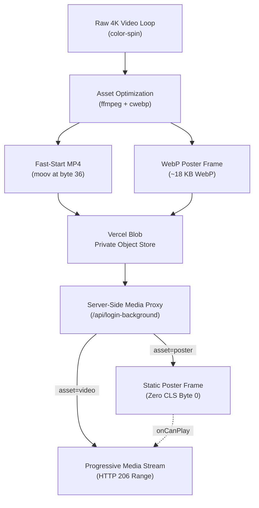

### Edge Bot Mitigation & Token-Bucket Rate Limiting
- **Vercel Edge Route Mitigation (`vercel.json`):** Intercepts incoming requests at Vercel's global edge network layer prior to invoking serverless compute. Evaluates request headers against automated crawler/script patterns (`curl`, `wget`, `python`, `postman`, `axios`, `go-http-client`) across sensitive authentication paths (`^/(login|api/auth/.*)`), applying `mitigate.action: "deny"` to reject bot traffic with 0ms serverless function execution—fully compatible with Vercel Hobby tier constraints.
- **Token Bucket Algorithm (`lib/core/ratelimit.ts`):** Accommodates legitimate burst traffic up to bucket capacity (30 tokens for general API endpoints, 5 tokens for mutating actions) while refilling deterministically (10 tokens every 10 seconds for API, 1 token every 12 seconds for sensitive actions) to protect public routes and prevent serverless execution exhaustion.
- **Stateless HTTP REST (`@upstash/redis`):** Bypasses TCP socket pool exhaustion, lifecycle leaks, and connection-handshake latency on Vercel Hobby serverless functions by issuing rate limit queries over stateless HTTP REST pipelines.
- **Fail-Open Dev Isolation:** Unblocks local offline development workflows when Redis credentials are not configured, and gracefully degrades during third-party connectivity hiccups to prevent operational downtime.

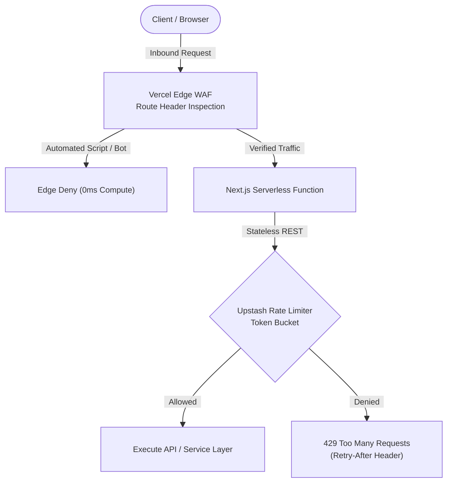

---

## 13. Technology Stack Matrix

### Mail Pilot + Companion Architecture (Chrome Extension v1.0.0)

MailPilot extends its career telemetry pipeline directly into the candidate's browser via **Mail Pilot + Companion** ([`extension/`](file:///Users/marqlott/desktop/mailpilot/extension)):
- **Platform:** Google Chrome Extension Manifest V3 utilizing the modern Chrome Side Panel API (`chrome.sidePanel`).
- **UI & Build System:** Built with React 19, TypeScript, and Tailwind CSS, bundled with Vite 8 (`extension/vite.config.ts`) into a standalone distribution bundle (`extension/dist/`).
- **Packaging & Distribution Pipeline:** Compiled and archived via `node scripts/package-extension.mjs` into `mailpilot-extension.zip` at the repository root and copied to `public/downloads/mailpilot-extension.zip` for instant web downloads.
- **Client-Side Metadata Extractor (`extension/src/extractor.ts`):** Injected content script executing non-destructive DOM scans for Schema.org JSON-LD microdata and custom DOM selector trees across LinkedIn, Greenhouse, Lever, Ashby, Workday, Indeed, and Glassdoor.
- **Dedicated Extension Endpoints:** Direct communication with the Next.js serverless backend over typed REST endpoints authenticated via session cookies (`credentials: "include"`):
  - `POST /api/extension/session`: Active session verification and candidate persona synchronization.
  - `POST /api/extension/tailor`: End-to-end 1-page/2-page knapsack resume tailoring stream.
  - `POST /api/extension/draft/node`: Granular bullet toggle mutations and inline rewrites.
  - `POST /api/extension/draft/refine`: On-demand bullet synthesis and AI reframing.
  - `POST /api/extension/draft/reorder`: Tactile bullet drag re-indexing.
  - `POST /api/extension/export`: Direct PDF and DOCX document compiling.
  - `GET /api/extension/download`: Streaming binary download endpoint for `mailpilot-extension.zip`.

### Enterprise Technology Stack

| Layer | Technology | Version / Specification | Architectural Responsibility |
| :--- | :--- | :--- | :--- |
| **Framework** | **Next.js** | 15.5+ (App Router, Server Actions) | Unified web framework with React 19 Server Components, Route Handlers, and `after()`. |
| **Serverless Runtime** | **Node.js** | v20+ on Vercel Serverless | Non-blocking background worker execution using Next.js 15 `after()`. |
| **Edge Infrastructure** | **Vercel Edge WAF** | Managed Edge Firewall / Route Rules | Edge-level bot mitigation and header deny rules on sensitive auth routes (`^/(login\|api/auth/.*)`). |
| **Rate Limiting & Security** | **Upstash Redis** | `@upstash/ratelimit` & `@upstash/redis` | Serverless token-bucket rate limiting via stateless HTTP REST with fail-open isolation. |
| **Database** | **PostgreSQL** | v16 (Neon / Supabase) | Multi-tenant relational persistence with connection pooling. |
| **ORM** | **Prisma** | v6.19+ | Type-safe query building, relation mapping, and migrations. |
| **Object Storage** | **Vercel Blob** | `@vercel/blob` v2.8 | Private object store for progressive HTTP 206 background video streaming and WebP poster delivery. |
| **Cloud Messaging & APIs** | **Google Cloud Pub/Sub** | `googleapis` v178 | Asynchronous webhook push notifications for mailbox deltas and RFC 8058 unsubscribe automation. |
| **Schema Validation** | **Zod** | v4 | Runtime boundary validation for webhook payloads, LLM structured JSON, and extensible account rules. |
| **Design System** | **Tailwind CSS / Radix** | Tailwind v3.4, Radix UI | Mobile-first responsive design, 4-tier typographic scale, tactile wave controls, Lucide icons. |
| **Drag & Drop** | **Custom Pointer Engine** | Zero-dependency RAF Lerp loop | 3-zone vertical deadzone, floating 3D ghost stack, edge auto-paging bumpers, 60fps hardware-accelerated transforms. |
| **Cryptography** | **Node.js Crypto** | AES-256-GCM / timingSafeEqual | Authenticated envelope encryption at rest; timing-safe secret comparisons. |
| **Document Compilers** | **React-PDF & JSZip** | `@react-pdf/renderer` v4 | Dynamic vector PDF rendering and binary `.docx` XML generation. |
| **Inference Router** | **Multi-Provider BYOK** | Local Ollama + Cloud REST | Multi-tier failover: Zero-clone Ollama (Quick Tunnel) $\to$ OpenRouter $\to$ `PENDING_AI` parking. |
| **Scraping & Parsing** | **Custom AST & JSON Parsers** | Schema.org JSON-LD, Nuxt 3 AST, Semantic DOM | Anti-bot spec extraction, Nuxt state un-flattening, LinkedIn Guest API, HasData/ScrapingAnt proxies. |
| **Logging & Telemetry** | **Pino & TableLogger** | Pino v10 + 66-col ASCII | Structured JSON logging in production; formatted ASCII telemetry in dev. |
| **Browser Extension** | **Mail Pilot + Companion** | Chrome MV3 · React 19 + Vite 8 | Native Side Panel API, client-side listing extraction, real-time tailoring, and pagination engine. |
| **Testing** | **Vitest** | v4.1 (Zero-Token Mocks) | Deterministic, offline unit and integration test suite (677+ tests passing). |

---

## 14. Test Suite, Verification & Local Development

### Deterministic Test Suite
MailPilot maintains a comprehensive, zero-token test suite using **Vitest**. All tests execute completely offline without network calls or live database dependencies:

```bash
# Run the complete test suite (51 test files, 677+ tests)
npx vitest run

# Run tests in interactive watch mode
npm run test:watch

# Execute strict TypeScript typecheck
npx tsc --noEmit
```

```text
 ✓ lib/ai/__tests__/classification-normalizer.test.ts (16 tests)
 ✓ lib/ai/__tests__/email-cleaner.test.ts (12 tests)
 ✓ lib/ai/__tests__/llm-ratelimit.test.ts (4 tests)
 ✓ lib/ai/__tests__/llm-vault.test.ts (15 tests)
 ✓ lib/ai/__tests__/local-ollama-circuit.test.ts (18 tests)
 ✓ lib/ai/__tests__/prefilter.test.ts (29 tests)
 ✓ lib/ai/__tests__/salary.test.ts (14 tests)
 ✓ lib/core/__tests__/account-encryption.test.ts (7 tests)
 ✓ lib/core/__tests__/crypto.test.ts (2 tests)
 ✓ lib/core/__tests__/ratelimit.test.ts (9 tests)
 ✓ lib/core/__tests__/ssrf.test.ts (3 tests)
 ✓ lib/document/__tests__/experience-heading.test.ts (4 tests)
 ✓ lib/document/__tests__/pdf-spacing-render.test.ts (1 test)
 ✓ lib/github/__tests__/github-metrics.test.ts (8 tests)
 ✓ lib/github/__tests__/github-sync.test.ts (80 tests)
 ✓ lib/logging/__tests__/table-logger.test.ts (15 tests)
 ✓ lib/matching/__tests__/matching.test.ts (8 tests)
 ✓ lib/opportunities/context/__tests__/dom-extractor.test.ts (22 tests)
 ✓ lib/opportunities/context/__tests__/hasdata.test.ts (6 tests)
 ✓ lib/opportunities/context/__tests__/html-markdown.test.ts (10 tests)
 ✓ lib/opportunities/context/__tests__/job-context.test.ts (28 tests)
 ✓ lib/opportunities/context/__tests__/json-ld.test.ts (53 tests)
 ✓ lib/opportunities/context/__tests__/section-classifier.test.ts (14 tests)
 ✓ lib/opportunities/sync/__tests__/jobleads-flow.test.ts (6 tests)
 ✓ lib/opportunities/sync/__tests__/jobleads.test.ts (5 tests)
 ✓ lib/persona/__tests__/persona.test.ts (3 tests)
 ✓ lib/profile/__tests__/deduplication.test.ts (43 tests)
 ✓ lib/profile/__tests__/dev-resume-cache.test.ts (3 tests)
 ✓ lib/profile/__tests__/master-profile-export.test.ts (4 tests)
 ✓ lib/profile/__tests__/persistent-profile.test.ts (7 tests)
 ✓ lib/profile/__tests__/resume-cached-versions.test.ts (5 tests)
 ✓ lib/profile/__tests__/resume-reconciliation-run.test.ts (10 tests)
 ↓ lib/profile/__tests__/temp-resume-llm-audit.test.ts (1 test | 1 skipped)
 ✓ lib/resume-draft/__tests__/resume-draft-sheet-pagination.test.ts (7 tests)
 ✓ lib/resume-draft/__tests__/resume-draft.test.ts (56 tests)
 ✓ lib/scraping/__tests__/hasdata-usage.test.ts (9 tests)
 ✓ lib/scraping/__tests__/scrapingant.test.ts (6 tests)
 ✓ lib/tailor/__tests__/tailor.test.ts (28 tests)
 ✓ lib/utils/__tests__/bridge-scripts.test.ts (2 tests)
 ✓ lib/utils/__tests__/company-logo.test.ts (11 tests)
 ✓ lib/utils/__tests__/format-distance.test.ts (7 tests)
 ✓ lib/utils/__tests__/format-status-pill.test.ts (4 tests)
 ✓ lib/utils/__tests__/location.test.ts (9 tests)
 ✓ lib/utils/extension/__tests__/extension-api.test.ts (12 tests)
 ✓ lib/utils/extension/__tests__/extractor.test.ts (18 tests)
 ✓ lib/utils/navigation/__tests__/page-tabs.test.ts (11 tests)
 ✓ lib/utils/navigation/__tests__/settings-accordion.test.ts (6 tests)
 ✓ lib/utils/ui/__tests__/ui-preferences.test.ts (18 tests)
 ✓ app/api/account/sync-status/__tests__/route.test.ts (4 tests)
 ✓ app/api/login-background/__tests__/route.test.ts (6 tests)
 ✓ app/api/ollama/verify/__tests__/route.test.ts (5 tests)

Test Files  50 passed | 1 skipped (51)
     Tests  677 passed | 6 skipped (683)
  Duration  12.28s
```

### Next.js Production Build & Static Page Generation
MailPilot executes a zero-error Next.js 15 production build with verified static route optimization:

```text
 ✓ Generating static pages (19/19)
 Route (app)                                 Size  First Load JS
 ┌ ƒ /                                     3.8 kB         173 kB
 ├ ƒ /_not-found                             1 kB         103 kB
 ├ ƒ /api/account/sync-status               193 B         103 kB
 ├ ƒ /api/auth/callback/google              193 B         103 kB
 ├ ƒ /api/auth/google                       193 B         103 kB
 ├ ƒ /api/bridge/mac                        193 B         103 kB
 ├ ƒ /api/bridge/win                        193 B         103 kB
 ├ ƒ /api/cron/renew-watch                  193 B         103 kB
 ├ ƒ /api/cron/sync                         193 B         103 kB
 ├ ƒ /api/extension/download                193 B         103 kB
 ├ ƒ /api/extension/draft/node              193 B         103 kB
 ├ ƒ /api/extension/draft/refine            193 B         103 kB
 ├ ƒ /api/extension/draft/reorder           193 B         103 kB
 ├ ƒ /api/extension/export                  193 B         103 kB
 ├ ƒ /api/extension/session                 193 B         103 kB
 ├ ƒ /api/extension/tailor                  193 B         103 kB
 ├ ƒ /api/gmail/message                     193 B         103 kB
 ├ ƒ /api/login-background                  193 B         103 kB
 ├ ƒ /api/ollama/dev-models                 193 B         103 kB
 ├ ƒ /api/ollama/verify                     193 B         103 kB
 ├ ƒ /api/profile/history                   193 B         103 kB
 ├ ƒ /api/settings/ollama-bridge            193 B         103 kB
 ├ ƒ /api/subscriptions/digest              193 B         103 kB
 ├ ƒ /api/subscriptions/digest/delete       193 B         103 kB
 ├ ƒ /api/webhooks/gmail                    193 B         103 kB
 ├ ƒ /jobs                                35.4 kB         295 kB
 ├ ƒ /login                               2.67 kB         141 kB
 ├ ƒ /settings                              180 kB         426 kB
 └ ƒ /subscriptions                       40.5 kB         250 kB
```

### Prerequisites
- **Node.js:** v20.0.0 or higher
- **npm:** v10.0.0 or higher
- **PostgreSQL:** v15+ instance (local or hosted on Neon / Supabase)
- **Google Cloud Platform:** Project with Gmail API and Cloud Pub/Sub enabled
- **Upstash Redis:** (Optional) Serverless Redis instance for token-bucket rate limiting

### Local Setup Instructions

1. **Clone the repository and install dependencies:**
   ```bash
   git clone https://github.com/Marqlo-C/MailPilot.git
   cd MailPilot
   npm install
   ```

2. **Configure environment variables:**
   ```bash
   cp .env.example .env.local
   ```
   Populate `.env.local` using the environment configuration table below.

3. **Push Prisma database schema:**
   ```bash
   npx prisma db push
   ```

4. **Launch development server:**
   ```bash
   npm run dev
   ```
   Open `http://localhost:3000` in your browser.

5. **Connect Local Ollama via Zero-Clone Quick Tunnel (Optional):**
   ```bash
   npm run ollama:bridge
   ```
   Spawns a Cloudflare Quick Tunnel that securely registers local model tags with your MailPilot account.

6. **Build and Package Mail Pilot + Companion (Chrome Extension):**
   ```bash
   # Compile extension to extension/dist
   npm run build:extension

   # Build and package production ZIP archive (mailpilot-extension.zip)
   npm run package:extension
   ```
   See [`extension/README.md`](file:///Users/marqlott/desktop/mailpilot/extension/README.md) for full installation and architecture details.

### Key Environment Variables

| Variable | Description | Source / Requirement |
| :--- | :--- | :--- |
| `DATABASE_URL` | PostgreSQL connection string (with connection pooling) | Required |
| `TOKEN_ENCRYPTION_KEY` | 64-character hexadecimal key (256-bit AES-GCM master secret) | Required |
| `GOOGLE_CLIENT_ID` | GCP OAuth 2.0 Client ID | Required |
| `GOOGLE_CLIENT_SECRET` | GCP OAuth 2.0 Client Secret | Required |
| `GOOGLE_REDIRECT_URI` | GCP OAuth callback URI (`http://localhost:3000/api/auth/callback/google`) | Required |
| `GMAIL_PUBSUB_TOPIC` | Google Pub/Sub topic (`projects/{project}/topics/{topic}`) | Required |
| `GMAIL_WEBHOOK_SECRET`| Shared secret verifying `/api/webhooks/gmail?token=` requests | Required |
| `CRON_SECRET` | Bearer token securing scheduled background maintenance endpoints | Required |
| `UPSTASH_REDIS_REST_URL` | Upstash Redis REST API endpoint URL for token-bucket rate limiting | Optional (Fails open in dev) |
| `UPSTASH_REDIS_REST_TOKEN` | Upstash Redis REST API bearer token | Optional (Fails open in dev) |
| `BLOB_READ_WRITE_TOKEN`| Vercel Blob access token for private object storage | Optional |
| `GITHUB_TOKEN` | Optional GitHub personal access token for higher rate limits during repository sync | Optional |
| `OPENROUTER_API_KEY` | Optional development fallback (production keys are managed per-account) | Optional |

---

## License

This project is proprietary software. All rights reserved.
