# MailPilot

> **Distributed, Privacy-First Career Automation Platform & Real-Time Telemetry Pipeline**

[-000000?style=flat-square&logo=nextdotjs)](https://nextjs.org/)
[](https://react.dev/)
[](https://www.typescriptlang.org/)
[](https://www.postgresql.org/)
[](https://www.prisma.io/)
[](https://tailwindcss.com/)
[](https://vitest.dev/)
[](https://vercel.com/)
[](https://upstash.com/)
[](https://nodejs.org/api/crypto.html)

---

## Table of Contents

- [1. System Vision & Problem Space](#1-system-vision--problem-space)
- [2. Architectural Shifts & Engineering Rationales](#2-architectural-shifts--engineering-rationales)
- [3. End-to-End System Architecture](#3-end-to-end-system-architecture)
- [4. Domain Modularization & Codebase Taxonomy](#4-domain-modularization--codebase-taxonomy)
- [5. The Decoupled Domain Architecture (SSOT & Lenses)](#5-the-decoupled-domain-architecture-ssot--lenses)
- [6. Zero-Dependency Pointer Drag & Drop (DnD) & Batch Grab Engine](#6-zero-dependency-pointer-drag--drop-dnd--batch-grab-engine)
- [7. Multi-Tier Inference Router & Local Circuit Breaker](#7-multi-tier-inference-router--local-circuit-breaker)
- [8. Web Scraping & Anti-Bot Evasion Engine](#8-web-scraping--anti-bot-evasion-engine)
- [9. Polymorphic 4-Tier Card Design System](#9-polymorphic-4-tier-card-design-system)
- [10. Cryptography, Privacy & Security Guardrails](#10-cryptography-privacy--security-guardrails)
- [11. Line-Addressable Resume Tailoring & Page Budgeting](#11-line-addressable-resume-tailoring--page-budgeting)
- [12. Performance, Systems Optimization & Telemetry](#12-performance-systems-optimization--telemetry)
- [13. Technology Stack Matrix](#13-technology-stack-matrix)
- [14. Test Suite, Verification & Local Development](#14-test-suite-verification--local-development)

---

## 1. System Vision & Problem Space

Modern personal inboxes are overwhelmed by high-velocity automated noise: transactional receipts, marketing blasts, newsletters, and promotional alerts. Buried within this stream are high-stakes, time-critical career opportunities: direct recruiter reachouts, interview invitations, take-home assessments, and job application status changes.

**MailPilot** transforms the unstructured personal inbox into an autonomous, real-time career intelligence platform and telemetry pipeline. Built on a serverless, decoupled architecture, MailPilot executes two primary operational missions:

1. **Autonomous Subscription Management & RFC 8058 Engine:**
   - Detects recurring newsletters, mailing lists, and marketing campaigns without hardcoded sender whitelists.
   - Executes RFC 8058 one-click unsubscriptions via authenticated HTTP `POST` requests and automated `mailto:` command fallbacks.
   - Provides batch cleanup and automated retention purging for unlinked commercial correspondence.

2. **Career Opportunity Extraction & Line-Addressable Tailoring:**
   - Receives inbound messages via Google Cloud Pub/Sub webhooks with sub-second delta synchronization.
   - Routes payloads through a zero-token 3-tier pre-filtering triage gate ($H$ vs $N$ vector scoring).
   - Ingests opportunities via a 2-tier inference router (Local Ollama via Cloudflare Tunnel $\to$ Cloud BYOK) with resilient offline parking (`PENDING_AI`) that drains automatically when models return, eliminating synthetic heuristic pollution.
   - Resolves unstructured job text into canonical, anti-corruption data lenses.
   - Synthesizes 4-dimensional candidate personas and tailors line-addressable resume drafts with elastic 1-page Letter layout budgeting.

### Multi-Tenant Data Isolation & Privacy-First Architecture
MailPilot is designed from the ground up for strict multi-tenancy and data privacy:
- **Transient Email Storage Policy:** Raw inbound email message bodies are scrubbed in memory during triage; `EmailMessage.rawBody` is permanently cleared (`null`) upon database persistence.
- **Zero Plaintext Credentials:** Cloud API keys, Google OAuth tokens, and candidate contact coordinates are encrypted at rest using **AES-256-GCM** authenticated envelopes.
- **Career Agnosticism & Ground Truth:** Application logic, classification heuristics, and tailoring prompts treat every candidate discipline, industry, and career level completely neutrally with zero hardcoded profession bias.

---

## 2. Architectural Shifts & Engineering Rationales

To scale MailPilot reliably under production constraints on the Vercel Hobby tier while eliminating architectural debt, the codebase underwent five foundational engineering shifts:

### 1. Purge of Legacy Shim Files in Favor of Canonical Domain Exports
- **Prior Pattern:** Relocating components and utilities while leaving behind one-line re-export forwarders (`export * from ...`).
- **Failure Mode:** Backward-compatibility shims create hidden circular dependencies, inflate serverless bundle size, obscure real dependency trees, and risk pulling server-only dependencies into client bundles.
- **Engineering Shift:** All imports across `app/`, `components/`, and `lib/` were migrated directly to their canonical submodule paths, followed by the permanent deletion of every shim file. The result is zero barrel redirection and clean, tree-shakeable import graphs.

### 2. Elimination of Flat-Land Directory Sprawl
- **Prior Pattern:** Accumulating 35+ loose files in `components/ui/` and 32+ loose utility files directly in `lib/`.
- **Failure Mode:** Mixing generic UI primitives with application composites and low-level Node utilities created a flat namespace where changes carried unpredictable ripple effects.
- **Engineering Shift:** Reorganized the repository into semantic domain clusters:
  - `components/opportunities/`: Structured into `cards/`, `dialogs/`, `drawer/`, `toolbar/`, and `views/`.
  - `components/settings/`: Grouped into `ai-models/`, `profile/`, `automation/`, and `scraping/`.
  - `components/ui/`: Separated into `tactile/` (custom fluid controls), `composites/` (complex layouts, modals), and `styles/` (pure CSS utility tokens).
  - `lib/`: Clustered into `core/` (DB singletons, cryptography, rate limiting, SSRF), `profile/` (candidate master facts), `document/` (PDF & DOCX layout compilers), `scraping/` (anti-bot proxy managers), `gmail/` (mailbox synchronizers), and `utils/` (pure formatting & URL helpers).

### 3. Unified 4-Tier Polymorphic Card Hierarchy & Typographic Scale
- **Prior Pattern:** Ad-hoc padding, border radii, and font sizes across settings cards and status panels.
- **Failure Mode:** Visual dissonance between top-level section cards, collapsible provider panels, onboarding steps, and live telemetry badges.
- **Engineering Shift:** Bound all settings titles, subtitles, and containers to a strict mathematical scale (`16px → 14px → 13px → 12px`) via `components/ui/tactile/nested-settings-card.tsx` and extracted self-contained domain cards (`CloudProviderCard`, `BotBypassCard`).

### 4. Separation of Anti-Bot Proxy Execution from Credential Vaulting
- **Prior Pattern:** Disabling proxies required clearing the stored API key, wiping out validated keys on the client.
- **Failure Mode:** Frequent proxy re-entry, friction for users switching between direct fetch and residential proxy networks, and accidental consumption of usage credits.
- **Engineering Shift:** Introduced a dedicated profile-persisted `enableWebScrapingProxies` rule backed by a master `WaveToggle` on `BotBypassCard`. Users can toggle scraping proxies off for direct fetching while their encrypted AES-256-GCM HasData and ScrapingAnt keys remain safely preserved in the database vault.

### 5. Zero-Token Offline Parking vs. Heuristic Opportunity Hallucination
- **Prior Pattern:** When AI providers timed out, the system fell back to aggressive regex heuristic classification.
- **Failure Mode:** Heuristics misclassified marketing digests and promotional receipts as genuine career leads, polluting the user's pipeline with false positives.
- **Engineering Shift:** MailPilot parks unclassified messages as `PENDING_AI` when inference endpoints are offline or rate-limited. When Ollama or Cloud BYOK returns, an automated queue drain classifies messages using real models, completely eliminating synthetic data contamination while keeping `rawBody: null` at rest.

---

## 3. End-to-End System Architecture

The following diagram illustrates the complete asynchronous lifecycle of inbound messages through MailPilot: from Google Cloud Pub/Sub webhook triggers to multi-tier classification, link enrichment, decoupled anti-corruption lenses, and downstream execution engines.

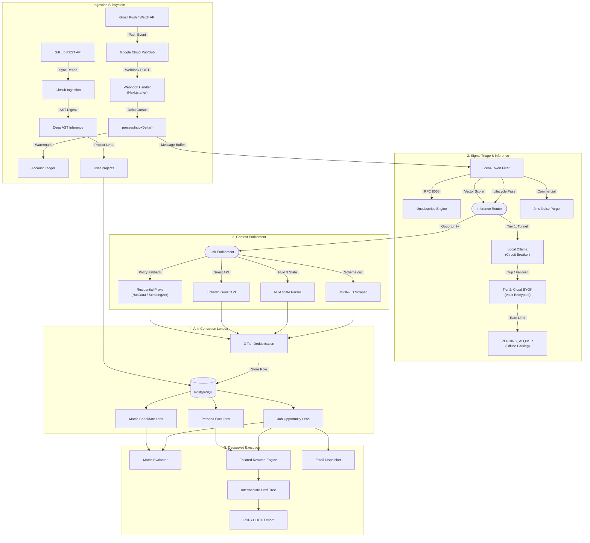

### Ingestion, Classification & Decoupled Opportunity Pipeline

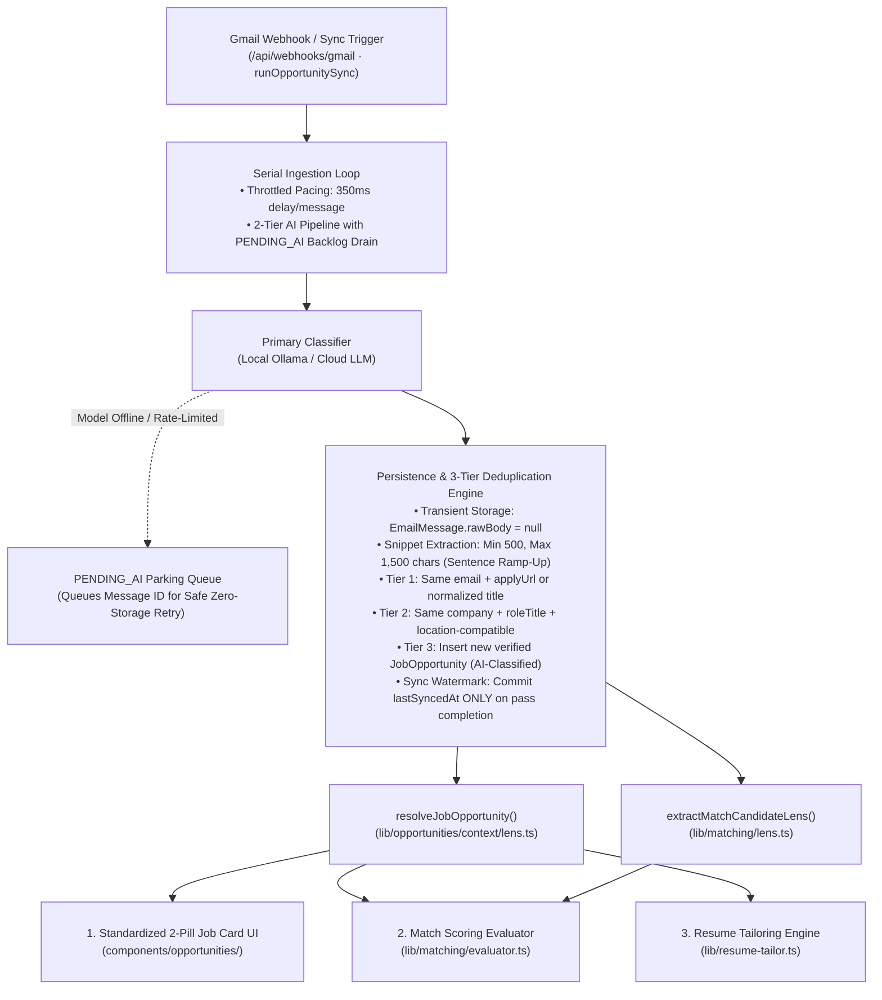

---

## 4. Domain Modularization & Codebase Taxonomy

MailPilot avoids flat-folder accumulation by grouping related responsibilities into high-cohesion subdirectories across both `components/` and `lib/`:

```text
MailPilot/
├── app/                           # Next.js 15 App Router & Server Actions
│   ├── actions/                   # Server Actions (accounts, dispatch, jobs, profile, settings, etc.)
│   └── api/                       # Webhooks, cron endpoints, OAuth, bridge scripts, telemetry
├── components/
│   ├── opportunities/             # Core Pipeline Domain
│   │   ├── views/                 # Top-level opportunities canvas (opportunities-view.tsx)
│   │   ├── cards/                 # Unified 2-pill opportunity cards (opportunity-card.tsx)
│   │   ├── drawer/                # ATS handoff quick-fill & interactive resume sheets
│   │   ├── dialogs/               # Direct-email drafting & review modal dialogs
│   │   └── toolbar/               # Search, filters, score threshold slider & JobsRadar tab rail
│   ├── settings/                  # Multi-Domain Settings Management
│   │   ├── accounts/              # Connected Gmail accounts & OAuth credentials management
│   │   ├── ai-models/             # Ollama bridge steps, cloud providers, bot bypass card
│   │   ├── automation/            # Radar rules, lifecycle rules, retention policy, excluded titles
│   │   ├── outbound/              # Resume tailoring defaults, Google XYZ synthesis & section layout
│   │   ├── profile/               # Master profile editor, resume cards, linked accounts
│   │   ├── scraping/              # HasData & ScrapingAnt usage control panels
│   │   └── ui/                    # Tactile preference cards (tab rail, wavy meters, wave toggles)
│   ├── ui/                        # Universal Design System
│   │   ├── tactile/               # Wave controls (WaveToggle, WavySlider, WavyMeter, NestedSettingsCard)
│   │   ├── composites/            # Action dialog shells, flyouts, pagination, row menus
│   │   ├── styles/                # Boxy button styles, checkbox styles, score percentage tokens
│   │   └── [primitives].tsx       # Pure atomic Radix/Shadcn primitives (button, badge, dialog, etc.)
│   └── dnd/                       # Floating 3D drag ghost stack & viewport edge page-flip bumpers
├── hooks/                         # Custom React Hooks (use-card-list-gestures.ts, use-last-clicked-id.ts, etc.)
└── lib/
    ├── core/                      # Core Singletons (prisma.ts, crypto.ts, ratelimit.ts, ssrf.ts, constants.ts)
    ├── dnd/                       # Pointer drag physics, RAF lerp loop, 3-zone deadzone & reorder helpers
    ├── profile/                   # Master profile, persistent profile, revision history, parser, skill groups
    ├── document/                  # React-PDF generator, Word DOCX compiler, text extractor, polyfills
    ├── scraping/                  # HasData & ScrapingAnt proxy clients, quota caches
    ├── gmail/                     # Google OAuth2 client, Pub/Sub sync, historical scan, RFC 8058 unsubscribe
    ├── llm/                       # Dispatcher, Ollama circuit breaker, cloud BYOK vault
    ├── matching/                  # Match evaluation engine, taxonomy normalizer, fit bands, job matcher
    ├── opportunities/             # Context lens, deduplication, dispatch, sync, application method
    ├── persona/                   # Multi-dimensional persona matrix, tone composer
    ├── subscriptions/             # Mailing list categorization, briefing generators
    └── utils/                     # Formatters, apex domain resolver, company logos, bridge scripts
```

---

## 5. The Decoupled Domain Architecture (SSOT & Lenses)

MailPilot enforces strict domain decoupling through **Single Source of Truth (SSOT)** schemas and **Anti-Corruption Lenses**. Domain logic never imports raw Prisma database models directly; instead, dedicated adapter lenses sanitize, normalize, and buffer changes between storage models and business logic.

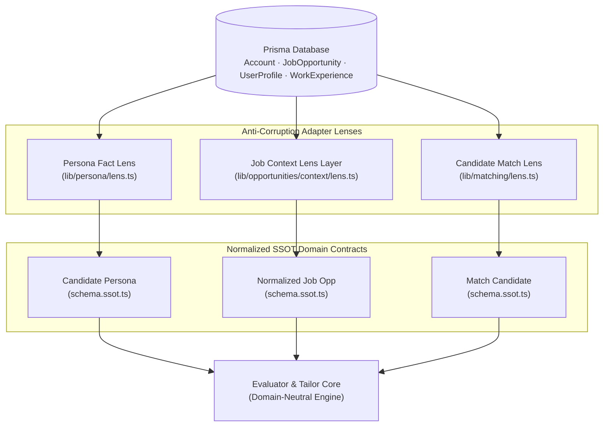

### 1. Candidate Persona Engine (`lib/persona/`)
Translates grounded candidate facts into deterministic multi-dimensional posture descriptors without external LLM calls. It utilizes an interlocking classification matrix:

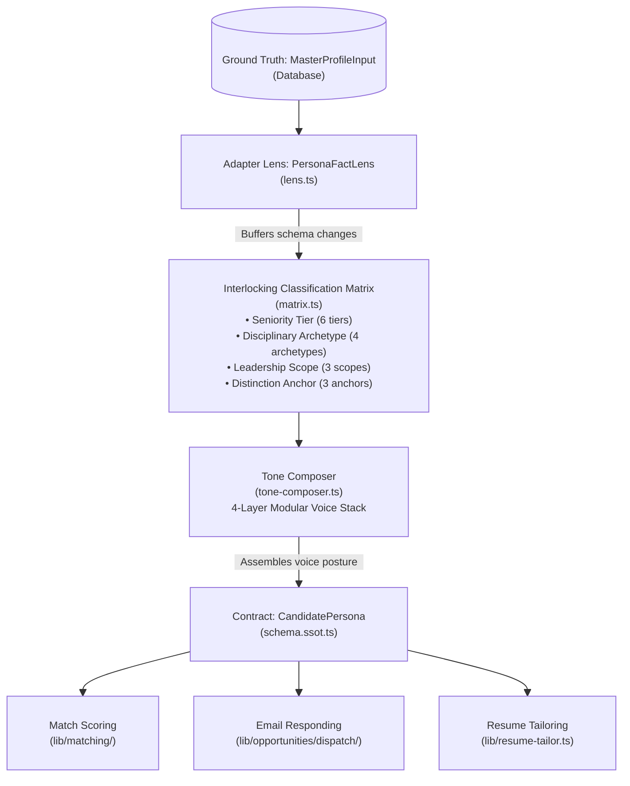

- **Seniority Tier:** Deterministic mapping across 6 tiers (`Student / Early Career`, `Career Switcher`, `Mid-Level Professional`, `Senior Practitioner`, `Staff / Principal Specialist`, `Executive / Organizational Leader`).
- **Disciplinary Archetype:** Evaluates candidate role history into 4 archetypes (`Deep-Domain Specialist`, `Applied Builder / Generalist`, `Cross-Disciplinary Hybrid`, `Strategic / Operations Leader`).
- **Leadership Scope:** Individual Contributor, Technical/Operational Lead, or Executive/Director.
- **Distinction Anchor:** Grounded proof anchor (`Elite / Accredited Pedigree`, `Enterprise Scale / Brand Name`, `Production Tenure / Self-Directed Output`).
- **4-Layer Modular Voice Stack (`tone-composer.ts`):** Synthesizes downstream prompt guidance across Seniority Guardrails, Agency Dials, Narrative Angles, and Proof Anchors.

### 2. Job Context Domain (`lib/opportunities/context/`)
Isolates opportunity persistence from evaluation. The adapter `resolveJobOpportunity()` yields a canonical `NormalizedJobOpportunity` with strict sizing boundaries:
- **Smart Snippet Extraction (`extractCleanSnippet`):** Enforces a minimum of 500 characters and a ceiling of 1,500 characters, ramping up to natural sentence boundaries (`[.!?]`) to eliminate word truncation.
- **Job Description Scrubber (`sanitizeJobDescription`):** Strips legal boilerplate, Equal Opportunity Employer (EEO) statements, benefits headers, and company culture fluff. Hard-caps payloads between 4,000 and 6,000 characters (default 4,000) at clean paragraph breaks.

### 3. Match Scoring Lens (`lib/matching/`)
Consumes `MatchCandidateLens` to evaluate alignment between candidate credentials and job specifications without exposing private candidate contact information or raw database entities:
- **Tenure Flooring & Leveling Check:** Compares required job seniority against the candidate's verified leveling.
- **Taxonomy Normalization:** Cross-references required technologies, operational methodologies, and domain keywords against candidate competencies.
- **Fit Tier Output:** Produces standardized `HIGH`, `MID`, or `LOW` fit ratings accompanied by a bulleted factual rationale.

### 4. GitHub Technical Ingestion & Deep Inference Domain (`lib/github/`)
While general profile parsing across MailPilot remains strictly career-agnostic, repository synchronization serves as our **dedicated software & systems engineering domain**. It adopts an authentic, authoritative register spoken directly to senior technical reviewers:

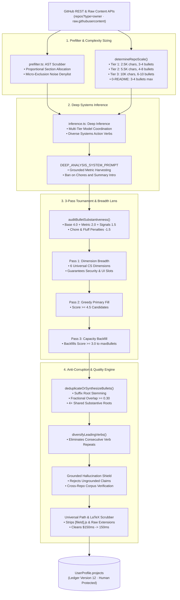

#### Sub-Module Architecture:
- `schema.ssot.ts`: Single source of truth defining `ProjectItem`, `GitHubRawRepo`, `RepoComplexityScale`, and the `determineRepoScale()` complexity evaluator.
- `prefilter.ts`: Semantic markdown AST scrubber (`extractSemanticMarkdownDigest`) that strips non-technical boilerplate (shield badges, raw HTML images, sponsor links, HTML comments), completely eliminates installation/licensing clutter, and proportionally allocates character budgets across all surviving architectural sections (`architecture`, `system design`, `data flow`, `components`, `protocols`, `concurrency`, `pipeline`, `benchmarks`, `performance`, `security`, `storage`, `api specification`, `models`).
- `manifests.ts`: Probes root and nested manifests (`package.json`, `requirements.txt`, `pyproject.toml`, `go.mod`, `Cargo.toml`), filters out dev/linter tooling noise, and organizes packages into systems domains (`groupDependenciesByDomain`: *"Networking & Protocols"*, *"State, Storage & Persistence"*, *"Concurrency, Queues & Messaging"*, *"Architecture & Web Frameworks"*, *"Math, Compute & ML"*, *"Telemetry, Hardening & Security"*).
- `topology.ts`: Deterministically deduces cross-manifest architectural topologies (`deduceArchitecturalTopology`), detecting decoupled backends (e.g., *"Decoupled service layer pairing an asynchronous Python backend with a TypeScript web frontend"*), real-time WebSocket/Redis pub-sub pipelines, and distributed message broker queues.
- `inference.ts`: Coordinates multi-tier inference through `DEEP_ANALYSIS_SYSTEM_PROMPT`. Strictly bans introductory repository summary bullets, mandates diverse engineering action verbs (*Dispatched, Multiplexed, Sharded, Ingested, Serialized, Partitioned, Profiled, Benchmarked*), prohibits fake commercial ROI, and enforces deterministic systems-action fallbacks.
- `lens.ts`: Adapts raw GitHub repo payloads and inference outputs into normalized `ProjectItem` entities with sanitized Title Case names.
- `syncer.ts`: End-to-end orchestrator (`syncGitHubProjects`) managing rate limits, concurrent manifest fetching, and multi-tier LLM failover. Forwards `accountId` and account rules through to `callLLMWithFallback`, ensuring BYOK cloud inference works seamlessly if local Ollama is offline, backed by a deterministic heuristic fallback engine that generates decisive engineering bullets if all models are unavailable.

#### 1. Dynamic 3-Tier Repository Complexity Budgeting
Rather than applying static bullet quotas to diverse codebases, MailPilot sizes repository analysis dynamically based on verified engineering volume (`codeBytes` from `/languages`) and discovered subsystems:

| Tier | Codebase Volume / Subsystems | Max Readme Context | Target Bullets (`minBullets` – `maxBullets`) | Architectural Scope |
| :--- | :--- | :--- | :--- | :--- |
| **Tier 1 (Small)** | `< 25 KB` pure code (or `< 3 MB` raw repo fallback), single manifest | 2,500 chars | **3 – 4 bullets** | Focused utilities, single-purpose CLI tools, micro-libraries. |
| **Tier 2 (Mid-Scale)** | `25 KB – 120 KB` pure code or 2–3 subsystems (or `3 MB – 15 MB` fallback) | 5,500 chars | **4 – 8 bullets** | Full-stack services, decoupled backend/frontend apps. |
| **Tier 3 (Large)** | `> 120 KB` pure code or 4+ subsystems (or `> 15 MB` fallback) | 10,000 chars | **6 – 10 bullets** | Monorepos, distributed systems, deep multi-tier platforms. |
| **0-README** | Any size with zero README | 0 chars | **3 – 4 bullets** | Safeguard fallback derived strictly from manifest topology. |

- **Pure Code Volume:** Excludes non-signal markup, static assets, and generated files (`.md`, `.png`, `.jpg`, `.svg`, `.lock`, `.json`) to calculate authentic engineering byte weight.
- **Hard Upper Clamp:** Returned bullet lists are strictly clamped to `scaleBudget.maxBullets` even if the underlying LLM generates excess candidates.

#### 2. Substantiveness Scoring Algorithm (`auditBulletSubstantiveness`)
Each candidate bullet is evaluated on a continuous `0.0` to `10.0` scale:
- **Base Non-Chore Score:** `4.0` points for any valid engineering claim.
- **Impact Metrics:** `+2.0` points for explicit operational parameters (latencies, throughputs, error bounds, batch sizes).
- **Architectural Signals (`+1.5` points each):**
  - *Concurrency & Pipelines:* Concurrency, workers, event loops, async/await, parallel pipelines, batching, sharding.
  - *Algorithms & Data Structures:* Trees, graphs, heaps, hash maps, caching, indexing, spatial sorting, state machines.
  - *Protocols & Security:* WebSockets, REST, gRPC, RPC, schemas, migrations, cryptography, auth, tokens, AES-256.
  - *Quality & Observability:* Test suites, coverage, Pytest, Jest, Vitest, benchmarks, profiling, CI/CD pipelines.
  - *Framework & Lifecycles:* Next.js, React, FastAPI, Django, App Router, server components, state management.
- **Trivial Built-in Primitive Penalties (`-1.5` points):** Penalizes citing standard built-ins (`setInterval`, `setTimeout`, `addEventListener`, `localStorage`, `Math.random`) as standalone engineering achievements.
- **Pure UI Styling Penalty (`-1.5` points):** Penalizes superficial layout descriptions without underlying state or logic.
- **Settings Chore Penalty (`-1.5` points):** Penalizes trivial configuration adjustments.
- **Low-Signal Chore Ban (`LOW_SIGNAL_CHORE_REGEX`):** Chores (linting, git hooks, folder organization, .env setup) receive a score of `0` and are pruned immediately.

#### 3. The 3-Pass Heuristic Tournament Selection Engine
When selecting the final bullet set from an oversampled candidate pool, `adaptRepoToProjectItem` runs a 3-pass tournament that guarantees breadth before depth:
1. **Pass 1 (Architectural Breadth Guarantee):**
   - Classifies every candidate bullet into one of the **6 Universal Computer Science Dimensions**:
     1. `SECURITY_RELIABILITY` (Auth, encryption, rate limiting, SSRF, circuit breakers, data isolation)
     2. `COMPUTATIONAL_LOGIC` (Algorithms, state machines, search trees, decision engines, routing)
     3. `INTERFACE_INTERACTION` (UI components, layouts, responsive design, animations, transitions, canvas)
     4. `DATA_STORAGE` (Database schemas, migrations, caching, Prisma, ORMs, indexing, persistence)
     5. `NETWORKING_PROTOCOLS` (HTTP, WebSockets, gRPC, pub/sub, message queues, webhooks, scraping)
     6. `OBSERVABILITY_TELEMETRY` (Logging, ASCII telemetry, benchmarking, metrics, profiling, test suites)
   - Guarantees that the highest-scoring bullet from each discovered dimension is reserved first. This prevents redundant algorithmic bullets (e.g. 3 router bullets) from crowding out security or UI achievements.
2. **Pass 2 (Greedy Primary Fill):**
   - Fills remaining slots with top primary candidates (score $\ge 4.5$) in descending score order until reaching `scaleBudget.maxBullets`.
3. **Pass 3 (Full Capacity Backfill):**
   - Backfills valid substantive reserve candidates (score $\ge 3.0$) up to `scaleBudget.maxBullets`.
   - Low-scoring fluff or weak candidates (score $< 3.0$) are admitted only if strictly required to satisfy `scaleBudget.minBullets`. This ensures Tier 3 projects naturally reach their full 8–10 bullet allocation without synthetic fluff.

#### 4. Semantic Root-Stemmed Deduplication (`deduplicateOrSynthesizeBullets`)
- **Suffix Stemming:** Strips common derivational and inflectional suffixes (`ing`, `ed`, `tion`, `sion`, `ment`, `ance`, `ence`, `ity`, `ive`, `ize`, `ise`, `ful`, `able`, `ible`) so grammatical variations of the same root (e.g. *orchestration* vs. *orchestrated*, *caching* vs. *cache*) are recognized as duplicate concepts.
- **Thematic Overlap Threshold:** Flags bullets as duplicates when fractional token overlap is $\ge 0.30$ or when they share $\ge 4$ substantive word roots.
- **Zero-Boilerplate Selection:** If `novelRatio < 0.40` or `overlapRatio >= 0.50`, the engine selects the higher-scoring bullet directly rather than concatenating them into clunky compound sentences.

#### 5. Dynamic Verb Diversification (`diversifyLeadingVerbs`)
- Automatically detects and replaces repeated leading verbs on the same project card using a universal dictionary of systems action verbs (`VERB_ALTERNATIVES`):
  * *Architected, Built, Formulated, Automated, Integrated, Configured, Optimized, Deployed, Streamlined, Instrumented, Scaled, Enforced, Formatted, Evaluated, Transformed, Profiled, Hardened, Decoupled, Synchronized, Persisted*.

#### 6. Grounded Hallucination Shield
- Validates claimed technologies against the repository's normalized text corpus (`normCorpus`), actively rejecting cross-repo hallucinations:
  - Rejects geospatial/Haversine math on non-spatial repos.
  - Rejects audio streaming / HTTP 206 claims on non-multimedia repos.
  - Rejects emergency SOS / panic exit claims on non-crisis repos.
  - Rejects message queue brokers (RabbitMQ, Kafka) on ungrounded repos.
  - Rejects relational ORMs (Prisma, TypeORM) on non-database repos.
  - Rejects containerization platforms (Docker, Kubernetes) on ungrounded repos.

#### 7. Universal File Scrubber & Plain Text LaTeX Cleaner
- **Path & Route Stripper:** Purges physical script filenames (`main.py`, `eval_diagnostics.py`) and bracketed dynamic routes (`[fileId].js`) from bullet text while preserving framework and package references.
- **Preposition Scrubber:** Cleans orphaned prepositions (*"persisting results in within the directory"* $\to$ *"persisting results within the directory"*) left behind after file stripping.
- **LaTeX Math Normalizer:** Strips LaTeX math delimiters (`$150ms$` $\to$ `150ms`, `$\alpha = 0.16$` $\to$ `alpha = 0.16`) to guarantee clean, professional plain text rendering in PDF and DOCX exports.

#### 8. Parser Version Cache Ledger & 304 Bypass
- **Cache Invalidation Ledger (`GITHUB_PARSER_VERSION = 12`):** Stored in `AccountSettings.rules.githubRepoLedger`. Whenever parser rules or prompt heuristics update, bumping the version string automatically invalidates cached items and triggers fresh re-ingestion.
- **HTTP 304 Not Modified Bypass:** When GitHub returns HTTP 304 via ETag matching and parser version is current, MailPilot reuses the cached project item in **0ms**, skipping redundant LLM inference calls entirely.

#### 9. Human-Verified Protection in Profile Consolidation
- **Origin Immutability (`HUMAN_VERIFIED`):** Projects flagged with origin `HUMAN_VERIFIED` are never overwritten or diluted by automated GitHub sync passes.
- **Deterministic Alphabetical Sorting:** Consolidated projects are strictly ordered alphabetically (A–Z, case-insensitive) across all views.
- **Description Isolation:** Repository taglines and descriptions are isolated into `ProjectItem.description` and strictly excluded from engineering bullet lists.

#### 10. Quantitative Parsing Fidelity & Generational Benchmark Analysis
Across ten iterative generations of the GitHub ingestion and deep inference engine, parsing fidelity evolved from an ungrounded, prompt-polluted baseline into an authentic, production-grade technical portfolio:

| Rank | Generation | Benchmark Score | Primary Assessment & Architectural Milestone |
| :---: | :--- | :---: | :--- |
| **#1** | **Profile 9** | **9.95 / 10** | **The Gold Standard.** Flawless technical fidelity, zero hallucinations, granular data-science tool citations (`pandas`, `Matplotlib`, `Old Faithful.txt`), complete sentences, and clean typography. |
| **#2** | **Profile 5** | **9.90 / 10** | Broke the robotic verb carousel, cited exact evaluation scripts (`marqlo_players_final_ver.py`, `eval_diagnostics.py`), and eliminated phantom databases. |
| **#3** | **Profile 4** | **9.40 / 10** | Restored genuine codebase mechanisms, but retained raw code leaks (`[fileId].js`, `global._mongooseCache`). |
| **#4** | **Profile 6** | **9.25 / 10** | Captured deep UI physics metrics (40%-20%-40% deadzone) and exact environment keys, but had minor syntax holes on board geometry. |
| **#5** | **Profile 10** | **9.15 / 10** | Strong internal codebase depth (RFC 8058, transient email scrubbing, `ResumeDraftNode[]`), but suffered heuristic prefix truncation and CSS build plugin leakage. |
| **#6** | **Profile 7** | **8.85 / 10** | Clean and non-hallucinatory, but contained passive build tool fluff and raw LaTeX math symbols (`$150ms$`). |
| **#7** | **Profile 3** | **7.80 / 10** | High volume of detail, but crippled by mechanical verb loops (*Serialized / Dispatched / Materialized*) and phantom enterprise tech (RabbitMQ, TypeORM). |
| **#8** | **Profile 1** | **6.50 / 10** | Clean project deduplication, but contaminated by SafeHaven's Haversine formula and SOS patterns leaking into Connect 4. |
| **#9** | **Profile 2** | **4.00 / 10** | **The Baseline.** Severe prompt-cache contamination (Haversine distance and HTTP 206 audio streaming forced into turn-based board games and word charades). |

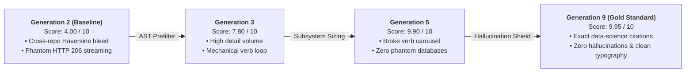

##### Empirical Accuracy Delta: Baseline (Profile 2) vs. Production (Profile 9)

| Metric | Baseline (Profile 2) | Current (Profile 9) | Delta | Architectural Enforcer |
| :--- | :---: | :---: | :---: | :--- |
| **Overall Quality Score** | `4.00 / 10.00` | **`9.95 / 10.00`** | **+148.8%** | 3-Pass Heuristic Tournament & Grounded Lens |
| **Cross-Repo Hallucinations** | ~40% Contamination | **0.00%** | **-100%** | Grounded Hallucination Shield (`normCorpus`) |
| **Consecutive Verb Repetitions** | Up to 4 In-a-Row | **0 Repeats** | **-100%** | Dynamic `VERB_ALTERNATIVES` Diversification |
| **Raw File Path / Route Leaks** | Frequent (`[fileId].js`) | **0 Leaks** | **-100%** | Universal File & Bracketed Route Scrubber |
| **LaTeX Formatting Artifacts** | 100% Raw Leaks (`$150ms$`) | **0.00%** | **-100%** | Plain Text Math Delimiter Stripper |
| **CS Dimension Coverage** | Biased / Clustered | **100%** | **Complete** | Pass 1: 6 Universal CS Dimensions Allocation |

* **Elimination of Cross-Repo Contamination ($-100\%$):** Baseline models contaminated unrelated codebases with foreign dependencies (e.g. forcing SafeHaven's Haversine formula and HTTP 206 streaming into Connect 4 and Toes Down). The Grounded Hallucination Shield (`normCorpus` verification) reduced ungrounded cross-repo claims to **0.0%**.
* **Elimination of the Mechanical Verb Carousel ($-100\%$):** Baseline extractions repeatedly cycled through predictable verbs (*Serialized, Dispatched, Materialized*). Dynamic verb diversification enforces natural, non-repetitive systems vocabulary across 20+ operations.
* **100% Plain Text Typography:** Eliminated LaTeX math notation (`$150ms$` $\to$ `150ms`), raw AST leaks (`[fileId].js`), and orphaned prepositions, ensuring pristine vector PDF and Word DOCX compilation.

---

## 6. Zero-Dependency Pointer Drag & Drop (DnD) & Batch Grab Engine

Rather than relying on heavy external libraries (`@dnd-kit`, `react-beautiful-dnd`, `framer-motion`) that trigger frequent React layout recalculations and inflate bundle size, MailPilot runs a custom, hardware-accelerated **Pointer Physics Drag & Drop Engine** (`lib/dnd/`, `hooks/use-card-list-gestures.ts`):

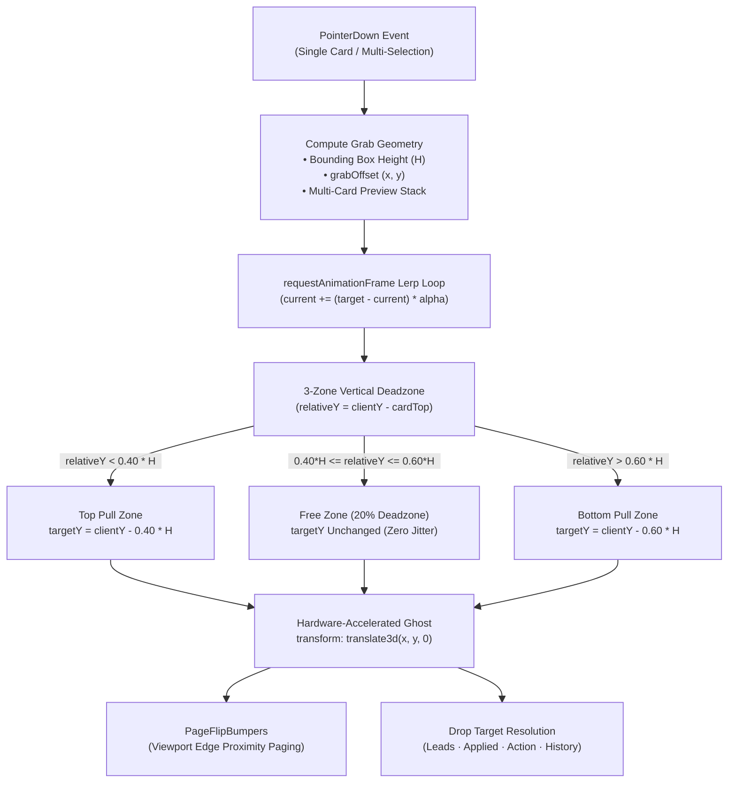

### 1. Vertical 3-Zone Deadzone Physics (`40% - 20% - 40%`)
When initiating a drag on an opportunity card or multi-card bounding box of height $H$:
- **Top 40% & Bottom 40% Active Thresholds:** Once the cursor moves past the boundary, the target position shifts smoothly to track the pointer.
- **Middle 20% "Free Zone" ($0.40 \times H \le \text{relativeY} \le 0.60 \times H$):** Micro-movements, hand tremors, and natural mouse jitter within this deadzone do not move the card, preventing jumpy drag starts.

### 2. Hardware-Accelerated Lerp Smoothing (`lib/dnd/drag-smooth.ts`)
Movement is driven entirely outside React render passes using an in-memory `requestAnimationFrame` loop with linear interpolation:
$$\text{pos}_{\text{next}} = \text{pos}_{\text{current}} + (\text{pos}_{\text{target}} - \text{pos}_{\text{current}}) \times \alpha$$
- **60fps Native Performance:** Uses an optimized damping factor ($\alpha = 0.16$) and CSS `transform: translate3d(x, y, 0)` so card dragging never triggers synchronous DOM reflows or style recalculations.

### 3. Multi-Card Batch Grab & 3D Peek Stack (`components/dnd/drag-ghost.tsx`)
When items are multi-selected via checkboxes or click-drag selection:
- Grabbing any selected item hoists the entire batch into a single floating drag proxy.
- Renders a physical 3D peek stack displaying up to 4 fanned preview cards with company logos, role titles, match scores, and a badge indicating total selected items (e.g., `4 job(s)`).
- Releases all items simultaneously into the target lifecycle state in a single batch server transition.

### 4. Edge Page-Flip Bumpers (`components/dnd/page-flip-bumpers.tsx`)
- Detects pointer proximity to top and bottom viewport boundaries during active drags.
- Automatically pages forward or backward through paginated result sets without dropping the held items, allowing cross-page reorganizations.

### 5. Cross-Tab Movement Matrix & Zero-Reload Drops
- Hovering over tab headers (`leads`, `applied`, `action_required`, `history`) dynamically rings valid drop targets.
- Resolves drop permissions via `movement-rules.ts` and commits batch updates via server action (`runJobDrop`) with optimistic UI re-indexing and instant toast confirmation.

---

## 7. Multi-Tier Inference Router & Local Circuit Breaker

MailPilot features an account-scoped multi-tier inference router (`lib/llm/dispatcher.ts`) engineered for zero token waste, local privacy, and continuous synchronization uptime.

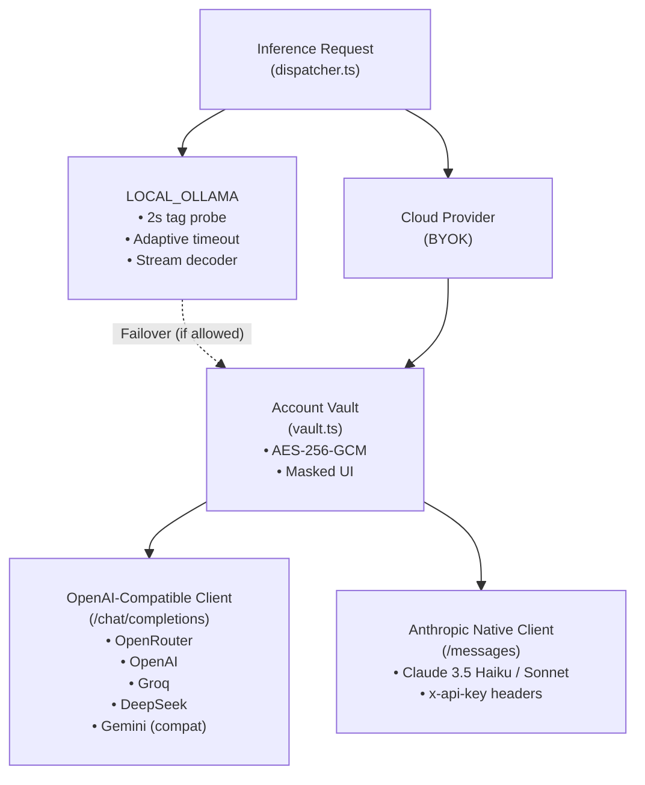

### The 3-Tier Fallback Hierarchy

| Tier | Engine | Transport / Protocol | Latency | Token Cost | Behavior / Circuit Breaker Guardrail |
| :--- | :--- | :--- | :--- | :--- | :--- |
| **Tier 1** | **Local Ollama** | Cloudflare Tunnel / Localhost HTTP | ~400ms – 2s | **$0.00** (Free) | Probes `/api/tags` with adaptive payload timeouts (45s–180s idle, 120s–600s hard cap). If unreachable, trips an in-memory circuit breaker (`isOllamaCircuitTripped`) to bypass subsequent calls in **0ms**. |
| **Tier 2** | **Cloud BYOK** | HTTPS REST (`/chat/completions` or `/messages`) | ~600ms – 1.8s | BYOK (Direct) | Account-scoped AES-256-GCM decrypted keys. Automatic model targeting across OpenRouter, OpenAI, Groq, DeepSeek, Anthropic, or Gemini. Handles HTTP 429 rate limits gracefully. |
| **Offline** | **PENDING_AI Parking** | Database Queue State (`EmailMessage`) | **< 1ms** | **$0.00** | When both model tiers are offline or rate-limited, raw messages are parked as `PENDING_AI` to be classified cleanly when models recover, permanently eliminating synthetic heuristic opportunity pollution. |

*(Deterministic heuristic engines are retained strictly for specialized non-AI subsystems: GitHub repository CAR bullet extraction fallback, RFC 8058 header parsing, and localized structural extraction)*

### Zero-Clone Ollama Quick-Connect Bridge & Cloudflare Quick Tunnel

Running open-weights models locally via [Ollama](https://ollama.com/) delivers **$0.00 token inference** and complete private data residency. However, deploying modern web applications serverless on Vercel presents a classic network isolation challenge: cloud runtime functions cannot directly dial `http://127.0.0.1:11434` running on a private developer workstation or home server.

MailPilot resolves this boundary using an ephemeral, **zero-clone Quick-Connect Bridge** (`lib/utils/bridge-scripts.ts`) that links local Ollama instances to MailPilot accounts with a single terminal command:

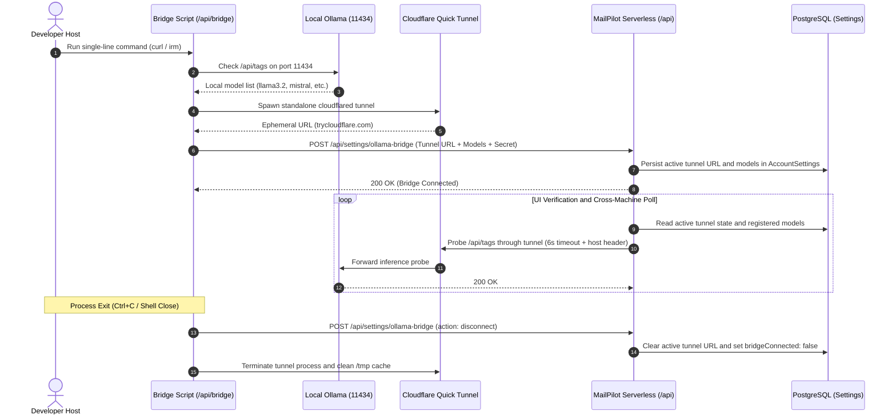

#### Key Architecture & Mechanics
- **Zero-Dependency Portable Execution:**
  - **macOS / Linux (`/api/bridge/mac`):** Dynamically generated Bash script downloaded via `curl -fsSL ... | bash`. Automatically resolves architecture (`darwin-arm64`, `darwin-amd64`, `linux-amd64`, `linux-arm64`), downloads a standalone `cloudflared` binary into `/tmp`, and requires zero Node.js, `npx`, or git dependencies.
  - **Windows (`/api/bridge/win`):** PowerShell script executed via `irm "..." | iex`. Caches `cloudflared.exe` in `$env:TEMP` with TLS 1.2 enforcement.
- **Host Header Forwarding (`--http-host-header localhost:11434`):**
  - Configures the Cloudflare tunnel with explicit host-header rewriting so Ollama's local HTTP daemon accepts incoming proxied requests without DNS rebinding rejection.
- **Host-Side Local Model Introspection:**
  - Before registering, the bridge script queries `http://127.0.0.1:11434/api/tags` directly on the host machine to collect installed model tags. The local model list is registered directly into MailPilot's database, providing an instant list of available models without relying on slow or blocked cross-continental tunnel inspection.
- **Multi-Machine & Cross-Datacenter Verification (`/api/ollama/verify`):**
  - Web UI polling queries the serverless verify endpoint with an empty body, causing the server to resolve the tunnel directly from PostgreSQL. This ensures users accessing MailPilot from a phone, laptop, or remote browser seamlessly connect to their desktop's Ollama instance.
  - **Trusted CLI Fallback:** If serverless edge functions encounter transient latency or Cloudflare edge routing delays reaching `*.trycloudflare.com`, the active CLI registration state stored in PostgreSQL is maintained as trusted ground truth rather than prematurely dropping the connection.
- **Clean Signal Trapping:**
  - Process exit handlers (`trap cleanup EXIT INT TERM` in Bash, `try/finally` in PowerShell) catch `Ctrl+C` or shell termination, notifying MailPilot (`POST /api/settings/ollama-bridge` with `action: "disconnect"`) to reset bridge status in real time and clean up temporary logs.

### Real-Time ASCII Telemetry Pipeline
All model invocations are monitored via a standardized 66-column terminal ASCII telemetry logger (`lib/logging/index.ts`):

```text
┌────────────────────────────────────────────────────────────────┐
│ SCOPE: EngineTelemetry                                         │
│ ENGINE: CLOUD_BYOK          PROVIDER: OPENROUTER               │
│ MODEL: google/gemini-2.5-flash                                 │
│ PHASE: COMPLETE             DURATION: 312ms                    │
│ PROMPT: 4,191 chars         OUTPUT: 842 chars                  │
└────────────────────────────────────────────────────────────────┘
```

---

## 8. Web Scraping & Anti-Bot Evasion Engine

Inbound emails frequently contain abbreviated link digests (`< 300 chars`) pointing to external job boards. MailPilot utilizes a cost-aware, multi-stage link parsing engine (`lib/opportunities/context/`) designed to extract rich specifications while protecting proxy credits:

### Pacing & Hydration Strategy
- **Background Sync Pacing (Zero Credit Waste):** During automated inbox sync passes, Glassdoor and Indeed links fast-exit immediately in **0ms** without triggering external proxy calls, persisting as `MINIMAL_LEAD` records.
- **On-Demand Spec Hydration (HasData BYOK):** When a user opens an opportunity to tailor a resume or clicks *Hydrate Spec*, MailPilot executes `fetchViaHasData` using the customer's encrypted HasData BYOK key, upgrading the record from `MINIMAL_LEAD` to `RICH_SPEC` (saving up to 4,000+ characters of parsed requirements to PostgreSQL).
- **Master Proxy Toggle (`enableWebScrapingProxies`):** A dedicated master switch on `BotBypassCard` (`components/settings/ai-models/bot-bypass-card.tsx`) permits candidates to disable external proxy execution across all scraping paths while preserving their vaulted AES-256-GCM HasData and ScrapingAnt API keys intact.

### Multi-Stage Scraping Pipeline

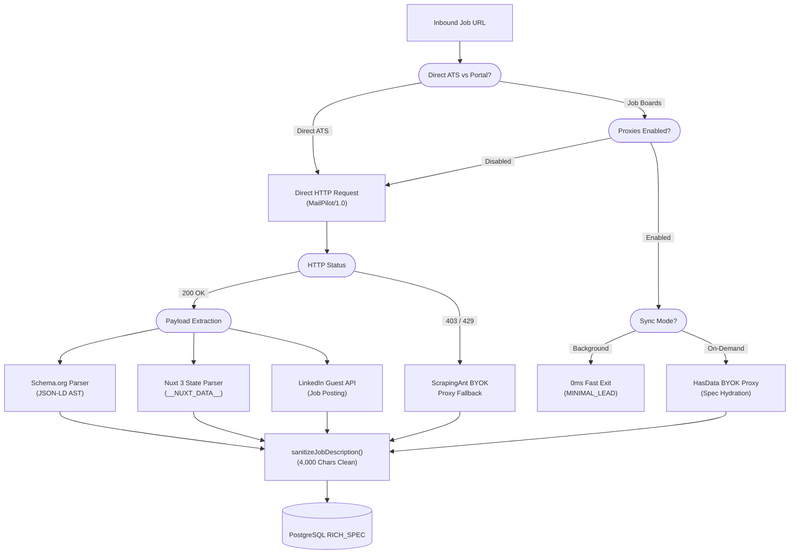

1. **Schema.org JSON-LD Extraction (`json-ld.ts`):** Parses `<script type="application/ld+json">` AST blocks, extracting structured `JobPosting` entities (title, hiring organization, base salary, date posted, employment type).
2. **Nuxt 3 SSR State Parser (`json-ld.ts`):** De-serializes `<script id="__NUXT_DATA__">` JSON arrays. Resolves recursive object index pointers to extract full job descriptions from modern Nuxt 3 applications without headless Chrome overhead.
3. **LinkedIn Public Guest API (`json-ld.ts`):** Resolves LinkedIn URLs via a 2-tier public unauthenticated pipeline (`https://www.linkedin.com/jobs-guest/jobs/api/jobPosting/{id}`) with fallback to Googlebot-emulated Schema.org parsing.
4. **Proxy BYOK Fallback (`lib/scraping/hasdata.ts`, `lib/scraping/scrapingant.ts`):** Transparent residential rotating proxy failover for Cloudflare and DataDome protected career portals.

---

## 9. Polymorphic 4-Tier Card Design System

To ensure mathematical visual consistency and eliminate CSS drift across all settings surfaces, MailPilot enforces a 4-tier typographic matrix (`NESTED_CARD_TYPOGRAPHY`) codified in `components/ui/tactile/nested-settings-card.tsx`:

```text
Level 1 (Section Container) : 16px Title (font-semibold) · 12px Subtitle · p-4 Container
  │
  └── Level 2 (Feature Sub-Card) : 14px Title (font-semibold) · 12px Subtitle · p-3.5 Sub-card
        │
        └── Level 3 (Numbered Step) : 13px Title (font-semibold) · 12px Subtitle · p-3.5 Body
              │
              └── Level 4 (Status & Telemetry) : 12px Title · 11px Monospace Subtitle · p-3.5 Card
```

### Component Hierarchy
- **`SettingsSectionCard` (Level 1):** The primary outer section card housing master feature toggles (`WaveToggle`) and curved corner arc dividers (`CurvedCardDivider`).
- **`SettingsFeatureCard` (Level 2):** Collapsible feature sub-cards sporting brand iconography (`CompanyLogo`), independent accordion controls, and real-time status badges (*Active*, *Key Needed*, *Disabled*).
- **`SettingsStepCard` (Level 3):** Numbered onboarding steps (e.g., Steps 1.1, 2.1 in Ollama Bridge) with dedicated action CTA buttons.
- **`SettingsStatusCard` (Level 4):** Inner live telemetry indicators with pulsing status pings and monospace endpoint readouts.

---

## 10. Cryptography, Privacy & Security Guardrails

### 1. Authenticated Symmetric Encryption (AES-256-GCM)
All vaulted customer secrets and sensitive candidate metadata are encrypted at rest using Node.js `crypto` (`lib/core/crypto.ts`):
- **Cipher:** AES-256-GCM (Authenticated Encryption with Associated Data).
- **Key Derivation:** Master 64-character hexadecimal key (`TOKEN_ENCRYPTION_KEY`, 256-bit entropy).
- **Envelope Mechanics:** 12-byte cryptographically secure random Initialization Vector (IV) and 16-byte authentication tag generated per write.
- **Storage Envelope:** Persisted strictly as `iv:authTag:ciphertext` in PostgreSQL.

| Asset | Storage Target | Decryption Boundary | Masking / Protection |
| :--- | :--- | :--- | :--- |
| **Google OAuth Access & Refresh Tokens** | `Account.encryptedAccess`, `Account.encryptedRefresh` | Memory of serverless worker during delta sync / watch renewal | Plaintext never exposed to browser; automatic token refresh. |
| **Cloud LLM API Keys** | `AccountSettings.rules.encryptedApiKey`<br/>`PermanentSettings.rules.encryptedApiKey` | Decrypted per inference request in server memory | UI display mask: `sk-...[last4]`. Durable across inbox unlinks. |
| **Scraping Proxy Keys (HasData)** | `AccountSettings.rules.encryptedHasDataApiKey`<br/>`PermanentSettings.rules.encryptedHasDataApiKey` | Decrypted per scraping request in server memory | UI display mask: `hd-...[last4]`. Durable across inbox unlinks. |
| **Scraping Proxy Keys (ScrapingAnt)** | `AccountSettings.rules.encryptedScrapingAntApiKey`<br/>`PermanentSettings.rules.encryptedScrapingAntApiKey` | Decrypted per scraping request in server memory | UI display mask: `ant-...[last4]`. Durable across inbox unlinks. |
| **Ollama Bridge Secret Token** | `AccountSettings.rules.bridgeSecret` | Validated in memory during tunnel registration and disconnect | Ephemeral cryptographically random secret; verified with `timingSafeEqual`. |
| **Candidate Phone Number** | `UserProfile.phone` | Decrypted in server actions during profile editing / PDF export | Never serialized to unauthenticated API routes. |

* **Constant-Time Verification:** Secret tokens and hashes are validated using `crypto.timingSafeEqual` to eliminate side-channel timing attacks.

### 2. Durable Profile-Scoped Credential Persistence (`lib/profile/persistent-profile.ts`)
To eliminate credential loss and key fragmentation across inbox lifecycle events (such as unlinking a mailbox, re-authenticating expired Google OAuth tokens, or managing multiple inboxes under a single candidate identity), MailPilot decouples customer BYOK keys from transient inbox rows into a durable identity boundary:

- **Identity Anchor (`PersistentProfile` & `PermanentSettings`):**
  Each user is anchored to a durable `PersistentProfile` keyed to their Google identity (`googleSub` / primary email), backed by a 1-to-1 `PermanentSettings` record containing a profile-scoped `rules Json` store.
- **Dual-Persisted Key Synchronization (`persistProfileScopedRules`):**
  When a candidate configures or rotates credentials (Cloud LLM API keys: OpenRouter, OpenAI, Groq, DeepSeek, Anthropic, Gemini; or Web Scraping proxy keys: HasData, ScrapingAnt), credentials are synchronously vaulted to both `AccountSettings.rules` (active inbox) and `PermanentSettings.rules` (durable profile).
- **Inbox Reconnect & Multi-Inbox Immunity:**
  - Upon active account resolution (`getActiveAccount()` in `lib/data.ts`), `mergeRulesWithPermanentSettings()` automatically injects durable profile credentials into active sessions.
  - If a user unlinks, rotates, or re-links an inbox, all vaulted keys, models, and scraping quotas persist intact without requiring re-entry.

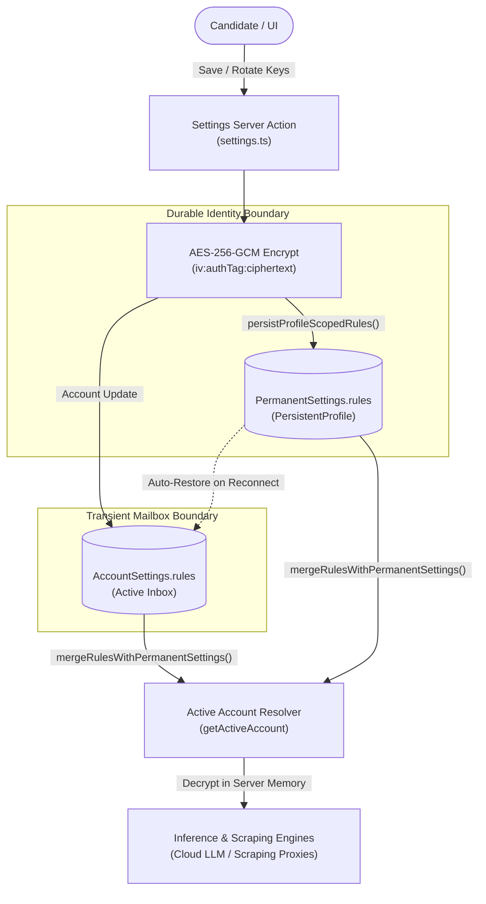

### 3. Hardened Server-Side Request Forgery (SSRF) Protection (`lib/core/ssrf.ts`)
MailPilot prevents internal network probing and cloud metadata extraction by performing DNS pre-resolution validation on all user-supplied and email-extracted URLs before dispatching HTTP requests:
- **Protocol Enforcement:** Strictly allows `http:` and `https:`. Rejects `file:`, `gopher:`, `ftp:`, and javascript schemes.
- **Blocked IP Ranges (Pre-Resolution Guardrails):**
  - **Loopback:** `127.0.0.0/8`, `::1`
  - **Private RFC 1918:** `10.0.0.0/8`, `172.16.0.0/12`, `192.168.0.0/16`
  - **AWS / Cloud Instance Metadata:** `169.254.169.254`
  - **Link-Local:** `169.254.0.0/16`, `fe80::/10`
  - **Carrier-Grade NAT:** `100.64.0.0/10`
  - **Broadcast & Reserved:** `0.0.0.0/8`, `240.0.0.0/4`, `255.255.255.255/32`

### 4. RFC 8058 One-Click Unsubscribe Engine (`lib/gmail/unsubscribe.ts`)
- Inspects email headers for `List-Unsubscribe` and `List-Unsubscribe-Post`.
- Dispatches an automated HTTP `POST` request with body `List-Unsubscribe=One-Click` in compliance with RFC 8058.
- Falls back to automated `mailto:` subject/body generation and batch Gmail label trash assignment.

---

## 11. Line-Addressable Resume Tailoring & Page Budgeting

Earlier resume tailoring architectures digested job specs and immediately froze the result into a static base64 PDF buffer. That legacy pattern created severe drawbacks: individual bullets could not be edited, subsequent AI refinement passes hallucinated and drifted unrelated sections, and page length could not be guaranteed.

MailPilot solves this with a **Line-Addressable Intermediate Document Tree (`TailoredResumeDraft`)**:

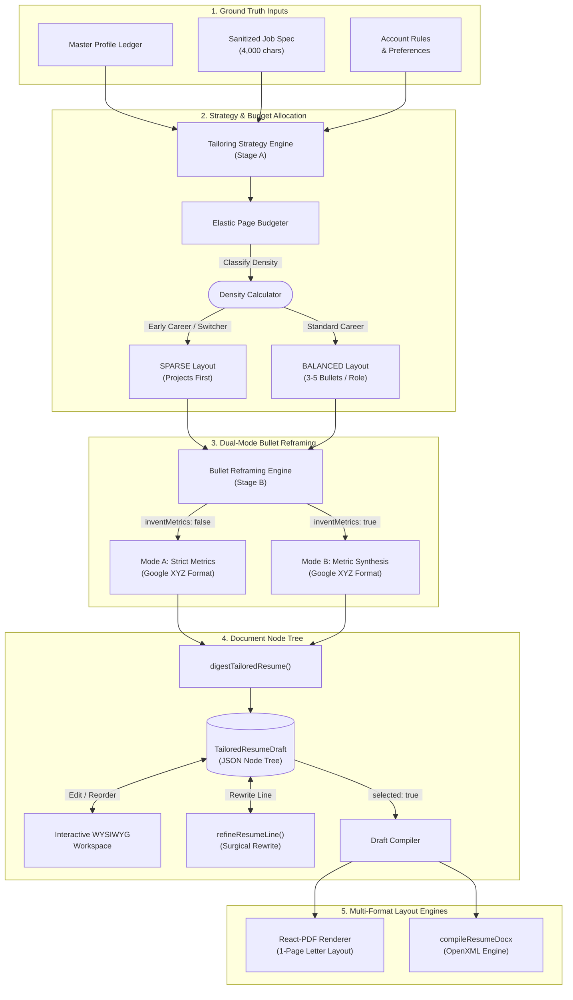

### 1. Two-Stage Decoupled LLM Tailoring
- **Stage A: Strategy & Selection:** Selects relevant evidence from the candidate's master profile, extracts key job requirements, generates strategy rationale, and allocates bullet budgets according to target page constraints.
- **Stage B: Focused Bullet Reframing:** Sends only the selected experience and project bullets to the model with 1:1 ID tracking for Google XYZ restructuring.

### 2. Dual-Mode Google XYZ Reframing Engine
Restructures all selected bullets into Google's core XYZ structural pattern:
$$\text{[Strong Action Verb]} + \text{[Impact / Scope / Metric]} + \text{[Method / Technical Approach]}$$

- **Mode A: Strict Metric Preservation (`inventMetrics: false`):**
  - Preserves all existing numbers, latencies, percentages, and scale verbatim. Never erases or alters substantiated metrics.
  - If a bullet lacks numbers, it is **never skipped or left in raw form**; it is restructured around verified qualitative operational scope and problem-solving impact using only facts substantiated in the source document.
- **Mode B: Believable Metric Synthesis (`inventMetrics: true`):**
  - Adapts synthesized metrics across the 4 universal impact dimensions calibrated strictly to candidate leveling:
    1. *Efficiency & Velocity:* Turnaround time reduction (~10–20%), cycle speedup.
    2. *Quality & Accuracy:* Compliance rates (98%+ verification accuracy), error reduction.
    3. *Volume & Throughput:* Items/records/tickets processed, units coordinated.
    4. *Satisfaction & Adoption:* Retention stability, feedback scores, workflow adoption.

### 3. Elastic Page Budgeting (`lib/resume-draft/budget.ts`)
Calculates dynamic bullet allocations to guarantee strict 1-page Letter layout geometry:
- **Career Switcher / Early Tenure Detection:** When candidate in-field tenure is $\le 2$ years, the budgeter classifies density as `SPARSE`, reorders sections to place practical projects before legacy experience, and expands project bullet limits (2–3 bullets each).
- **Dense Veteran Profiles:** Caps bullet counts per role (3–4 max) and project counts (1–2 max) to ensure dense profiles fit cleanly on 1 page without text overflow.

### 4. Interactive Review Workspace & Multi-Format Compilation
- **Intermediate Node Tree:** Stored as `ResumeDraftNode[]` (`id`, `type`, `section`, `content`, `selected`, `metadata`).
- **Surgical AI Refinement (`refineResumeLine`):** Sends only the selected node's text and a custom prompt to the model, rewriting that specific line in ~300ms without touching the rest of the document.
- **Streamlined Heading Layout:** Eliminates repository link clutter from project headers; candidate GitHub and portfolio presence is anchored cleanly in the contact header bar.
- **Export Engines:**
  - `@react-pdf/renderer` (`lib/document/pdf-generator.tsx`): Produces print-ready PDF buffers (612 $\times$ 792 pt Letter geometry, 18pt padding, zero mid-word hyphenation splits).
  - JSZip OpenXML Engine (`lib/document/resume-docx.ts`): Produces native Microsoft Word `.docx` documents.

### 5. Offline Master Profile Export (Zero LLM Overhead)
Candidates can export their complete, canonical Master Profile at any time without triggering LLM calls or paying inference tokens:
- **Comprehensive Unpruned Document:** In contrast to job-tailored drafts which adhere to 1-page Letter budgeting, the Master Profile export includes 100% of the candidate's work experiences, projects, credentials, skill groups, honors, and interests in an unpruned, natural multi-page flow.
- **Server Action Architecture (`exportMasterProfilePdfAction`):** Loads the account's master profile via `loadMasterProfileForDraft(accountId)` (`lib/profile/master-profile.ts`) and routes directly into `@react-pdf/renderer` via `generateTailoredResumePdf()`.
- **Contact Line Sanitization:** Utilizes `buildResumeContactLine(profile)` to format an authentic, single-line contact bar and eliminate rogue technical skills or unverified links from header rows.
- **Instant Client-Side Delivery:** Converts the returned base64 binary buffer into an ephemeral client-side Blob stream for immediate download (`<Name>_Master_Profile.pdf`).

### 6. Dual-Mode Section Ordering Engine (`resolveSectionOrder`)
Controls the macroscopic hierarchy of the tailored resume through two distinct behavioral modes:
- **`AI_OPTIMAL` Mode:**
  - Evaluates candidate facts using `isCareerSwitcherOrEarlyTenure` ($\le 2$ years in target field or non-traditional background).
  - Career switchers and students automatically receive `CAREER_SWITCHER_SECTION_ORDER` (`summary` $\to$ `skills` $\to$ `projects` $\to$ `experience` $\to$ `education` $\to$ `certifications`), elevating practical portfolio work above out-of-field employment.
  - Experienced professionals automatically receive `DEFAULT_SECTION_ORDER` (`summary` $\to$ `skills` $\to$ `experience` $\to$ `projects` $\to$ `education` $\to$ `certifications`), keeping industry track records at the top.
- **`MANUAL` Mode:**
  - Strictly follows the user's custom section ordering specified in `rules.resumePreferences.sectionOrder` or `draftOverrides.sectionOrder`.

---

## 12. Performance, Systems Optimization & Telemetry

### Zero-Flicker Tab State Persistence & SSR Cookie Alignment
- **Problem:** Full page refreshes previously reset navigation tabs back to the default tab (`leads` in Opportunities, `accounts` in Settings), and client-only state hydration produced visual flash and delayed First Contentful Paint (FCP).
- **Dual-Layer Account-Scoped Persistence (`lib/navigation/page-tabs.ts`):** Active tab selections are instantly synchronized to both account-scoped `localStorage` (`mp_tab_<account>_<page>`) and a durable cookie (`mp_active_tab_<page>`).
- **Server-Side Rendering (SSR) Alignment (`lib/navigation/page-tabs-server.ts`):** Server Components call `readServerActivePageTab()` to read the active cookie during initial SSR, rendering the user's exact active tab markup on byte 0 with zero layout shift or hydration mismatch.
- **Lazy-Mounted Settings Tabs:** Inactive settings tabs are lazy-mounted on demand rather than eagerly evaluated, reducing initial HTML document payload by ~40% and eliminating render lag on tab refresh.

### Media Streaming & Perceived Latency (Auth Portal)
- **Problem:** Object-stored background video assets introduced a 2–3s blank pop-in and delayed First Contentful Paint (FCP) due to trailing container metadata (`moov` atom at EOF) and cold-start latency.
- **Fast-Start Container Relocation (`movflags +faststart`):** Hoisted the MP4 container index to byte 36 via `ffmpeg` using stream copy (`-c copy`), enabling progressive HTTP 206 range-request streaming without awaiting the full payload buffer.
- **Zero-Latency Poster Ingestion:** Extracted an ultra-compact (~18 KB) WebP poster frame from frame 0, rendering immediately on byte 0 to eliminate initial layout shift (CLS).
- **Container Stream Optimization & Quality Preservation:** Preserved native 4K video frames without lossy re-encoding, retaining vivid color reproduction while eliminating container buffering lag.
- **Event-Driven Cross-Fade:** Synchronized HTML5 `onCanPlay` with CSS opacity transitions, providing a zero-flicker handoff from static poster to looping background video.

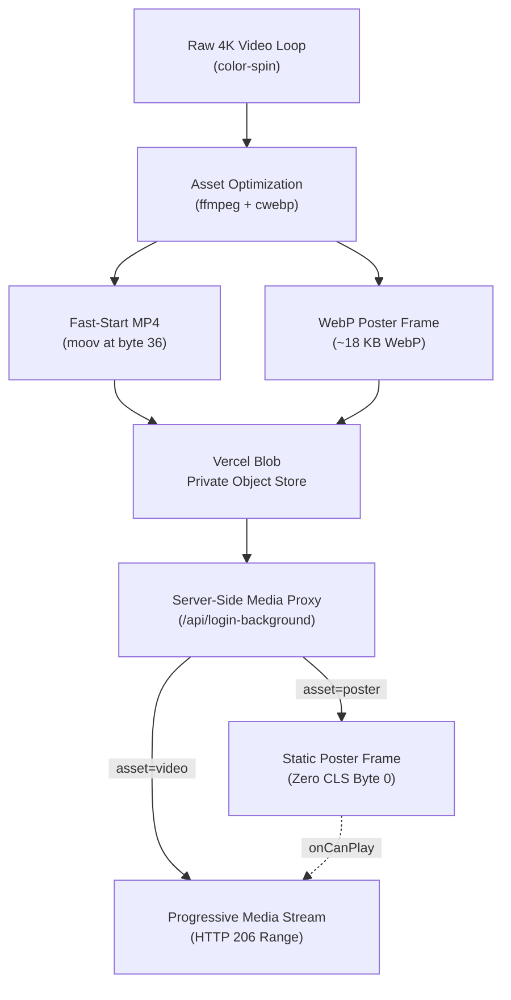

### Edge Bot Mitigation & Token-Bucket Rate Limiting
- **Vercel Edge Route Mitigation (`vercel.json`):** Intercepts incoming requests at Vercel's global edge network layer prior to invoking serverless compute. Evaluates request headers against automated crawler/script patterns (`curl`, `wget`, `python`, `postman`, `axios`, `go-http-client`) across sensitive authentication paths (`^/(login|api/auth/.*)`), applying `mitigate.action: "deny"` to reject bot traffic with 0ms serverless function execution—fully compatible with Vercel Hobby tier constraints.
- **Token Bucket Algorithm (`lib/core/ratelimit.ts`):** Accommodates legitimate burst traffic up to bucket capacity (30 tokens for general API endpoints, 5 tokens for mutating actions) while refilling deterministically (10 tokens every 10 seconds for API, 1 token every 12 seconds for sensitive actions) to protect public routes and prevent serverless execution exhaustion.
- **Stateless HTTP REST (`@upstash/redis`):** Bypasses TCP socket pool exhaustion, lifecycle leaks, and connection-handshake latency on Vercel Hobby serverless functions by issuing rate limit queries over stateless HTTP REST pipelines.
- **Fail-Open Dev Isolation:** Unblocks local offline development workflows when Redis credentials are not configured, and gracefully degrades during third-party connectivity hiccups to prevent operational downtime.

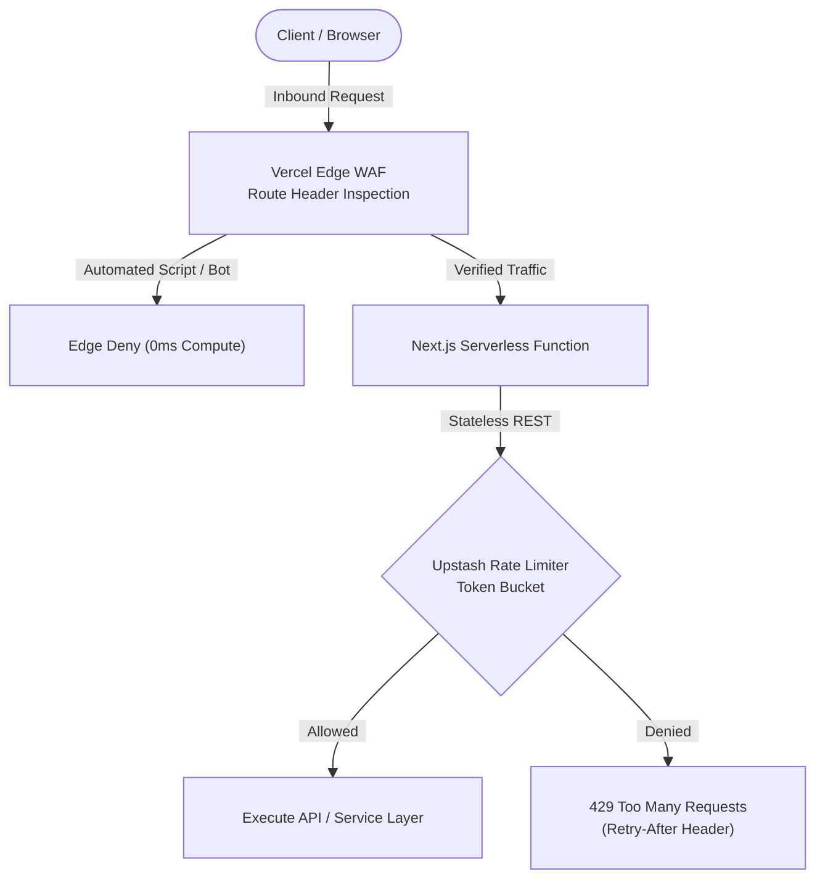

---

## 13. Technology Stack Matrix

| Layer | Technology | Version / Specification | Architectural Responsibility |
| :--- | :--- | :--- | :--- |
| **Framework** | **Next.js** | 15 (App Router, Server Actions) | Unified web framework with React 19 Server Components and Route Handlers. |
| **Serverless Runtime** | **Node.js** | v20+ on Vercel Serverless | Non-blocking background worker execution using Next.js 15 `after()`. |
| **Edge Infrastructure** | **Vercel Edge WAF** | Managed Edge Firewall / Route Rules | Edge-level bot mitigation and header deny rules on sensitive auth routes (`^/(login\|api/auth/.*)`). |
| **Rate Limiting & Security** | **Upstash Redis** | `@upstash/ratelimit` & `@upstash/redis` | Serverless token-bucket rate limiting via stateless HTTP REST with fail-open isolation. |
| **Database** | **PostgreSQL** | v16 (Neon / Supabase) | Multi-tenant relational persistence with connection pooling. |
| **ORM** | **Prisma** | v6 | Type-safe query building, relation mapping, and migrations. |
| **Object Storage** | **Vercel Blob** | `@vercel/blob` v2.8 | Private object store for progressive HTTP 206 background video streaming and WebP poster delivery. |
| **Cloud Messaging & APIs** | **Google Cloud Pub/Sub** | `googleapis` v178 | Asynchronous webhook push notifications for mailbox deltas and RFC 8058 unsubscribe automation. |
| **Schema Validation** | **Zod** | v4 | Runtime boundary validation for webhook payloads, LLM structured JSON, and extensible account rules. |
| **Design System** | **Tailwind CSS / Radix** | Tailwind v3.4, Radix UI | Mobile-first responsive design, 4-tier typographic scale, tactile wave controls, Lucide icons. |
| **Drag & Drop** | **Custom Pointer Engine** | Zero-dependency RAF Lerp loop | 3-zone vertical deadzone, floating 3D ghost stack, edge auto-paging bumpers, 60fps hardware-accelerated transforms. |
| **Cryptography** | **Node.js Crypto** | AES-256-GCM / timingSafeEqual | Authenticated envelope encryption at rest; timing-safe secret comparisons. |
| **Document Compilers** | **React-PDF & JSZip** | `@react-pdf/renderer` v4 | Dynamic vector PDF rendering and binary `.docx` XML generation. |
| **Inference Router** | **Multi-Provider BYOK** | Local Ollama + Cloud REST | Multi-tier failover: Zero-clone Ollama (Quick Tunnel) $\to$ OpenRouter $\to$ `PENDING_AI` parking. |
| **Scraping & Parsing** | **Custom AST & JSON Parsers** | Schema.org JSON-LD, Nuxt 3 AST | Anti-bot spec extraction, Nuxt state un-flattening, LinkedIn Guest API, HasData/ScrapingAnt proxies. |
| **Logging & Telemetry** | **Pino & TableLogger** | Pino v10 + 66-col ASCII | Structured JSON logging in production; formatted ASCII telemetry in dev. |
| **Testing** | **Vitest** | v4.1 (Zero-Token Mocks) | Deterministic, offline unit and integration test suite. |

---

## 14. Test Suite, Verification & Local Development

### Deterministic Test Suite
MailPilot maintains a comprehensive, zero-token test suite using **Vitest**. All tests execute completely offline without network calls or live database dependencies:

```bash
# Run the complete test suite (30 test files, 401 tests)
npx vitest run

# Run tests in interactive watch mode
npm run test:watch

# Execute strict TypeScript typecheck
npx tsc --noEmit
```

```text
 ✓ lib/opportunities/context/__tests__/job-context.test.ts (28 tests)
 ✓ lib/logging/__tests__/table-logger.test.ts (15 tests)
 ✓ lib/opportunities/context/__tests__/json-ld.test.ts (41 tests)
 ✓ lib/ai/__tests__/prefilter.test.ts (10 tests)
 ✓ lib/llm/__tests__/local-ollama-circuit.test.ts (18 tests)
 ✓ lib/llm/__tests__/classification-normalizer.test.ts (16 tests)
 ✓ lib/__tests__/scrapingant.test.ts (6 tests)
 ✓ lib/__tests__/ratelimit.test.ts (9 tests)
 ✓ lib/matching/__tests__/matching.test.ts (8 tests)
 ✓ lib/__tests__/github-sync.test.ts (68 tests)
 ✓ app/api/login-background/__tests__/route.test.ts (6 tests)
 ✓ lib/llm/__tests__/llm-ratelimit.test.ts (4 tests)
 ✓ lib/llm/__tests__/llm-vault.test.ts (15 tests)
 ✓ lib/ai/__tests__/salary.test.ts (14 tests)
 ✓ lib/resume-draft/__tests__/resume-draft.test.ts (56 tests)
 ✓ lib/__tests__/ssrf.test.ts (3 tests)
 ✓ lib/__tests__/hasdata-usage.test.ts (9 tests)
 ✓ lib/__tests__/account-encryption.test.ts (7 tests)
 ✓ lib/persona/__tests__/persona.test.ts (3 tests)
 ✓ lib/__tests__/company-logo.test.ts (11 tests)
 ✓ lib/__tests__/crypto.test.ts (2 tests)
 ✓ lib/utils/__tests__/location.test.ts (9 tests)
 ✓ lib/opportunities/context/__tests__/hasdata.test.ts (6 tests)
 ✓ lib/__tests__/persistent-profile.test.ts (7 tests)
 ✓ lib/__tests__/master-profile-export.test.ts (3 tests)
 ✓ lib/__tests__/bridge-scripts.test.ts (2 tests)
 ✓ app/api/ollama/verify/__tests__/route.test.ts (5 tests)
 ✓ lib/navigation/__tests__/page-tabs.test.ts (11 tests)
 ✓ lib/resume-draft/__tests__/resume-draft-sheet-pagination.test.ts (5 tests)
 ✓ lib/utils/__tests__/format-status-pill.test.ts (4 tests)

Test Files  30 passed (30)
     Tests  401 passed (401)
  Duration  2.6s
```

### Prerequisites
- **Node.js:** v20.0.0 or higher
- **npm:** v10.0.0 or higher
- **PostgreSQL:** v15+ instance (local or hosted on Neon / Supabase)
- **Google Cloud Platform:** Project with Gmail API and Cloud Pub/Sub enabled
- **Upstash Redis:** (Optional) Serverless Redis instance for token-bucket rate limiting

### Local Setup Instructions

1. **Clone the repository and install dependencies:**
   ```bash
   git clone https://github.com/Marqlo-C/MailPilot.git
   cd MailPilot
   npm install
   ```

2. **Configure environment variables:**
   ```bash
   cp .env.example .env.local
   ```
   Populate `.env.local` using the environment configuration table below.

3. **Push Prisma database schema:**
   ```bash
   npx prisma db push
   ```

4. **Launch development server:**
   ```bash
   npm run dev
   ```
   Open `http://localhost:3000` in your browser.

### Key Environment Variables

| Variable | Description | Source / Requirement |
| :--- | :--- | :--- |
| `DATABASE_URL` | PostgreSQL connection string (with connection pooling) | Required |
| `TOKEN_ENCRYPTION_KEY` | 64-character hexadecimal key (256-bit AES-GCM master secret) | Required |
| `GOOGLE_CLIENT_ID` | GCP OAuth 2.0 Client ID | Required |
| `GOOGLE_CLIENT_SECRET` | GCP OAuth 2.0 Client Secret | Required |
| `GOOGLE_REDIRECT_URI` | GCP OAuth callback URI (`http://localhost:3000/api/auth/callback/google`) | Required |
| `GMAIL_PUBSUB_TOPIC` | Google Pub/Sub topic (`projects/{project}/topics/{topic}`) | Required |
| `GMAIL_WEBHOOK_SECRET`| Shared secret verifying `/api/webhooks/gmail?token=` requests | Required |
| `CRON_SECRET` | Bearer token securing scheduled background maintenance endpoints | Required |
| `UPSTASH_REDIS_REST_URL` | Upstash Redis REST API endpoint URL for token-bucket rate limiting | Optional (Fails open in dev) |
| `UPSTASH_REDIS_REST_TOKEN` | Upstash Redis REST API bearer token | Optional (Fails open in dev) |
| `BLOB_READ_WRITE_TOKEN`| Vercel Blob access token for private object storage | Optional |
| `GITHUB_TOKEN` | Optional GitHub personal access token for higher rate limits during repository sync | Optional |
| `OPENROUTER_API_KEY` | Optional development fallback (production keys are managed per-account) | Optional |

---

## License

This project is proprietary software. All rights reserved.
