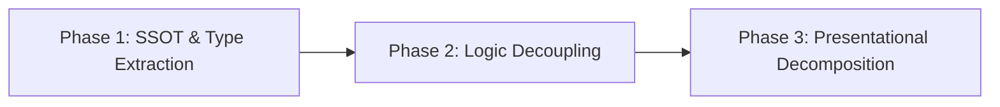

# MailPilot Architecture Compliance Audit & Remediation Plan

**Audit Scope:** Full codebase compliance audit against standards specified in [`AGENTS.md`](../AGENTS.md).  
**Status:** Ready for Execution  
**Execution Strategy:** 3-Phase Safe Refactor with continuous test verification and zero regressions.

---

## 1. Executive Summary

A comprehensive scan reveals significant architectural friction across the codebase:
- **Monolithic Bloat:** 22 files exceed 800 lines, 6 exceed 1,200 lines, and the largest component ([`subscriptions-view.tsx`](../components/subscriptions/subscriptions-view.tsx)) reaches **2,525 lines** (>5× the 500-line ceiling in [`AGENTS.md`](../AGENTS.md)).
- **App Router & Server Action Pollution:** App Router pages (e.g., [`app/page.tsx`](../app/page.tsx)) contain raw data-munging and inline view components. Server Actions ([`app/actions/profile.ts`](../app/actions/profile.ts), [`app/actions/opportunities.ts`](../app/actions/opportunities.ts), [`app/actions/settings.ts`](../app/actions/settings.ts)) act as massive procedural god-files (>1,000–1,400 lines each) containing raw DB queries, encryption, PDF builds, and diff calculations instead of serving as thin mutation boundaries.
- **SSOT & Schema Fragmentation:** Ad-hoc Zod schemas and types are declared inline across API route handlers, actions, and services rather than centralized in [`lib/validations/`](../lib/validations). Duplicate domain utilities exist across [`lib/ai/classifier.ts`](../lib/ai/classifier.ts) and [`lib/llm/classification.ts`](../lib/llm/classification.ts).
- **Domain Neutrality & Zero-Hardcoding Breaches:** Critical violations of the "100% Career Agnosticism" and "Zero Hardcoding" rules exist in LLM prompts (hardcoded regional cities), GitHub inference heuristics (hardcoded portfolio project terms: "wildfire", "shelter", "domestic violence", "minimax"), and login templates (hardcoded personal GitHub URLs).

---

## 2. Egregious Violations Inventory

### Priority 1: Critical (Boundary Breaks, Severe Monolithic Bloat, Hardcoding)

| File Path & Line Count | Core Offense ([`AGENTS.md`](../AGENTS.md)) | Smells Observed |
| :--- | :--- | :--- |
| **[`components/subscriptions/subscriptions-view.tsx`](../components/subscriptions/subscriptions-view.tsx)** *(2,525 lines)* | **File Length & Modular Architecture Guardrails** *Soft ceiling: ~400–500 lines* | Monolithic view container. Combines DND state machine, bulk selection logic, dialog lifecycle, search/filter algorithms, and inline desktop tables + mobile card components inside one single file. |
| **[`components/profile/manual-profile-editor.tsx`](../components/profile/manual-profile-editor.tsx)** *(1,530 lines)* | **File Length & Modular Architecture Guardrails** | Multi-section nested form state machine. Inlines editors for contact info, skills, work experiences, projects, coursework, and awards along with raw form reducer state and data sanitizers. |
| **[`components/opportunities/dialogs/opportunity-draft-dialog.tsx`](../components/opportunities/dialogs/opportunity-draft-dialog.tsx)** *(1,464 lines)* | **File Length & Modular Architecture Guardrails** | 1,280+ line single component body. Combines resizable split-pane layout, PDF base64 blob stream management, live email refinement, attachment manipulation, and async mutation triggers. |
| **[`app/actions/profile.ts`](../app/actions/profile.ts)** *(1,422 lines)* | **Next.js Route Orchestration & Server Actions** | Heavy monolithic server action. Executes direct Prisma queries, phone encryption/decryption, PDF generation orchestration, LinkedIn archive ingestion, GitHub sync orchestration, and diff snapshotting directly in the route action layer. |
| **[`lib/gmail/sync.ts`](../lib/gmail/sync.ts)** *(1,529 lines)* | **File Length & Modular Architecture Guardrails** | Single procedural function `persistClassifiedEmail` spans **713 continuous lines** (lines 651–1364). Blends Gmail message fetching, classification mapping, DB deduplication, and notification creation. |
| **[`lib/ai/classifier.ts`](../lib/ai/classifier.ts)** *(Line 651)* | **Zero Hardcoding & No Concrete Example Bleed in Prompts** | System prompt explicitly injects candidate-specific geographic locations: `(e.g., "Sacramento, CA", "Folsom, CA")` directly into the LLM extraction prompt instructions. |
| **[`lib/github/lens.ts`](../lib/github/lens.ts)** *(1,287 lines, lines 975–1080)* | **100% Career Agnosticism & Zero Hardcoding** | Hardcoded regex checks checking specifically for candidate-specific portfolio project concepts: `"wildfire"`, `"shelter"`, `"domestic violence"`, `"panic exit"`, `"haversine"`, and `"minimax"`. |
| **[`app/login/page.tsx`](../app/login/page.tsx)** *(Lines 58, 86)* | **Zero Hardcoding** | Hardcodes candidate/author GitHub handle (`marqlo-c`) and personal repository URLs directly into the presentation template. |

---

### Priority 2: Moderate (Mixed Concerns, SSOT Fragmentation, Bloated Presentational Layers)

| File Path & Line Count | Core Offense ([`AGENTS.md`](../AGENTS.md)) | Smells Observed |
| :--- | :--- | :--- |
| **[`app/page.tsx`](../app/page.tsx)** *(391 lines)* | **App Router Boundary Pollution** | Does not act as a thin orchestration layer. Computes metrics, performs opportunity sorting/filtering inline, defines inline helper functions (`domainFromUrl`, `scoreTone`), and declares 4 inline sub-components (`OpportunityDigestRow`, `ApplicationDigestRow`, etc.). |
| **[`app/actions/opportunities.ts`](../app/actions/opportunities.ts)** *(1,066 lines)* | **Next.js Route Orchestration & Reusable Logic** | Procedural god-file housing 25+ discrete server actions across draft preparation, resume generation, batch operations, and archive lifecycle. Inlines ad-hoc Zod schemas (`draftAttachmentSchema`). |
| **[`app/actions/settings.ts`](../app/actions/settings.ts)** *(1,011 lines)* | **Next.js Route Orchestration & SSOT** | Inlines `updateCustomLlmKeyInputSchema` (Zod), mixed API key encryption, third-party balance checks (HasData, ScrapingAnt, Jina), and rule JSON updates. |
| **[`lib/llm/classification.ts`](../lib/llm/classification.ts)** *(1,294 lines)* | **Architectural Consolidation & SSOT** | Massive overlap with [`lib/ai/classifier.ts`](../lib/ai/classifier.ts). Inlines core data contracts (`extractedJobSchema`, `jobClassificationSchema`) instead of locating them in [`lib/validations/`](../lib/validations). Re-exports and aliases circular dependencies. |
| **[`components/settings/profile/master-profile-card.tsx`](../components/settings/profile/master-profile-card.tsx)** *(1,247 lines)* | **File Length & Modular Architecture Guardrails** | Renders 10 distinct feature cards inline (Contacts, Summary, Experience, Education, Skills, Projects, Certifications, Awards, Interests) inside one monolithic component. |
| **[`lib/opportunities/context/dom-extractor.ts`](../lib/opportunities/context/dom-extractor.ts)** *(1,194 lines)* | **File Length & Refactor by Concern** | Combines 6 completely independent platform extractors (Indeed, Glassdoor, Monster, Jobleads, Greenhouse, Lever) in one file instead of isolating them into strategy modules. |
| **[`lib/subscriptions/digest.ts`](../lib/subscriptions/digest.ts)** *(1,027 lines)* | **File Length & Refactor by Concern** | Blends Gmail API message fetching, LLM briefing generation, and raw HTML/CSS string template rendering in a single module. |
| **[`lib/profile/deduplication.ts`](../lib/profile/deduplication.ts)** *(1,379 lines)* | **File Length & Zero Hardcoding** | Hardcodes candidate project bleed in `UNIVERSAL_STOPWORDS` (`"game"` on line 30); contains massive, deeply nested project and experience bullet similarity algorithms. |
| **[`lib/profile/resume-parser.ts`](../lib/profile/resume-parser.ts)** *(1,253 lines)* | **SSOT Standards & File Length** | Contains 76-line embedded Zod schema (`resumeLlmSchema`) in the middle of document parsing and normalization routines. |

---

### Priority 3: Minor (Scattered Inline Schemas & Local Utilities)

| File Path & Line Count | Core Offense ([`AGENTS.md`](../AGENTS.md)) | Smells Observed |
| :--- | :--- | :--- |
| **[`app/actions/scan.ts`](../app/actions/scan.ts)**, **[`app/actions/email.ts`](../app/actions/email.ts)** | **SSOT Standards** | Ad-hoc Zod schemas (`scanInputSchema`, `syncInputSchema`, `drainQueuedSchema`) declared in action files instead of [`lib/validations/`](../lib/validations). |
| **[`app/api/extension/draft/*`](../app/api/extension)** | **SSOT Standards** | Micro-schemas (`reorderNodeSchema`, `refineNodeSchema`, `patchNodeSchema`) duplicated across route handlers. |
| **[`lib/resume-draft.ts`](../lib/resume-draft.ts)** *(720 lines, line 675)* | **SSOT Standards** | Declares `refineLineSchema` inline rather than consuming from [`lib/resume-draft/schema.ssot.ts`](../lib/resume-draft/schema.ssot.ts). |
| **[`lib/tailor/legacy.ts`](../lib/tailor/legacy.ts)** | **SSOT Standards** | Duplicates `strategyRationaleSchema` and `tailorSchema` from existing SSOT definitions. |

---

## 3. Safe, Phased Refactor Roadmap

---

### Phase 1: SSOT, Schemas & Domain Neutrality Extraction
*Objective: Unify validation schemas, eliminate domain/candidate bleed, and centralize constants without modifying runtime execution flows.*

#### 1.1 Centralize Validation Schemas into `lib/validations/`
- [x] Create `lib/validations/classification.ts` and migrate `extractedJobSchema`, `jobClassificationSchema`, and derived TypeScript types from `lib/llm/classification.ts`.
- [x] Maintain re-exports in `lib/llm/classification.ts` to preserve backwards compatibility across all consumers.
- [x] Migrate `resumeLlmSchema` from `lib/profile/resume-parser.ts` to `lib/validations/profile.ts`.
- [x] Centralize extension draft schemas (`reorderNodeSchema`, `refineNodeSchema`, `patchNodeSchema`) into `lib/validations/extension.ts` or `lib/resume-draft/schema.ssot.ts`.
- [x] Centralize action payload schemas (`scanInputSchema`, `syncInputSchema`, `drainQueuedSchema`, `updateCustomLlmKeyInputSchema`, `draftAttachmentSchema`) into appropriate `lib/validations/` modules.
- [x] Relocate `refineLineSchema` from `lib/resume-draft.ts` to `lib/resume-draft/schema.ssot.ts`.
- [x] Deprecate duplicate schemas in `lib/tailor/legacy.ts` by pointing them to `lib/resume-draft/schema.ssot.ts`.

#### 1.2 Enforce Career Agnosticism & Zero Hardcoding
- [x] **Prompt Neutrality:** Replace `(e.g., "Sacramento, CA", "Folsom, CA")` in `lib/ai/classifier.ts` (line 651) with domain-neutral wording: `(e.g., physical city, state, or regional workplace)`.
- [x] **GitHub Lens Neutrality:** Refactor candidate-specific regex assertions in `lib/github/lens.ts` (`wildfire`, `shelter`, `domestic violence`, `panic exit`, `connect4.py`, `minimax`) into career-neutral corpus grounding checks (verifying claims exist in the target repository's code/docs instead of hardcoding domain nouns).
- [x] **Stopword Neutrality:** Remove candidate-specific `"game"` token from `UNIVERSAL_STOPWORDS` in `lib/profile/deduplication.ts` (line 30).
- [x] **Identity Neutrality:** Externalize author GitHub URLs (`marqlo-c`) in `app/login/page.tsx` (lines 58, 86) into environment variables or `lib/constants/branding.ts`.

---

### Phase 2: Logic Decoupling (Services & Custom Hooks)
*Objective: Extract database queries, background mutations, and UI state engines into dedicated services and custom hooks.*

#### 2.1 Deconstruct Server Action God-Files into Service Modules
- [x] **Deconstruct `app/actions/profile.ts` (1,422 lines):**
  - [x] Extract GitHub & LinkedIn synchronization logic to `lib/services/profile-sync.service.ts`.
  - [x] Extract diff generation and history pruning to `lib/services/profile-diff.service.ts`.
  - [x] Extract phone encryption/decryption and snapshot mutations to `lib/services/profile-snapshot.service.ts`.
  - [x] Reduce `app/actions/profile.ts` to a thin orchestration layer (<250 lines).
- [x] **Deconstruct `app/actions/opportunities.ts` (1,066 lines):**
  - [x] Extract draft preparation, node refinement, and PDF compile orchestration to `lib/services/opportunity-draft.service.ts`.
  - [x] Extract batch operations (archive, dismiss, restore, delete) to `lib/services/opportunity-lifecycle.service.ts`.
  - [x] Reduce `app/actions/opportunities.ts` to a thin action layer (<250 lines).
- [x] **Deconstruct `app/actions/settings.ts` (1,011 lines):**
  - [x] Extract API key encryption, vault management, and balance checks (HasData, ScrapingAnt, Jina) to `lib/services/api-keys.service.ts`.
  - [x] Extract rule mutation logic to `lib/services/settings-rules.service.ts`.
  - [x] Reduce `app/actions/settings.ts` to <200 lines.

#### 2.2 Decompose Backend Ingestion & Parsing Engines
- [x] **Decompose `lib/gmail/sync.ts` (1,529 lines):**
  - [x] Extract `persistClassifiedEmail` (lines 651–1364) into `lib/gmail/ingestion-pipeline.ts`.
  - [x] Separate subscription upsert and activity logging into modular helper pipelines.
- [x] **Decompose `lib/opportunities/context/dom-extractor.ts` (1,194 lines):**
  - [x] Split platform-specific extractors into `lib/opportunities/context/extractors/` (`indeed.ts`, `glassdoor.ts`, `greenhouse.ts`, `lever.ts`, `monster.ts`, `jobleads.ts`).
  - [x] Unify through a strategy registry in `dom-extractor.ts`.
- [x] **Decompose `lib/subscriptions/digest.ts` (1,027 lines):**
  - [x] Extract HTML/CSS briefing template generation into `lib/subscriptions/digest-renderer.ts`.
  - [x] Keep message fetching and summary compilation in `lib/subscriptions/digest.ts`.

#### 2.3 Extract UI State Machines into Custom Hooks
- [x] **Subscriptions UI State:**
  - [x] Extract drag-and-drop ordering and animation states from `subscriptions-view.tsx` into `hooks/use-subscriptions-reorder.ts`.
  - [x] Extract row selection and bulk action handlers into `hooks/use-subscriptions-selection.ts`.
- [x] **Opportunity Draft Dialog UI State:**
  - [x] Extract split-pane resize logic and layout persistence from `opportunity-draft-dialog.tsx` into `hooks/use-draft-split-pane.ts`.
  - [x] Extract PDF base64 blob creation, download, and preview lifecycle into `hooks/use-draft-pdf.ts`.

---

### Phase 3: Presentational Decomposition
*Objective: Modularize bloated UI view containers into co-located sub-components and slim down App Router entry points.*

#### 3.1 Slim Down App Router Boundaries
- [x] **Refactor `app/page.tsx` (391 lines -> <100 lines):**
  - [x] Extract `OpportunityDigestRow`, `ApplicationDigestRow`, `SubscriptionDigestRow`, and `DigestLink` into `app/components/console-digest/`.
  - [x] Move `scoreTone` and `domainFromUrl` into centralized utilities (`lib/utils/domain.ts`, `lib/utils/format.ts`).
  - [x] Encapsulate metric calculations into a clean data-preparation helper or view component.

#### 3.2 Modularize Massive View Containers
- [x] **Modularize `components/subscriptions/subscriptions-view.tsx` (2,525 lines -> <350 lines):**
  - [x] Extract `ActiveDesktopTable` into `components/subscriptions/parts/subscriptions-desktop-table.tsx`.
  - [x] Extract `ActiveMobileCards` into `components/subscriptions/parts/subscriptions-mobile-cards.tsx`.
  - [x] Extract `ArchiveDesktopTable` and `ArchiveMobileCards` into `components/subscriptions/parts/subscriptions-archive-table.tsx`.
  - [x] Extract `AnalyticsMetrics` and badges into `components/subscriptions/parts/subscriptions-metrics-bar.tsx`.
  - [x] Extract row actions menu into `components/subscriptions/parts/subscription-row-actions.tsx`.
- [x] **Modularize `components/profile/manual-profile-editor.tsx` (1,530 lines -> <300 lines):**
  - [x] Extract `ContactField` and contact controls into `components/profile/manual-editor/contact-section.tsx`.
  - [x] Extract `ExperienceEditor` into `components/profile/manual-editor/experience-section.tsx`.
  - [x] Extract `ProjectPointsEditor` into `components/profile/manual-editor/projects-section.tsx`.
  - [x] Extract `TagListEditor` and skills into `components/profile/manual-editor/skills-section.tsx`.
- [x] **Modularize `components/settings/profile/master-profile-card.tsx` (1,247 lines -> <300 lines):**
  - [x] Extract feature card sections into `components/settings/profile/sections/` (`profile-contacts-card.tsx`, `profile-experience-card.tsx`, `profile-skills-card.tsx`, `profile-projects-card.tsx`, `profile-education-card.tsx`, `profile-awards-card.tsx`).
- [x] **Modularize `components/opportunities/dialogs/opportunity-draft-dialog.tsx` (1,464 lines -> <400 lines):**
  - [x] Extract email editor & refine panel into `components/opportunities/dialogs/draft/email-editor-panel.tsx`.
  - [x] Extract resume preview & refine panel into `components/opportunities/dialogs/draft/resume-preview-panel.tsx`.
  - [x] Extract attachment list & footer controls into `components/opportunities/dialogs/draft/draft-footer-controls.tsx`.

---

## 4. Verification & Safeguards

- [x] Run `npm test` before any phase to confirm 100% green baseline.
- [x] Run `npx tsc --noEmit` following each extraction step to ensure no type contract breaks.
- [x] Run `npm test` after each phase to verify zero behavioral regressions.
- [x] Verify Next.js build: `npm run build` succeeds cleanly.
